# OMNet: A Magnification-Aware Dual-Branch Network for Breast Cancer Histopathology Classification

**Project Report** — Bachelor of Technology (B.Tech) in Information Technology, 2024–2028
Department of Information Technology, Guru Nanak Institute of Technology, Kolkata (affiliated to Maulana Abul Kalam Azad University of Technology)
November 2026

**Submitted by:** Sourish Panda (500424010080), Subarna Maity (500424010084), Saikat Das (500424010061), Soumyajit Mukherjee (500424010077), Sujoy Ghosh (500424010085), Soumen Kundu (500424010076)

Formatted versions: [OMNet_V3_Project_Report.docx](OMNet_V3_Project_Report.docx) · [OMNet_V3_Project_Report.pdf](OMNet_V3_Project_Report.pdf)

---

## List of Abbreviations

| Abbreviation | Meaning | Abbreviation | Meaning |
|---|---|---|---|
| AUC | Area under the ROC curve | A | Adenosis |
| CNN | Convolutional neural network | F | Fibroadenoma |
| ViT | Vision transformer | PT | Phyllodes tumor |
| KL | Kullback-Leibler divergence | TA | Tubular adenoma |
| MCC | Matthews correlation coefficient | DC | Ductal carcinoma |
| ROC | Receiver operating characteristic | LC | Lobular carcinoma |
| OD | Optical density | MC | Mucinous carcinoma |
| SVD | Singular value decomposition | PC | Papillary carcinoma |
| AMP | Automatic mixed precision | | |

# 1. Abstract / Aim

## 1.1 Abstract

OMNet-V3 investigated magnification-conditioned breast histopathology classification using EfficientNet-B0 and ViT-Tiny/16. Projected 256-dimensional features were blended through a scalar gate receiving image features and a 64-dimensional magnification embedding; residual refinement fed binary and eight-class subtype heads. Local training combined weighted cross-entropy with directional probability consistency. BreaKHis supplied 7,909 images at 40X, 100X, 200X and 400X, evaluated through five stratified grouped folds with internal grouped validation. The primary conference-paper series reported binary accuracy of 84.05 ± 3.13% and subtype macro-F1 of 24.42 ± 3.84%; corresponding local means were 83.82% and 25.63%, and cloud means were 84.56% and 23.45%. Series, fold means and pooled reconstructions remain separate. Subtype recognition was weak, particularly for local phyllodes, mucinous and papillary classes. Saved cloud fold 0 mean CNN gate weights decreased from 0.685 at 40X to 0.470 at 400X, with the same direction in the local box plot. This observational association describes internal mixing; matched improvement from magnification conditioning was not established. Evaluation was disjoint by subtype-prefixed case group, subject to the identity collision and implementation and traceability limitations in Section 7.3. The evidence supports an implemented joint classifier and documented errors, without establishing external validity or clinical readiness.

## 1.2 Aim and Objectives

The aim was joint coarse and subtype classification from one image and its magnification index. Objectives were to:

- Implement magnification-conditioned fusion and residual refinement of two pretrained branch representations.
- Combine binary and subtype supervision with directional probability consistency.
- Evaluate all four magnifications through grouped outer folds and internal validation.
- Preserve distinct primary, local and cloud records and their aggregation conventions.
- Analyse gate behaviour and class-specific errors within the available evidence.

## 1.3 Research Questions

1. Can the shared representation support a useful coarse decision while learning the harder subtype task?
2. Does the gate change systematically with magnification?
3. Does adding scale metadata improve performance relative to the same network without it?
4. How much of the observed subtype error is associated with limited patient representation?

Table 7.1 answers these questions using the reported scores, gate records and case-support counts.

# 2. Introduction

## 2.1 Background, Tasks and Contributions

Histopathology images contain evidence at several spatial scales: low magnification shows tissue arrangements, while higher magnification reveals cellular structures within a narrower field. Resizing to identical pixel dimensions preserves this physical difference, making magnification relevant context for visual interpretation.

OMNet-V3 fused CNN and transformer representations of the same image through a gate conditioned on image features and acquisition magnification. Training included 40X, 100X, 200X and 400X, but each prediction used one image and one magnification index, without combining registered tissue views. Removing, fixing or shuffling the embedding would test the information supplied by metadata.

The model produced a benign-versus-malignant prediction and an eight-class subtype prediction, with four subtypes under each parent group. Independently parameterised heads could disagree; within-parent subtype errors required separate task evaluation. Ductal carcinoma classified as lobular carcinoma remains a subtype error within the correct malignant group. Binary accuracy can therefore remain reasonable while fine-grained recognition fails.

Dataset labels described image categories, not tumor grade, stage, receptor status, survival, recurrence or treatment response. The benign grouping of phyllodes was a benchmark convention, not a statement about every phyllodes tumor in practice.

The implementation contributions were a magnification-conditioned CNN-transformer blend, residual refinement and hierarchical supervision. Analysis covered grouped evaluation, three experimental series, class support, errors and gates; Chapter 8 proposes contribution tests.

## 2.2 Scope and Reading Conventions

Chapters 3–9 cover prior work, implementation, evaluation, conclusions, future work and references.

Metrics are image-level; accuracy and F1 are percentages, while MCC and AUC retain their usual scales. Local fold dispersion uses population standard deviation with denominator five: 4.04 points around 83.82% is neither a confidence interval nor a relative percentage change. Primary conference-paper scores, local runs and cloud runs remain separate; pooled confusion-count reconstructions do not replace fold summaries. Section 7.3 consolidates limitations.

# 3. Review Work

## 3.1 Feature Extraction and Fusion

OMNet-V3 used pretrained EfficientNet-B0, an architecture introduced by Tan and Le [12], without its classification layer, retaining a pooled 1,280-dimensional descriptor. Deeper features and pooling also capture broader tissue arrangements; calling this the local branch does not restrict every feature to cellular evidence. Fine-tuning adapted external pretraining to histopathology, but stain, acquisition and patient-specific shortcuts remained questions for grouped evaluation and external testing.

Dosovitskiy and colleagues' patch transformer [9] underpinned OMNet-V3's ViT-Tiny: a 224 × 224 image yielded a 14 × 14 grid of 196 16-pixel patches, positional information and a 192-dimensional class-token representation. Touvron and colleagues supplied data-efficient training and attention-based distillation [10]; OMNet-V3 used a pretrained backbone without a new distillation experiment.

OMNet-V3 projected both descriptors to 256 dimensions and learned a scalar mixing coefficient from image features and magnification. Unlike four fixed scale weights, this allowed different coefficients at the same magnification. Every feature coordinate nevertheless received the same branch weight. The local residual block also received the embedding, providing another scale pathway. The contribution was this implemented combination with hierarchical supervision; matched controls remain necessary to distinguish complementary features, capacity and training effects.

## 3.2 Grouping and Hierarchical Classification

Priyanka, Narendra and Dilleswar Rao evaluated nine architectures using patient-level GroupKFold and reported mean accuracies from 90.73% to 92.67% [1]. Comparison requires aligned grouping, preprocessing, checkpoint selection and class handling.

OMNet-V3's eight subtypes mapped to two parent groups. Shared features supported both tasks, and a probability regulariser encouraged agreement between independently parameterised heads. Independent heads allowed a stronger coarse classifier despite subtype uncertainty, but also contradictions. A no-consistency control and measured disagreement rate are needed to assess the regulariser's benefit.

## 3.3 Hybrid and Magnification Studies

Wang and colleagues' MFF-ClassificationNet used CNN-transformer multi-feature fusion [4], providing a hybrid precedent for OMNet-V3. Fiaz and colleagues' DFViT combined pretrained convolutional features, a transformer and an MLP classifier [6], motivating matched fusion controls. Aldakhil, Alhasson and Alharbi's ECSAnet instead refined EfficientNetV2 with channel and spatial attention [7], motivating comparison with a single refined backbone. Ashab and colleagues' MagViT used per-scale transformers, missing-scale masking and patient-level selection [2], unlike OMNet-V3's single-image magnification conditioning.

Table 3.1. Selected primary studies identify methodological controls for comparing OMNet-V3.
| Study | Relevant design | Comparison needed for OMNet-V3 |
|---|---|---|
| Priyanka et al. [1] | Patient-aware benchmarking | Align grouping, validation and metrics |
| MFF-ClassificationNet [4] | CNN-transformer fusion | Isolate scale metadata |
| DFViT [6] | CNN-transformer integration | Match inputs, folds and fusion controls |
| ECSAnet [7] | EfficientNetV2 with attention | Compare refined single and dual branches |
| MagViT [2] | Gated per-scale representations | Distinguish multi-view input from conditioning |

Bayramoglu, Kannala and Heikkila compared magnification-specific and independent CNNs [22], motivating a no-metadata OMNet-V3 control. Gupta and Bhavsar examined magnification with joint colour-texture features and an ensemble [16], motivating aligned preprocessing in that comparison.

## 3.4 Subtype Learning and Imbalance

Han and colleagues studied breast tumor multi-classification through structured deep learning [17], a different mechanism from OMNet-V3's probability-level hierarchy. Desai and Mahto compared ResNet-18, ResNet-34 and ResNet-50 on eight-class BreaKHis [5], reporting relevant lobular-mucinous and phyllodes-fibroadenoma confusions but leaving patient-level splitting to future work, precluding direct grouped comparison or a patient-count ceiling. Srikantamurthy and colleagues combined convolutional transfer learning with an LSTM for benign and malignant subtype classification [8], offering sequence-based feature processing under an unharmonised protocol.

Ativi and colleagues' CMAF-Net coupled cross-modal attention, information-theoretic regularisation and adaptive balancing [3], motivating fusion–imbalance controls for OMNet-V3 but, with its main IDC evaluation, no numerical ranking against eight-subtype BreaKHis.

Effective-number weighting [13] and focal loss [18] are alternative imbalance treatments that OMNet-V3 did not implement; neither supplies new case diversity. Calibration also requires separate assessment [19].

## 3.5 Requirements for a Fair Comparison

A matched experiment would compare CNN-only, transformer-only, fixed-fusion and magnification-aware variants on identical outer folds, validation policies, transformations, class weights, budgets and checkpoint criteria. Parameter counts would clarify whether it tested the complete system, metadata or fusion alone. Two single-backbone baselines, DenseNet-201 and ViT-B/16, were executed at 200X on one patient split and are reported in Chapter 6. Their different protocol leaves a matched OMNet-V3 comparison missing. OMNet-V2 supplies development history rather than a controlled OMNet-V3 ablation; detailed limitations appear in Section 7.3.

# 4. Proposed Scheme

## 4.1 Overview of the Proposed Scheme

Parsed groups and labels fed preprocessing, dual-branch extraction, magnification-aware adaptive fusion (MAF), refinement and hierarchical supervision. Internal validation selected checkpoints within grouped development partitions; outer folds tested them.

## 4.2 Dataset and Label Structure

BreaKHis, introduced by Spanhol and colleagues [23], supplied 7,909 RGB microscopic fields, commonly 700 × 460 pixels: 2,480 benign and 5,429 malignant. Project counts came from saved filename metadata in a mirrored distribution. Subtype indices 0–7 followed A, F, PT, TA, DC, LC, MC and PC; the first four mapped to benign index 0, the last four to malignant index 1. Heads, grouped probabilities and matrices shared this order.

The metadata contained 7,909 records and unique filenames. Benign totals at 40X, 100X, 200X and 400X were 625, 644, 623 and 588; malignant totals were 1,370, 1,437, 1,390 and 1,232. The saved benign 40X count was 625, whereas the dataset website displayed 652 [23].

Table 4.1. Image and subtype-prefixed case-group counts from saved metadata.
| Subtype | 40X | 100X | 200X | 400X | Images | Groups |
|---|---|---|---|---|---|---|
| A | 114 | 113 | 111 | 106 | 444 | 4 |
| F | 253 | 260 | 264 | 237 | 1,014 | 10 |
| PT | 109 | 121 | 108 | 115 | 453 | 3 |
| TA | 149 | 150 | 140 | 130 | 569 | 7 |
| DC | 864 | 903 | 896 | 788 | 3,451 | 38 |
| LC | 156 | 170 | 163 | 137 | 626 | 5 |
| MC | 205 | 222 | 196 | 169 | 792 | 9 |
| PC | 145 | 142 | 135 | 138 | 560 | 6 |
| Total | 1,995 | 2,081 | 2,013 | 1,820 | 7,909 | 82 |

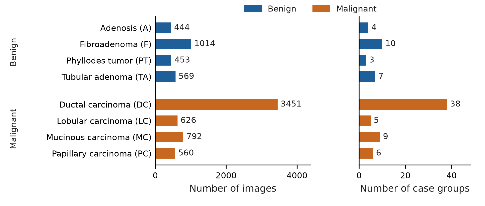

Figure 4.1. Dataset image and subtype-prefixed case-group support distinguish image abundance from contributing groups.

DC had 38 groups and PT three; holding out one PT group could leave only two for development. Section 7.3 describes the recount's limitations.

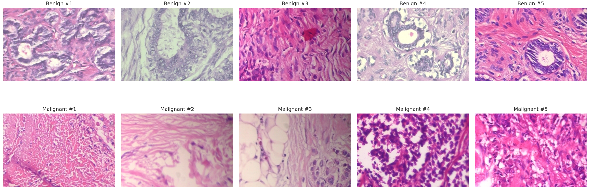

Figure 4.2. Saved 200X fields from the earlier OMNet-V2 pipeline illustrate benign tissue above and malignant tissue below.

## 4.3 Grouping, Splitting and Experimental Units

The parser extracted procedure, coarse class and subtype from underscore-separated prefixes, and case, magnification and sequence from hyphen-separated fields. For `SOB_B_TA-14-4659-40-001.png`, it retained subtype TA, case `14-4659`, magnification 40 and sequence 1. Group `TA_14-4659` excluded magnification and sequence, keeping related fields and scales together. Section 7.3 records the identity collision.

`StratifiedGroupKFold` used five splits, shuffling and seed 42, with subtype as stratification target and parsed identifiers as groups. Unequal group sizes constrained balance, and three PT groups could not populate all five test folds. Figure 4.3 shows the partitions.

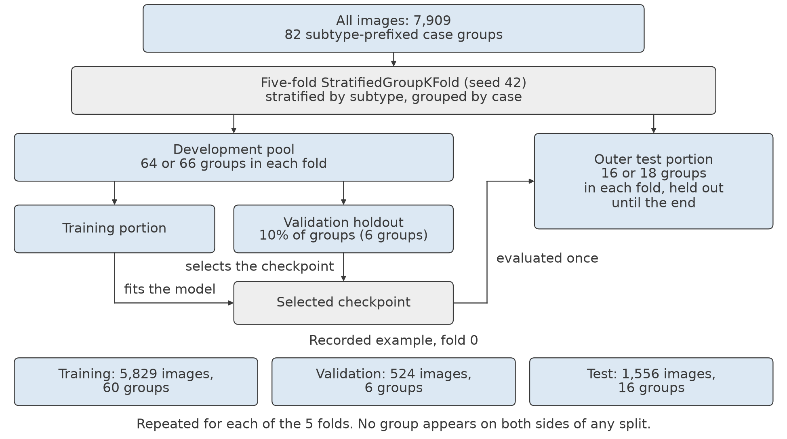

Figure 4.3. Grouped outer folds separate testing from development, with an internal grouped validation holdout for checkpoint selection.

Table 4.2. Recorded local outer-fold sizes include the later validation holdout within development.
| Fold | Development images | Development groups | Test images | Test groups |
|---|---|---|---|---|
| 0 | 6,353 | 66 | 1,556 | 16 |
| 1 | 6,380 | 66 | 1,529 | 16 |
| 2 | 6,320 | 66 | 1,589 | 16 |
| 3 | 6,207 | 64 | 1,702 | 18 |
| 4 | 6,376 | 66 | 1,533 | 16 |

The conference paper reports test-fold sizes of 1,564, 1,491, 1,652, 1,639 and 1,563 images, which differ from the local partition in Table 4.2. Validation sampled `max(1, int(0.1 * groups))` development groups: six from either 64 or 66. Fold 0 contained 5,829 training, 524 validation and 1,556 test images; fold 1 contained 5,748, 632 and 1,529, respectively, both with 60/6/16 groups.

Local fold 0 lacked PT test images and fold 2 lacked A. Local subtype macro-F1 used `zero_division=np.nan` without a fixed eight-label list; cloud used a different undefined-score setting. Effective class inclusion depended on observed and predicted labels (Section 5.5).

## 4.4 Preprocessing and Augmentation

### 4.4.1 Spatial Transforms and Normalisation

Images were opened with Pillow and converted to RGB. Training resized to 256 × 256, applied random resized cropping to 224 × 224 with area scale 0.8–1.0, horizontal and vertical flips, rotation up to 20 degrees, then stain perturbation with probability 0.5. Tensor conversion and ImageNet normalisation followed; both branches received the same tensor.

Validation and test used a deterministic 224 × 224 centre crop after resizing to 256 × 256. It retained 76.56% of the square area (`224²/256² = 0.765625`). Channel means were 0.485, 0.456 and 0.406, and standard deviations 0.229, 0.224 and 0.225; each channel used `(u - mean) / standard_deviation` after scaling to zero to one. This matched pretrained input scaling; it did not normalise stains or standardise biological colour meaning across laboratories. Cloud applied stain perturbation before spatial transforms and used random cropping rather than local random resized cropping.

### 4.4.2 Optical-Density Model and Local Reconstruction

Macenko-style processing motivated optical-density stain augmentation [25]. For intensity $I$, reference $I_0$, and $\epsilon$ preventing a logarithm of zero, the natural-logarithm representation and reconstruction were:

```math
\mathrm{OD} = -\ln\left(\max\left(\frac{I}{I_0},\ \epsilon\right)\right) \tag{4.1}
```

```math
\mathrm{OD} \approx C H \tag{4.2}
```

```math
I_{\mathrm{rec}} = I_0 \exp\left(-C_{\mathrm{pert}} H\right) \tag{4.3}
```

For $N$ pixels, $\mathrm{OD}$ was $N$ × 3, concentrations $C$ were $N$ × 2, and basis $H$ was 2 × 3. Cloud used base-10 density and matching `I0 * 10^(-OD)` reconstruction. Local SVD took the first two rows of Vh, projected density onto those directions, independently scaled coordinates by 0.85–1.15, added biases between -0.05 and 0.05, and projected back to three channels.

Local reconstruction then clipped density to zero to one and multiplied by 255, treating optical density as intensity instead of applying Equation (4.3). This defect could cause severe colour changes and clipping. The conference paper describes this step as a Macenko-based hematoxylin and eosin decomposition; the local function used principal SVD directions. Cloud instead used angular percentiles and returned the original image on exceptions.

## 4.5 Dual-Branch Architecture

### 4.5.1 Feature Extraction and Adaptive Fusion

With batch size $B$, inputs had shape $B$ × 3 × 224 × 224; magnification indices zero to three represented 40X, 100X, 200X and 400X. Pretrained `efficientnet_b0`, constructed through `timm.create_model` with `num_classes=0`, supplied globally pooled features. A biased linear projection reduced its 1,280-dimensional descriptor to 256, followed by LayerNorm with learned scale and bias. Local projections had no ReLU or dropout.

Pretrained `vit_tiny_patch16_224` also had its classifier removed. The local method used class token zero of its feature sequence. Its 192-element descriptor was projected to 256 and normalised with LayerNorm. 

The magnification embedding had four rows of 64 values. With projected vectors $c_i$, $v_i$ and embedding $e_i$, the scalar gate and blend were:

```math
\alpha_i = \sigma\left(w_g^{\top} [c_i ; v_i ; e_i] + b_g\right) \tag{4.4}
```

```math
u_i = \alpha_i c_i + (1 - \alpha_i) v_i \tag{4.5}
```

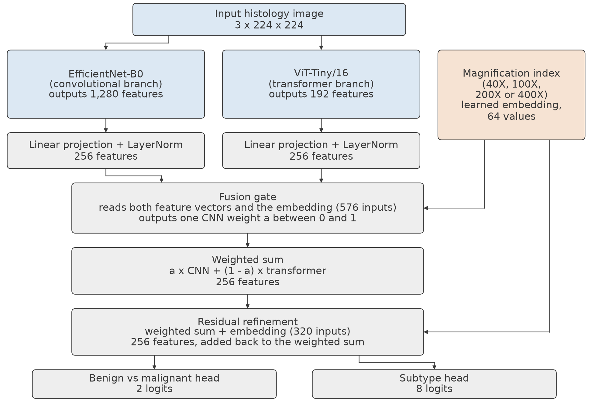

Figure 4.4. Local OMNet-V3 combines projected branch features, magnification-conditioned fusion, residual refinement and two prediction heads, with dimensions excluding the batch axis.

The gate received 576 coordinates; sigmoid bounded the CNN coefficient between zero and one, and the categorical embedding imposed no ordered scale progression.

### 4.5.2 Residual Refinement and Heads

Refinement concatenated the blend and embedding into 320 coordinates, then applied a 320-to-256 linear layer, GELU, dropout 0.3 and a 256-to-256 linear layer. The residual correction and heads were:

```math
r_i = W_2 \mathrm{Dropout}\left(\mathrm{GELU}\left(W_1 [u_i ; e_i] + b_1\right)\right) + b_2 \tag{4.6}
```

```math
h_i = u_i + r_i \tag{4.7}
```

```math
z_{\mathrm{binary}} = W_{\mathrm{binary}} h_i + b_{\mathrm{binary}} \tag{4.8}
```

```math
z_{\mathrm{subtype}} = W_{\mathrm{subtype}} h_i + b_{\mathrm{subtype}} \tag{4.9}
```

The identity-plus-correction structure followed residual learning [24]. Direct heads had two and eight outputs without a hidden 128-dimensional layer.

### 4.5.3 Parameter Accounting and Cloud Formulation

A biased linear layer has `d*k + k` parameters; 256-coordinate LayerNorm adds 512. Table 4.3 counts added local modules algebraically, excluding pretrained backbones.

Cloud added ReLU and dropout after projection LayerNorm. Its 576-to-128-to-1 gate with ReLU had 73,985 parameters against local's 577. Cloud refinement used a 256-to-256 layer, LayerNorm, GELU and dropout, totalling 66,304 parameters, instead of the local residual block.

Table 4.3. Added local-module parameter counts include biases and LayerNorm but exclude both pretrained backbones.
| Module | Calculation | Parameters |
|---|---|---|
| CNN projection plus LayerNorm | 1,280*256 + 256 + 512 | 328,448 |
| Transformer projection plus LayerNorm | 192*256 + 256 + 512 | 49,920 |
| Magnification embedding | 4*64 | 256 |
| Gate | 576*1 + 1 | 577 |
| Residual first linear layer | 320*256 + 256 | 82,176 |
| Residual second linear layer | 256*256 + 256 | 65,792 |
| Binary head | 256*2 + 2 | 514 |
| Subtype head | 256*8 + 8 | 2,056 |
| Total added parameters | Sum of rows | 529,739 |

## 4.6 Hierarchical Learning Objective

### 4.6.1 Supervised Losses and Grouped Probabilities

Both tasks used weighted `CrossEntropyLoss` on integer labels (two binary and eight subtype logits). Training-only inverse-frequency weights were proportional to `N / (K*n_k)`, where $N$ is the number of training images after validation removal, $K$ the task's class count and $n_k$ the training images in class $k$; label order was preserved. Cloud additionally divided weights by their mean; a common scaling cancelled in weighted mean cross-entropy:

```math
L_{\mathrm{CE}} = -\frac{\sum_{i} w_{y_i} \ln s_{i,y_i}}{\sum_{i} w_{y_i}} \tag{4.10}
```

The denominator summed target weights, not images. The cloud helper's sorted observed counts preserved label order only when every class occurred. Summing subtype softmax $s_i$ gave a binary distribution $q_i$, comparable with the direct binary softmax $p_i$:

```math
q_i[0] = s_i[A] + s_i[F] + s_i[\mathrm{PT}] + s_i[\mathrm{TA}] \tag{4.11}
```

```math
q_i[1] = s_i[\mathrm{DC}] + s_i[\mathrm{LC}] + s_i[\mathrm{MC}] + s_i[\mathrm{PC}] \tag{4.12}
```

### 4.6.2 Directional Consistency and Combined Objective

Local `F.kl_div(log(grouped), consistency_target, reduction='batchmean')` used detached binary softmax as target, protecting $q$ by minimum 1e-8 before logarithms. Its direction and combined objective were:

```math
L_{\mathrm{cons}} = \frac{1}{B} \sum_{i} \sum_{g} p_i[g] \ln\left(\frac{p_i[g]}{q_i[g]}\right) \tag{4.13}
```

```math
L = 0.3 L_{\mathrm{binary}} + 0.6 L_{\mathrm{subtype}} + 0.1 L_{\mathrm{consistency}} \tag{4.14}
```

Detaching $p$ sent consistency gradients only through $q$, to the subtype head and shared representation. Cloud MSE detached neither distribution, so its gradients reached both heads.

# 5. Algorithm / Flow Chart

## 5.1 Pipeline and Grouped Splitting

The pipeline assigned groups before transforms and training, removed validation groups before class weighting, and selected checkpoints by validation subtype macro-F1. Figures 4.3, 4.4 and 5.1 show partitioning, the local model and training respectively.

Algorithm 1. Group parsing and grouped five-fold splitting.

**Input:** Filenames, labels and magnifications; **output:** five outer development/test partitions with internal training/validation holdouts.

1. Parse the underscore prefix for coarse class and subtype, and hyphen fields for the complete case portion, magnification and sequence.
2. Prefix case identifiers with subtype; exclude magnification and sequence so related images share a group.
3. Run five-split `StratifiedGroupKFold`, shuffled with seed 42, using subtype stratification and parsed groups.
4. Reserve each outer test partition; use the other groups as its development pool.
5. Sample `max(1, int(0.1 * groups))` validation groups using the recorded fold-dependent seed and the original set-derived list.
6. Assign all selected-group images to validation and remaining development images to training; retain partition counts and labels.

## 5.2 Training Configuration

AdamW applied decoupled weight decay [14] through backbone and added-module parameter groups, without separate no-decay exclusions for biases or normalisation. No gradient accumulation was specified. Table 5.1 records local settings alongside separately documented primary and cloud settings; unspecified cells are not inferred across series. The local configuration timestamp was `2026-08-21T18:13:22.512087`, with smoke testing disabled. Reproduction requires linked manifests, image hashes, configuration, implementation and environment versions, epoch histories, checkpoint hashes and selection metrics, both heads' scores and per-image $\alpha$. These records must preserve run identity when recalculating the separate series.

Local settings: batch 16, 5 folds, 0 workers, input 224 after resize 256, 30 epochs with 5 frozen and patience 8, dropout 0.3, embedding 64, fusion 256, loss weights 0.3/0.6/0.1, weight decay 1e-4, gradient-norm limit 1.0, dataset mirror `saikatd1998/dataset`, seed 42.

Table 5.1. Recorded training settings preserve differences between local, primary and cloud series.
| Setting | Local series | Primary (conference paper) | Cloud series |
|---|---|---|---|
| Backbone learning rate | 1e-5 | 1e-4 | 1e-4 |
| Added-module learning rate | 1e-4 | 5e-4 | 5e-4 |
| Precision | AMP disabled | Mixed precision | FP32; no AMP |
| Hardware | AMD Radeon RX 9060 XT; 15.92 GiB | Tesla T4 | Unrecorded; ROCm-oriented configuration |
| Gate parameters | Linear 576-to-1; 577 | Not recorded | 576-to-128-to-1; 73,985 |
| Consistency | KL; detached binary target | Not recorded | Probability MSE; neither detached |

The conference paper reports backbone/head learning rates of 1e-4/5e-4, mixed precision and Tesla T4 hardware. Local warmup disabled backbone `requires_grad` for epochs 1–5 and enabled it from epoch 6. The cosine scheduler progressed throughout the 30-epoch budget, so backbone updates began below their initial learning rate. Warmup mode and record discrepancies are addressed in Section 7.3.

## 5.3 Training and Checkpoint Selection

Algorithm 2. Training and checkpoint selection per fold.

**Input:** Fold partitions, pretrained backbones and local configuration; **output:** the checkpoint selected by validation subtype macro-F1 and its test evaluation.

1. Compute training-only inverse-frequency weights, retaining two binary and eight subtype entries.
2. Prepare batches of 16 with labels and magnification; use training augmentation or deterministic evaluation transforms as appropriate.
3. Construct AdamW with backbone/added-module rates 1e-5/1e-4, weight decay 1e-4 and AMP disabled.
4. Train for at most 30 epochs, freezing backbone parameters for five epochs and unfreezing from epoch six.
5. Compute both branch features, gated fusion, residual refinement, heads and the weighted hierarchical objective.
6. Backpropagate, clip gradient norm to 1.0, update trainable parameters and evaluate validation subtype macro-F1 after each epoch.
7. Retain improvements, apply patience eight and step the cosine scheduler once per epoch after training and validation.
8. Stop at patience exhaustion or the epoch limit; evaluate the selected checkpoint on the outer test partition.

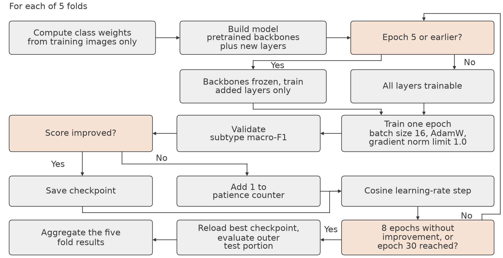

Figure 5.1. Validation subtype macro-F1 governs local checkpoint retention and patience before evaluation of the selected checkpoint on outer-test images.

## 5.4 Logged Behaviour, Hardware and Reproducibility

Fold 0 validation subtype macro-F1 reached 0.1512 at epoch 8; training stopped at 16 with test macro-F1 0.3028. Across 21 retained fold 1 epochs, validation subtype macro-F1 was 0.0525–0.1001 and binary F1 0.4191–0.4920; loss decreased. Five completed folds were reported.

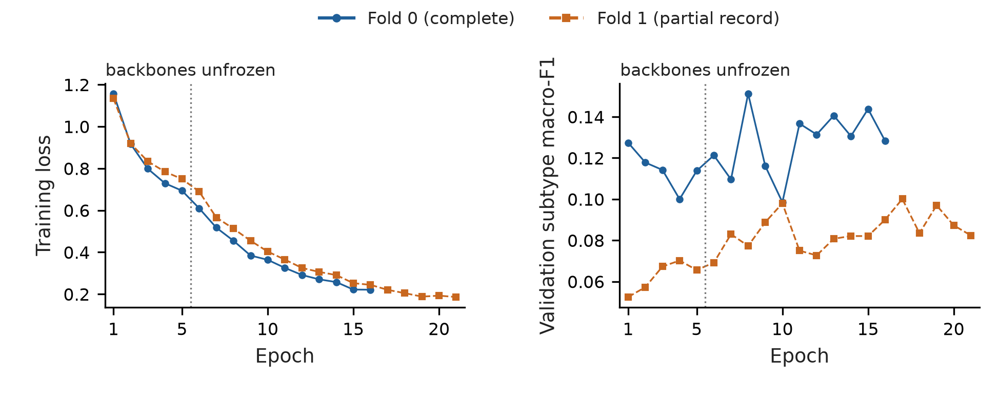

Figure 5.2. Retained local training loss and validation subtype macro-F1 cover complete fold 0 and partial fold 1 on separate axes.

The local runtime identified an AMD Radeon RX 9060 XT with 15.92 GiB total device memory, PyTorch 2.13.0+rocm7.2 and HIP 7.2.53211. Logged epochs took 97.9–103.4 seconds during frozen epochs 1–5 and 178.0–194.0 seconds after unfreezing; peak memory use and total run time were not recorded, and the cloud configuration had no linked runtime record. Seed 42 initialised Python, NumPy and PyTorch, with fold-dependent validation seeds. The project repository is https://github.com/T-RexBytes/OMNet.

## 5.5 Inference, Evaluation and Metric Definitions

Algorithm 3. Inference and evaluation.

**Input:** Selected checkpoint and held-out images with metadata; **output:** image predictions, fold summaries and separately labelled pooled metrics.

1. Convert to RGB, resize to 256 × 256, centre crop to 224 × 224, convert to tensor and apply ImageNet normalisation.
2. Supply the same tensor to both branches with its magnification index; apply the selected checkpoint's fusion, refinement and heads.
3. Apply softmax for probabilities and argmax for binary and subtype labels.
4. Evaluate images using the recorded subtype order and undefined-score conventions, retaining fold and series identities.
5. Compute equal-weight fold means and local population standard deviation with denominator five.
6. Check annotated matrix counts against support, then calculate pooled metrics from combined counts rather than averaging fold F1.

Malignant is positive: TP/TN are correct malignant/benign predictions and FP/FN are benign/malignant errors. A consistency penalty did not prevent contradictions between the two parameterised prediction heads. The six definitions are:

```math
\mathrm{Accuracy} = \frac{TP+TN}{TP+TN+FP+FN} \tag{5.1}
```

```math
\mathrm{Sensitivity} = \frac{TP}{TP+FN} \tag{5.2}
```

```math
\mathrm{Specificity} = \frac{TN}{TN+FP} \tag{5.3}
```

```math
\mathrm{Macro\text{-}F1} = \frac{1}{K}\sum_{k=1}^{K}\frac{2TP_k}{2TP_k+FP_k+FN_k} \tag{5.4}
```

```math
\mathrm{Balanced\ accuracy} = \frac{\mathrm{Sensitivity}+\mathrm{Specificity}}{2} \tag{5.5}
```

```math
\mathrm{MCC} = \frac{TP \cdot TN - FP \cdot FN}{\sqrt{(TP+FP)(TP+FN)(TN+FP)(TN+FN)}} \tag{5.6}
```

For multiclass scores, precision divides each diagonal by its column sum, recall by its row sum, and F1 is twice the diagonal divided by their sum. Macro-F1 averages included classes, weighted-F1 weights their support, and multiclass balanced accuracy averages recall. Binary macro-F1 averages malignant and benign F1. MCC is undefined at a zero denominator; reconstructed matrices here had nonzero denominators. Fold means weight folds equally, pooled accuracy weights images, and pooled macro-F1 uses summed counts. Separate head matrices cannot recover paired disagreements or probability-based measurements; see Section 7.3.

Accuracy weights images; macro-F1 weights included classes equally. MCC complements these under imbalance [11]. AUC measures ranking across thresholds, not discrete accuracy, and cannot be recovered from one matrix. PT, PC and MC ranking scores therefore do not replace recall. Nonlinear pooled scores differ from fold averages, which also depend on absent-class conventions.

# 6. Result

## 6.1 Reported Fold Means and Evidence

Primary evidence contains aggregate scores and AUC; cloud retains summaries, matrices, ROC and gate records; local additionally retains partial epoch logs; V2 retains predictions; baselines retain summaries, matrices and partial logs.

Table 6.1 preserves the three reported fold summaries; percentage metrics use percent and percentage-point dispersion, while MCC retains its original scale. Primary and cloud dispersions are reproduced as reported; local uses population fold standard deviation.

Table 6.1. Reported fold means and dispersions retain separate primary, cloud and local series.
| Metric | Primary reported series | Cloud series | Local series |
|---|---|---|---|
| Binary accuracy | 84.05 ± 3.13 | 84.56 ± 2.48 | 83.82 ± 4.04 |
| Binary macro-F1 | 79.89 ± 3.66 | 80.32 ± 3.13 | 81.24 ± 5.14 |
| Binary balanced accuracy | 80.84 ± 3.66 | 81.07 ± 3.26 | 82.37 ± 4.38 |
| Binary MCC | 0.6074 ± 0.0679 | 0.6175 ± 0.0532 | 0.6364 ± 0.1018 |
| Subtype accuracy | 45.29 ± 7.65 | 44.01 ± 6.38 | 42.86 ± 4.69 |
| Subtype macro-F1 | 24.42 ± 3.84 | 23.45 ± 4.30 | 25.63 ± 5.03 |
| Subtype weighted-F1 | 46.08 ± 6.51 | 44.75 ± 5.89 | 42.02 ± 5.40 |
| Subtype balanced accuracy | 35.35 ± 7.13 | 32.93 ± 4.70 | 30.50 ± 5.80 |
| Subtype MCC | 0.2975 ± 0.0630 | 0.2738 ± 0.0504 | 0.2565 ± 0.0570 |

All three series showed a substantial gap between coarse and fine-grained classification. Binary accuracy was around 84%, whereas subtype macro-F1 was around one quarter of its maximum.

The full dataset's always-malignant reference had 68.64% image accuracy. The binary records exceeded that descriptive reference, but it was not an actual same-fold baseline. For subtypes, the 43.63% pooled accuracy of an always-DC rule was close to the reported accuracies. Learned predictions were not equivalent to that rule, but accuracy in the low forties alone did not demonstrate useful eight-class recognition. Class recall and macro-F1 were needed to interpret that result.

## 6.2 Pooled Metrics and Binary Errors

Integer counts in the saved matrices were checked against class support and used for the pooled metrics in Table 6.2. Figures 6.1 and 6.2 show the local matrices. This was an arithmetic check of annotated counts. The broader evidence and evaluation limitations are discussed in Section 7.3.

Table 6.2. Pooled image metrics are reconstructed from annotated matrix counts.
| Source matrix | Accuracy | Macro-F1 | Weighted-F1 | Balanced accuracy | MCC |
|---|---|---|---|---|---|
| Local binary | 83.82% | 81.79% | 84.06% | 82.91% | 0.6390 |
| Local subtype | 42.72% | 27.58% | 42.08% | 29.88% | 0.2548 |
| Cloud binary | 84.51% | 81.98% | 84.50% | 81.93% | 0.6396 |
| Cloud subtype | 44.03% | 27.30% | 43.23% | 27.14% | 0.2546 |

 Local pooled accuracy was close to its fold mean, while subtype macro-F1 differed appreciably. The cloud binary matrix used counts 1,860, 620, 605 and 4,824. An alternative binary summary contained 1,870, 610, 657 and 4,772 and implied a different accuracy. Table 6.2 used the first set, without combining the alternatives.

The local matrix contained 1,996 true benign predictions, 484 benign images classified as malignant, 796 malignant images classified as benign and 4,633 true malignant predictions. Row totals matched 2,480 benign and 5,429 malignant images. Pooled accuracy was `(1,996 + 4,633) / 7,909`, or 83.8159%. These counts show the contributions of both classes to the aggregate result.

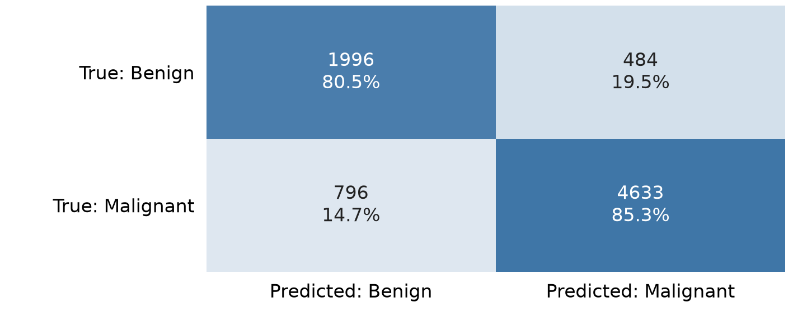

Figure 6.1. Local pooled binary confusion counts show true labels by row and predictions by column, with row percentages.

Sensitivity was 85.34%, specificity was 80.48%, and malignant precision was 90.54% in this image mixture. The false-negative rate was 14.66% of malignant images and the false-positive rate was 19.52% of benign images. False negatives were more numerous because malignant images were more common, even though their row error rate was lower. These are image-level errors; Section 7.3 explains why they do not define a clinical operating point.

## 6.3 Subtype Performance and Confusions

The local subtype matrix contained 3,379 correct predictions out of 7,909, including 2,269 correct ductal carcinoma predictions. The diagonal sum therefore needed to be read alongside individual classes. Table 6.3 reports precision, recall and F1 with the true-image support for each subtype. Subtype codes follow the List of Abbreviations.

Table 6.3. Local per-class precision, recall and F1 are percentages, with support counting true images.
| Subtype | Support | Precision | Recall | F1 |
|---|---|---|---|---|
| A | 444 | 42.39 | 58.33 | 49.10 |
| F | 1,014 | 37.36 | 36.29 | 36.82 |
| PT | 453 | 4.29 | 1.55 | 2.27 |
| TA | 569 | 17.66 | 34.80 | 23.43 |
| DC | 3,451 | 68.63 | 65.75 | 67.16 |
| LC | 626 | 25.94 | 29.71 | 27.70 |
| MC | 792 | 10.58 | 9.22 | 9.85 |
| PC | 560 | 6.01 | 3.39 | 4.34 |

PT had seven correct local predictions and 277 predictions as F; PC had 19 correct predictions and 310 as DC. MC had 73 correct predictions, with substantial predictions as DC and LC. Table 6.4 shows recurring PT-to-F, PC-to-DC, MC-to-DC and LC-to-MC errors in both series. LC correct counts differed markedly, at 186 locally and 42 in cloud, as did MC correct counts, at 73 and 197. Similar aggregate performance thus coexisted with different class-specific outcomes. MC was particularly weak locally, whereas LC and TA had lower recall and F1 than MC in cloud. Local TA precision was 17.66% despite 34.80% recall, and A precision was 42.39%, so recall alone obscured overprediction. Adenosis recall was more favourable than that of several classes with more images, so image count alone did not explain the pattern.

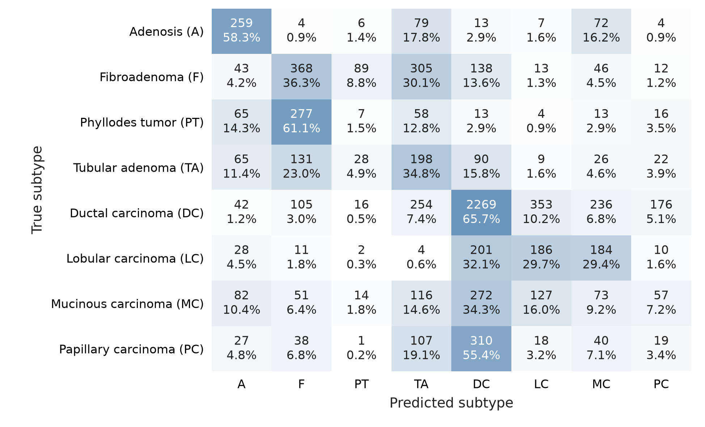

Figure 6.2. Local pooled subtype counts show the dominant ductal diagonal and weaker recognition of several smaller classes.

Table 6.4. Main local and cloud confusions and correct predictions use integer image counts and true-subtype support.
| True subtype | Wrongly predicted subtype (or correct label) | Local count | Cloud count | Support (images) |
|---|---|---|---|---|
| Phyllodes tumor | Fibroadenoma | 277 | 260 | 453 |
| Papillary carcinoma | Ductal carcinoma | 310 | 276 | 560 |
| Mucinous carcinoma | Ductal carcinoma | 272 | 270 | 792 |
| Lobular carcinoma | Mucinous carcinoma | 184 | 188 | 626 |
| Lobular carcinoma | Lobular carcinoma (correct) | 186 | 42 | 626 |
| Mucinous carcinoma | Mucinous carcinoma (correct) | 73 | 197 | 792 |

## 6.4 ROC Evidence

The separate binary AUC records were 0.8945 for primary, 0.8980 for cloud and 0.8819 for local. Figure 6.3 presents the saved local curves.

Local AUC was highest for A at 0.906 and lowest for PT at 0.577, PC at 0.595 and MC at 0.602. The other local legend values were F 0.738, TA 0.761, DC 0.812 and LC 0.713. Cloud AUCs were A 0.938, F 0.806, PT 0.525, TA 0.661, DC 0.801, LC 0.563, MC 0.616 and PC 0.442. The conference paper reports one-versus-rest AUCs of 0.941 for adenosis, 0.590 for PT and 0.490 for PC; these values are not reproduced by the saved local or cloud legends. Ranking performance and the subtype decision errors therefore required separate interpretation.

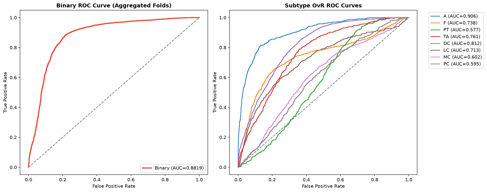

Figure 6.3. Saved local binary and one-versus-rest subtype ROC curves show binary AUC 0.8819 and uneven subtype ranking performance.

## 6.5 OMNet-V2 and Executed Baselines

OMNet-V2 studied binary classification at 200X with EfficientNet-B0, ViT-B/16 and a soft-voting ensemble. Its task, transformer size, magnification coverage and training design differed from OMNet-V3. Table 6.5 preserves its saved test summary. Its F1 column concerned the malignant class and must not be read as subtype or binary macro-F1.

Table 6.5. Saved OMNet-V2 test results report malignant-class F1.
| Model | Accuracy | Malignant F1 | Sensitivity | Specificity | ROC-AUC |
|---|---|---|---|---|---|
| EfficientNet-B0 | 81.79% | 87.94% | 94.90% | 51.19% | 0.8712 |
| ViT-B/16 | 84.29% | 89.67% | 97.45% | 53.57% | 0.8998 |
| Soft-voting ensemble | 84.29% | 89.57% | 96.43% | 55.95% | 0.8973 |

The detailed OMNet-V2 prediction CSV had 280 rows, with TN 45, FP 39, FN 5 and TP 191. These matched the rounded ViT-B/16 row rather than identifying a separate ensemble evaluation. Recalculation gave malignant F1 89.6714%, benign F1 67.1642% and macro-F1 78.4178%. This demonstrated the numerical distinction between malignant F1 and macro-F1. The OMNet-V2 manifest listed 56 training groups, 13 validation groups and 13 test groups with empty pairwise intersections under its identifiers; identity qualifications are discussed in Section 7.3.

Two single-backbone networks were also run at 200X on one patient-level split; they also selected checkpoints using validation subtype F1. Table 6.6 gives their recorded test scores.

Table 6.6. Executed baseline scores are decimal fractions, with split counts ordered as training, validation and test.
| Backbone | Mag. | Split images | Split patients | Test subtype accuracy | Subtype macro-F1 | Binary accuracy |
|---|---|---|---|---|---|---|
| DenseNet-201 | 200X | 1,444 / 289 / 280 | 56 / 13 / 13 | 0.5107 | 0.2556 | 0.7679 |
| ViT-B/16 | 200X | 1,444 / 289 / 280 | 56 / 13 / 13 | 0.5036 | 0.3070 | 0.8786 |

These baselines used a different protocol from OMNet-V3: one patient split, 200X only, larger backbones and no phyllodes images in the test split. They provide context rather than matched controls, so no ranking follows. Their subtype macro-F1 scores were not uniformly lower than the OMNet-V3 fold means: ViT-B/16 exceeded the reported OMNet-V3 values, while DenseNet-201 lay below local and above primary and cloud. Their printed macro averages cover eight rows, including a phyllodes row with zero test support and a recorded F1 of 0.00. This comparison is descriptive only.

Local binary accuracy ranged from 79.56% to 90.97%, and subtype macro-F1 ranged from 18.19% to 30.28%. These extrema described held-out case variation. Section 7.3 discusses fold dependence, incomplete prediction evidence and the boundaries of statistical comparison.

## 6.6 Fusion-Gate Analysis

The gate coefficient $\alpha$ was the CNN weight in the intermediate blend, with the complementary coefficient assigned to the transformer. Table 6.7 gives the saved cloud means and standard deviations by magnification. The cloud mean decreased by 0.2149 between 40X and 400X. The dispersion described variation among analysed images, rather than fold variation or uncertainty in the mean.

Table 6.7. Cloud gate means and image-level standard deviations describe dimensionless blend coefficients.
| Magnification | Mean CNN coefficient | Standard deviation | Mean transformer coefficient |
|---|---|---|---|
| 40X | 0.6850 | 0.1301 | 0.3150 |
| 100X | 0.5991 | 0.1283 | 0.4009 |
| 200X | 0.5258 | 0.1449 | 0.4742 |
| 400X | 0.4701 | 0.1459 | 0.5299 |

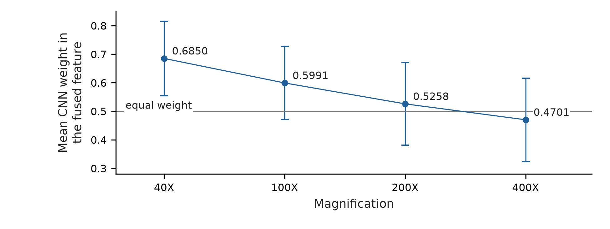

Figure 6.4. Cloud CNN gate means decrease across magnifications, with error bars showing one image-level standard deviation.

The saved local fold 0 box plot (not reproduced here) showed decreasing CNN coefficients from 40X to 400X with substantially overlapping distributions; no numerical values were extracted from it.

Both analyses covered fold 0 of one run per series; within-scale spread precluded a universal image coefficient, and the embedding imposed no monotonicity.

Feature norms, shared information and refinement prevent attribution from gate weights. One hypothesis was that broad textures at low magnification favoured convolutional features, while relationships among larger cellular appearances favoured transformer features at higher magnification; the gate records did not establish this explanation, and Chapter 8 proposes image-only, magnification-only and fixed-gate controls to test it.

## 6.7 Embedding Visualisation

Local t-SNE showed seven labels without PT, consistent with fold 0 test support; the cloud plot's legend contained only A, F, PT, TA and DC. t-SNE displays local neighbourhoods [26]; axes are not biological variables and inter-group distances are not quantitative subtype similarities. Label-dominated and mixed regions complemented confusion counts (Sections 6.2–6.3), without locating errors exclusively in embeddings or heads.

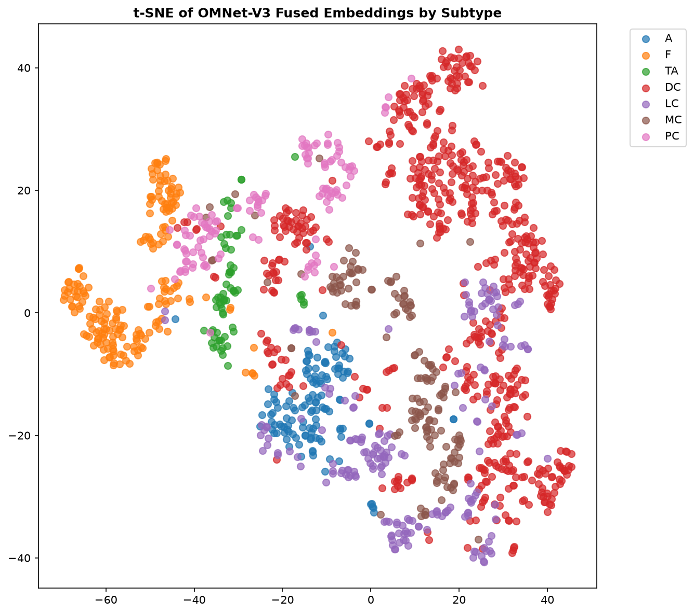

Figure 6.5. Saved local t-SNE embeddings show seven labelled subtypes, with neighbourhood groupings alongside overlap.

# 7. Conclusion

## 7.1 Conclusions

OMNet-V3 combined EfficientNet-B0 and ViT-Tiny/16 through magnification-conditioned gating, local scale-conditioned residual refinement, separate heads, weighted cross-entropy and directional KL. Primary binary accuracy was 84.05% and subtype macro-F1 24.42%; local pooled values were 83.82% and 27.58%, distinct from fold summaries and cloud results.

Local Phyllodes tumor, Mucinous carcinoma and Papillary carcinoma recognition remained weak. The local and cloud matrices showed recurring PT-to-F and PC/MC-to-DC confusions, despite different LC and MC outcomes. Limited case diversity was a plausible contributor, without establishing a ceiling; gate trends did not establish conditioning benefit (Table 7.1).

Clinical readiness, prospective benefit, regulatory status, latency and workload reductions were unestablished. Whole-slide use requires evaluated detection, tiling, quality control, aggregation, rejection and patient reporting. Record recovery enables recalculation; implementation corrections require new experiments, not reassigned historical scores.

## 7.2 Answers to the Research Questions

Table 7.1 relates each research question to the available benchmark evidence and its interpretation boundary.

Table 7.1. Answers to the research questions. Status refers to the available evidence within the reported benchmark.
| Question | What the evidence shows | Status |
|---|---|---|
| Can the shared representation support a useful coarse decision while learning the harder subtype task? | Joint training produced stronger binary performance than subtype performance within BreaKHis; usefulness beyond this benchmark remains unestablished. | Partly supported |
| Does the gate change systematically with magnification? | Saved cloud mean coefficients decreased from 40X to 400X in fold 0, and the saved local fold 0 plot shows the same direction; other folds were not analysed. | Supported for the analysed fold 0 records only |
| Does adding scale metadata improve performance relative to the same network without it? | No matched no-magnification ablation was available. | Not tested |
| How much of the observed subtype error is associated with limited patient representation? | Sparse case support accompanied weak rare-subtype recognition, but its contribution was not quantified or causally isolated. | Association only |

## 7.3 Limitations

**Dataset and identity.** Evaluation was disjoint by subtype-prefixed case group, but the case token `14-13412` occurs under both DC and LC (82 prefixed groups, 81 unprefixed portions); whether these represent one patient is unknown without the original identity mapping. No complete OMNet-V3 fold manifest survives, and the conference paper reports different test-fold sizes (Section 4.3). The recount checked filenames and label totals, not image bytes, visual duplicates, diagnoses or agreement between mirrors. Demographic, specimen, scanner and institution information was not verified, so no fairness or scanner-robustness claim is supported. All results come from BreaKHis without external validation or pathologist review of errors; CAMELYON16 [20] and BACH [15] use different label sets and cannot substitute for the eight subtypes.

**Case support and implementation.** PT had only three case groups; reweighting cannot create patient diversity, and scarcity, preprocessing, label ambiguity and checkpoint selection remain competing explanations for weak rare-subtype recognition. The six-group validation holdout gave a noisy selection signal. The local stain transform treated optical density as intensity during reconstruction, and square resizing distorted aspect ratio. During warmup, the backbones' `.eval()` mode could be reset by the recursive `model.train()` call, so batch-normalisation statistics could change while parameters stayed frozen. Set-derived validation ordering, lower-bound dependency versions and a single seed limit reproducibility; corrections require retraining.

**Evaluation.** Metrics were image-level, with correlated images within each case and no patient-level score; patient evaluation would need a defined probability-pooling, magnification-weighting and annotation rule. Higher malignant recall does not establish a safer operating point, because clinical trade-offs depend on thresholds, prevalence, downstream actions and error costs. Absent subtypes and evaluator conventions affected macro-F1. Fold dispersions are not confidence intervals, and because their training pools overlapped, the folds were not independent replications. Matched architecture, metadata and consistency controls, paired significance tests, head-disagreement measurements and calibration were unavailable.

**Records and scope.** A comparison summary reported about 84.6% binary accuracy and 23.4% subtype macro-F1, against the primary 84.05% and 24.42%; the primary binary AUC was 0.8945, while the cloud legend reported 0.8980. Learning rates and precision also differed (Table 5.1), and no complete execution history links the cloud formulation to the cloud score series. Checkpoints, per-image predictions and complete fold histories were not retained, so scores, thresholds and ROC curves cannot be independently recalculated; matrices were transcribed from figures. Gate evidence covers fold 0 only, without per-image weights. Reconciling the records requires a linked implementation, configuration, fold assignment, checkpoint and prediction record.

# 8. Future Work

## 8.1 Recommended Work

Priorities address record recovery, implementation, contribution and generalisation.

1. **Recover one complete experiment.**
   Recover implementation, parameter states, folds and predictions; resolve `14-13412` through original identities. Regenerate metrics, matrices and ROC curves from linked records, retaining run configuration differences. Check class errors by case and magnification.
2. **Correct implementation choices.**
   Correct inverse optical-density reconstruction, check reconstructed images and document fallback behaviour. Enforce warmup statistics, sort and export validation identities, and preserve label order and absent-class conventions. Repeat same-fold model and baseline comparisons as new experiments.
3. **Test architectural contribution.**
   Compare single-branch, static-fusion, no-magnification and no-consistency variants under matched folds, transformations, class weights, budgets and checkpoint criteria; extend gate analysis across folds; examine higher-resolution or aspect-preserving inputs. Report parameter counts to distinguish system, metadata and fusion tests.
4. **Test generalisation.**
   Additional rare-subtype patients would broaden training diversity and evaluation support. External evaluation requires compatible labels and a distinction between adaptation and locked-model testing. Patient reporting requires evaluated whole-slide tissue detection, tiling, quality control, aggregation and rejection.

## 8.2 Proposed Gate and Attribution Experiments

Export $\alpha$, image/patient IDs, magnification, labels, predictions and fold. Hold each image fixed while changing its magnification index, and separately shuffle magnification metadata during training. Compare image-only, magnification-only and fixed gates under matched splits and checkpoint selection, and compare stain transforms to investigate the local reconstruction defect. Grad-CAM uses target-class gradients [21]; Grad-CAM/Score-CAM inspection should specify targets, layers, selection, failures and pathologist regions. No numerical outcomes are assigned.

# 9. References

[1] V. Priyanka, M. Narendra and T. Dilleswar Rao. A patient-aware benchmarking of CNN and transformer architectures for breast cancer histopathology classification. Frontiers in Digital Health, 8, 1752938, 2026.

[2] N. Ashab, S. K. Kundu, S. M. Parvez, S. H. Sohag, B. Biswas and N. Subha. MagViT: Interpretable Multi-Magnification Transformers with Patient-Level Model Selection for Breast Histopathology. Author-produced conference version, arXiv:2608.16959, 2026.

[3] W. X. Ativi et al. CMAF-Net: cross-modal attention fusion with information-theoretic regularization for imbalanced breast cancer histopathology. Scientific Reports, 16, 9607, 2026. doi: 10.1038/s41598-025-32794-1.

[4] X. Wang, G. Wang, L. Li, H. Zou and J. Cui. MFF-ClassificationNet: CNN-Transformer Hybrid with Multi-Feature Fusion for Breast Cancer Histopathology Classification. Biosensors, 15(11), 718, 2025. doi: 10.3390/bios15110718.

[5] A. Desai and R. Mahto. Multi-Class Classification of Breast Cancer Subtypes Using ResNet Architectures on Histopathological Images. Journal of Imaging, 11(8), 284, 2025.

[6] A. Fiaz, B. Raza, M. Faheem and A. Raza. A deep fusion-based vision transformer for breast cancer classification. Healthcare Technology Letters, 11(6), 471-484, 2024.

[7] L. A. Aldakhil, H. F. Alhasson and S. S. Alharbi. Attention-Based Deep Learning Approach for Breast Cancer Histopathological Image Multi-Classification. Diagnostics, 14(13), 1402, 2024.

[8] M. M. Srikantamurthy, V. P. S. Rallabandi, D. B. Dudekula, S. Natarajan and J. Park. Classification of benign and malignant subtypes of breast cancer histopathology imaging using hybrid CNN-LSTM based transfer learning. BMC Medical Imaging, 23, 19, 2023. doi: 10.1186/s12880-023-00964-0.

[9] A. Dosovitskiy et al. An Image is Worth 16x16 Words: Transformers for Image Recognition at Scale. ICLR, 2021. arXiv:2010.11929.

[10] H. Touvron, M. Cord, M. Douze, F. Massa, A. Sablayrolles and H. Jegou. Training data-efficient image transformers & distillation through attention. Proceedings of ICML, PMLR 139, 10347-10357, 2021.

[11] D. Chicco and G. Jurman. The advantages of the Matthews correlation coefficient (MCC) over F1 score and accuracy in binary classification evaluation. BMC Genomics, 21, 6, 2020. doi: 10.1186/s12864-019-6413-7.

[12] M. Tan and Q. V. Le. EfficientNet: Rethinking Model Scaling for Convolutional Neural Networks. Proceedings of ICML, 2019. arXiv:1905.11946.

[13] Y. Cui, M. Jia, T.-Y. Lin, Y. Song and S. Belongie. Class-Balanced Loss Based on Effective Number of Samples. Proceedings of the IEEE Conference on Computer Vision and Pattern Recognition, 2019. arXiv:1901.05555.

[14] I. Loshchilov and F. Hutter. Decoupled Weight Decay Regularization. ICLR, 2019. arXiv:1711.05101.

[15] G. Aresta et al. BACH: Grand Challenge on Breast Cancer Histology Images. Medical Image Analysis, 2019. doi: 10.1016/j.media.2019.05.010.

[16] V. Gupta and A. Bhavsar. Breast Cancer Histopathological Image Classification: Is Magnification Important? Proceedings of the IEEE Conference on Computer Vision and Pattern Recognition Workshops, 2017.

[17] Z. Han et al. Breast Cancer Multi-classification from Histopathological Images with Structured Deep Learning Model. Scientific Reports, 7, 4172, 2017.

[18] T.-Y. Lin, P. Goyal, R. Girshick, K. He and P. Dollar. Focal Loss for Dense Object Detection. Proceedings of the IEEE International Conference on Computer Vision, 2017. arXiv:1708.02002.

[19] C. Guo, G. Pleiss, Y. Sun and K. Q. Weinberger. On Calibration of Modern Neural Networks. Proceedings of ICML, PMLR 70, 1321-1330, 2017.

[20] B. E. Bejnordi et al. Diagnostic Assessment of Deep Learning Algorithms for Detection of Lymph Node Metastases in Women With Breast Cancer. JAMA, 318(22), 2199-2210, 2017. doi: 10.1001/jama.2017.14585.

[21] R. R. Selvaraju, M. Cogswell, A. Das, R. Vedantam, D. Parikh and D. Batra. Grad-CAM: Visual Explanations from Deep Networks via Gradient-based Localization. Proceedings of the IEEE International Conference on Computer Vision, 2017. arXiv:1610.02391.

[22] N. Bayramoglu, J. Kannala and J. Heikkila. Deep learning for magnification independent breast cancer histopathology image classification. Proceedings of the 23rd International Conference on Pattern Recognition, 2016. doi: 10.1109/ICPR.2016.7900002.

[23] F. A. Spanhol, L. S. Oliveira, C. Petitjean and L. Heutte. A Dataset for Breast Cancer Histopathological Image Classification. IEEE Transactions on Biomedical Engineering, 63(7), 1455-1462, 2016. doi: 10.1109/TBME.2015.2496264.

[24] K. He, X. Zhang, S. Ren and J. Sun. Deep Residual Learning for Image Recognition. Proceedings of the IEEE Conference on Computer Vision and Pattern Recognition, 2016. arXiv:1512.03385.

[25] M. Macenko et al. A Method for Normalizing Histology Slides for Quantitative Analysis. IEEE International Symposium on Biomedical Imaging, 2009. doi: 10.1109/ISBI.2009.5193250.

[26] L. van der Maaten and G. Hinton. Visualizing Data using t-SNE. Journal of Machine Learning Research, 9, 2579-2605, 2008.
