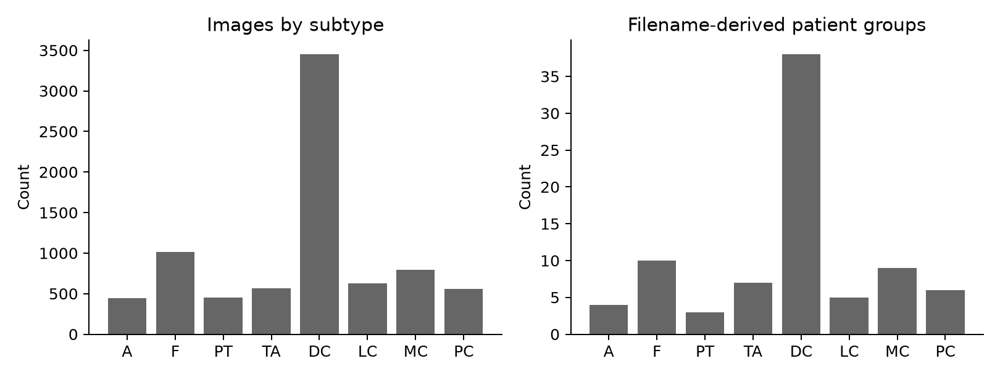
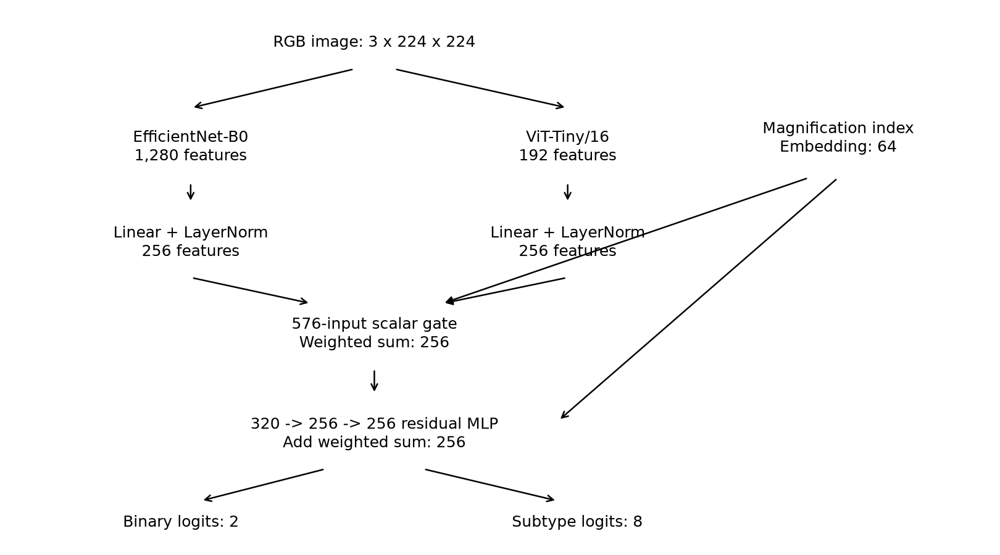
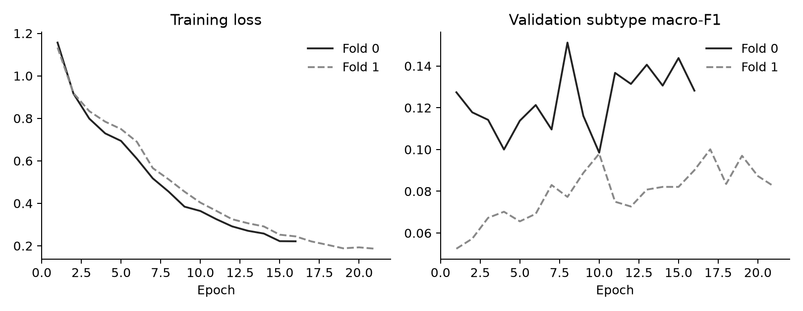
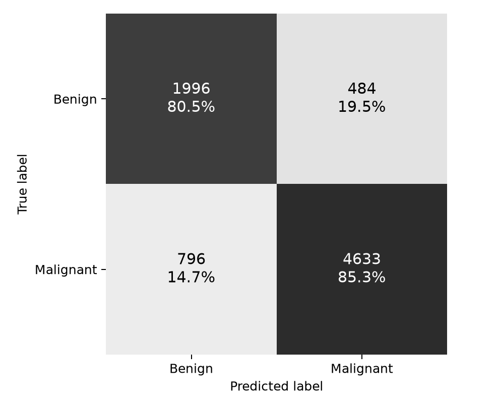
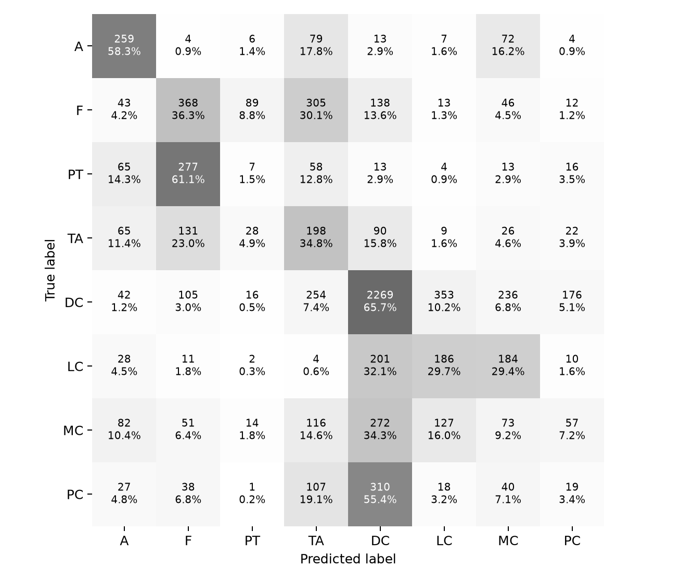
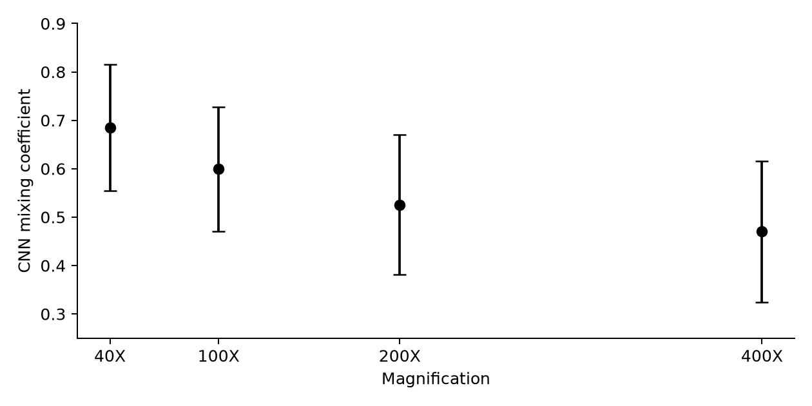

# A Magnification-Aware Dual-Branch Network for Breast Cancer Histopathology Classification

## OMNet Project Report

Department of Information Technology  
Guru Nanak Institute of Technology, Kolkata, India  
Academic session 2025 to 2026  
Revised 6 November 2026

## Abstract

OMNet studies the use of magnification metadata in a network for breast histopathology image classification. Its two image branches are EfficientNet-B0 and ViT-Tiny/16. Their outputs are projected into a common 256-dimensional space and combined by a learned scalar gate that receives both image features and a 64-dimensional magnification embedding. A residual refinement block supplies a shared representation to a binary classification head and an eight-class subtype head. The local implementation trains these heads with weighted cross-entropy and a directional consistency penalty between their probability distributions.

The project uses the four magnifications of BreaKHis: 40X, 100X, 200X and 400X. Recounting the saved local metadata gives 7,909 unique image filenames and 82 subtype-prefixed case groups. The evaluation code uses five-fold stratified grouped splitting, followed by a grouped validation holdout inside each training portion. This is intended to measure performance on unseen patients. However, the grouping convention needs further verification: case identifier `14-13412` occurs under both ductal and lobular carcinoma and is treated as two groups because the subtype is included in the identifier.

The primary reported result series gives binary accuracy of 84.05% with a fold standard deviation of 3.13 percentage points and subtype macro-F1 of 24.42% with a standard deviation of 3.84 points. The local series separately reports 83.82% binary accuracy and 25.63% subtype macro-F1, while the cloud series reports 84.56% and 23.45%, respectively. Complete prediction-level records and checkpoints are unavailable to reconstruct the relationship between these series. This report distinguishes the reported series from pooled metrics recalculated using recorded confusion counts.

The central result is the difficulty of subtype recognition relative to the binary task. Low subtype macro-F1 persists despite weighted training, and the local confusion matrix shows substantial failure on phyllodes, mucinous and papillary classes. Saved gate statistics decrease from a mean CNN weight of 0.685 at 40X to 0.470 at 400X, but do not establish a causal explanation for branch usefulness. The report develops the implementation, evaluation and error analysis in detail, while identifying unresolved grouping, augmentation and experiment-traceability limitations. No clinical deployment, external validation or controlled improvement over matched single-branch baselines is established.

## Contents

1. Research problem and scope
2. Related methods and research position
3. Dataset and label structure
4. Grouping, splitting and experimental units
5. Preprocessing and augmentation
6. Dual-branch architecture
7. Hierarchical learning objective
8. Training and implementation
9. Experimental results
10. Fusion analysis and representation studies
11. Error analysis and limitations
12. Conclusions and further work

Appendix A. Experimental records and result reconciliation  
Appendix B. Configuration and reproducibility record  
Appendix C. Metric calculations and confusion matrices  
Appendix D. Technical verification and unresolved questions  
References

## Notation and reading conventions

An image is denoted by x and its magnification index by m. Binary labels use 0 for benign and 1 for malignant. Subtype indices are ordered A, F, PT, TA, DC, LC, MC, PC throughout the report. A batch contains B images. Feature dimensions are written after the batch dimension, so B x 256 denotes one 256-element feature vector per image. The symbols p and q denote binary probabilities from the direct binary head and grouped subtype head, respectively.

Accuracy and F1 values are percentages unless a table explicitly uses the zero-to-one scale. An uncertainty of 4.04 percentage points attached to 83.82% is a dispersion across folds, not a relative 4.04% change. MCC and AUC remain on their usual numerical scales. The saved local aggregation code uses the population standard deviation of five fold values, with denominator five. It does not calculate a confidence interval.

Each result is identified by its experimental series and calculation method. The primary reported series, cloud series and local series are kept separate because their configurations and scores differ. A reconstructed matrix value is calculated from recorded integer confusion counts; it checks arithmetic but does not replace unavailable image-level predictions. These distinctions prevent different experiments from being merged into one apparently complete result.

## 1. Research problem and scope

### 1.1 Why magnification belongs in the model

Histopathology images contain evidence at several spatial scales. A low magnification field shows arrangements of tissue structures across a relatively broad area. A higher magnification field makes smaller cellular structures visible within a narrower area. Resizing both images to the same pixel dimensions does not remove this physical difference. A nucleus spanning a particular number of pixels after resizing may represent a different observation scale in the two images. Magnification therefore provides information about how image patterns should be interpreted.

The project investigates whether this information can be used within feature fusion. Instead of selecting one backbone for every image, OMNet computes features through a convolutional network and a transformer. It learns how to mix them using the image representations and the known acquisition magnification. This is a testable design choice: the magnification embedding can be removed, held constant or shuffled, and the resulting performance can be compared under the same evaluation protocol. Those controlled comparisons have not been supplied for the completed V3 experiment.

There is an important boundary to the term multi-scale in this project. The network receives one image and one magnification index for each prediction. It does not jointly receive registered 40X, 100X, 200X and 400X views of the same tissue region. Its training population contains images from four scales, and its gate is conditioned on scale metadata. This differs from a system that explicitly matches tissue locations across magnifications and fuses their observations. The distinction affects what can be claimed about contextual information available at inference.

### 1.2 The two classification tasks

The first output is a benign-versus-malignant image classification. The second assigns the image to one of eight dataset subtypes. Four subtype labels belong to the benign group and four to the malignant group. This label hierarchy makes joint training possible: a correct subtype should imply the correct coarse group. It also creates an observable failure mode when the two heads disagree.

The binary task discards distinctions within each broad group. For example, an image of ductal carcinoma classified as lobular carcinoma is wrong for the subtype task but remains within the correct malignant group. Reasonable binary performance can therefore coexist with poor subtype performance. The report examines both tasks separately rather than treating binary accuracy as a substitute for fine-grained success.

The labels are image annotations inherited from the dataset. The model does not estimate tumor grade, stage, receptor status, survival, recurrence or treatment response. A subtype classifier trained on these images cannot be interpreted as a general diagnostic workup. The dataset's phyllodes category is used according to its supplied coarse label; that benchmark convention is not a general statement that every phyllodes tumor encountered in practice is benign.

### 1.3 Research questions

The architecture raises four questions. Can the shared representation support a useful coarse decision while learning the harder subtype task? Does the gate change systematically with magnification? Does adding scale metadata improve performance relative to the same network without it? How much of the observed subtype error is associated with limited patient representation?

The available evidence answers these questions to different degrees. Aggregate results describe moderate binary discrimination and weak subtype macro-F1. The gate analysis describes a monotonic change in mean weight. A metadata recount establishes severe differences in class support measured in case groups. Matched ablations needed to attribute an improvement to the gate have not been established, and observational support differences cannot isolate the cause of every class error.

These distinctions determine the strength of the conclusion. OMNet implements a coherent way to condition dual-branch fusion on magnification. Its measured records indicate limitations that deserve further study. They do not demonstrate that the design is superior to every alternative or that its gate reproduces the reasoning of a pathologist.

### 1.4 Scope and organization of the report

This report develops the research problem, related methods, dataset, validation design, preprocessing, architecture, learning objective and experimental evaluation. It presents tensor dimensions, loss direction, split construction, transform order, metric definitions, configuration differences and failure analysis so that the system can be understood without consulting implementation materials.

The experimental record contains numerical differences that must remain explicit. The primary result summary uses 84.05% binary accuracy, whereas a comparison summary uses about 84.6%. Training descriptions differ in learning rates and precision, and the reported fold partitions are not identical. The following chapters identify the applicable configuration and result series for each claim. Appendix A summarizes the unresolved differences and the evidence needed to reconcile them.

## 2. Related methods and research position

### 2.1 Convolutional feature extraction

A convolutional network applies learned filters across an image and builds increasingly abstract features through a hierarchy of operations. Reusing the same filters across spatial positions gives a useful bias for texture and repeated local structures. EfficientNet-B0 provides the convolutional branch in OMNet-V3. The project uses pretrained weights and removes the original classification layer, retaining a pooled 1,280-dimensional descriptor [[3]](#ref-3).

Calling this the local branch describes its inductive bias, not an absolute restriction on its field of view. Deeper convolutional features combine information from increasingly broad image regions. Pooling also summarizes information across spatial positions. It would be inaccurate to say that the CNN cannot represent tissue architecture or that every feature in its pooled output is a cellular measurement.

Pretraining supplies a starting representation learned outside histopathology. Fine-tuning adapts it to the training images. This is useful when the number of independent cases is small, but it does not guarantee that the final representation ignores stain, acquisition conditions or patient-specific appearance. Those possible shortcuts must be investigated through split design and external testing.

### 2.2 Transformer feature extraction

The transformer branch divides the resized image into patches and represents them as tokens. For a 224 x 224 image and a patch width of 16, the grid contains 14 x 14, or 196, image tokens. A class token is used to summarize the sequence. ViT-Tiny supplies a 192-dimensional final representation in the local model. Positional information is needed because attention alone does not encode the original two-dimensional placement of tokens [[4]](#ref-4).

Self-attention allows a token to combine information from other tokens within the input field. This gives a different route to relationships across the image than repeated convolutions. However, global in this context means global within one resized field, not across an entire microscope slide. Information removed during cropping or downsampling cannot be restored by attention.

Touvron and colleagues study data-efficient image-transformer training and attention-based distillation [[18]](#ref-18). This is useful context for the use of compact transformer representations when training data is limited. OMNet-V3 uses its configured pretrained ViT-Tiny backbone; it does not implement a new distillation experiment. The exact pretrained weight recipe still needs to be tied to the saved checkpoint.

The two branches provide complementary parameterizations of the same pixels. Whether both are necessary is an empirical question. A dual-branch system may benefit from complementary features, increased capacity or training effects. Equal-protocol single-branch and fixed-fusion controls are required to separate these explanations.

### 2.3 Feature fusion and magnification conditioning

Feature fusion can concatenate descriptors, average them, apply fixed weights or learn weights from the data. Concatenation preserves branch-specific coordinates but increases the dimension passed to later layers. Averaging is simple but gives both branches the same contribution for every image. A learned gate introduces conditional weighting and can be inspected after training.

OMNet-V3 first projects both branch descriptors to 256 dimensions, allowing an elementwise weighted sum. The scalar gate is inexpensive relative to the backbones and exposes a directly inspectable coefficient. Its limitation is that every feature coordinate receives the same branch weight. It cannot independently prefer one CNN coordinate and a different transformer coordinate in the way a vector-valued gate could.

The magnification embedding gives the gate explicit acquisition information. Because the gate also receives the image features, two images at the same magnification can have different coefficients. This differs from learning only four fixed scale weights. The local implementation additionally passes the embedding to a residual block, so scale can affect the final feature through more than one path.

The contribution is the implemented combination of dual-branch features, magnification-conditioned fusion and hierarchical supervision. A claim of being the first magnification-aware model would require a systematic comparison with prior scale-aware and hybrid work. Published related systems provide context but do not substitute for matched experimental baselines.

### 2.4 Patient-aware benchmarking

Priyanka, Narendra and Dilleswar Rao evaluate nine architectures using patient-level GroupKFold [[2]](#ref-2). Their reported mean accuracies range from 90.73% to 92.67%. These figures should not be interpreted as an 80% to 85% patient-disjoint performance range. Its results also show why a high accuracy cannot, by itself, diagnose leakage.

The relevant lesson is methodological: split construction, preprocessing, checkpoint selection and class handling must be considered before comparing scores. Their GroupKFold protocol differs from OMNet-V3's subtype-stratified grouped folds and internal validation holdout. The external study is useful context, but its numerical ranking is not a controlled comparison against OMNet-V3.

### 2.5 Hierarchical classification

The hierarchy in this project is shallow: eight subtypes map to two parent groups. A shared feature can support both tasks, and a probability-level regularizer can encourage agreement. This uses label structure that ordinary eight-class cross-entropy does not explicitly impose between two separate prediction heads.

There are alternatives. A model could predict only eight subtype probabilities and derive the binary answer by summing them. That construction guarantees probability-level consistency because there is no independent binary head. Another design could first choose a broad group and then classify within that group. OMNet-V3 retains two independently parameterized heads and regularizes their relationship.

This choice permits a stronger coarse classifier even when the subtype distribution is uncertain, but it also allows disagreements. The regularization weight determines how strongly one head influences the other relative to supervised loss. Its benefit cannot be inferred simply from the fact that the hierarchy is sensible. A no-consistency control and a measured disagreement rate are needed.

### 2.6 Requirements for a fair comparison

A fair comparison would train CNN-only, transformer-only, fixed fusion and magnification-aware fusion variants on identical outer folds. Each variant would use the same internal validation policy, image transformations, class-weight calculation and training budget. Checkpoints would be selected using the same criterion. Fold-level differences would then be reported alongside the individual scores.

Architecture capacity also matters. Replacing a dual-branch model with a smaller single backbone changes parameter count as well as the fusion mechanism. An experiment should state what question it answers: whether the whole system improves prediction, whether scale metadata helps within that system, or whether one fusion rule is more effective than another. These questions require different controls.

V2 comparisons provide development history, while later baseline designs provide possible future protocols. Neither establishes a completed controlled ablation of the V3 architecture. Consequently, no measured V3 ablation advantage is asserted.

### 2.7 Related hybrid studies

Wang and colleagues' MFF-ClassificationNet is a CNN-transformer hybrid explicitly organized around multi-feature fusion [[6]](#ref-6). It is relevant to the decision to combine architectural families, rather than to a claim that OMNet first introduced hybrid histopathology classification. Its existence means that a novelty argument must identify the specific conditioning and supervision design, then demonstrate its contribution experimentally.

Fiaz and colleagues' DFViT combines pretrained convolutional features with a vision transformer and an MLP classifier [[7]](#ref-7). It provides another precedent for local and broader-context feature integration. Its documented CNN-transformer fusion is relevant to the choice of two feature-extraction families; no unverified RGB-versus-stain-normalized stream structure is assumed.

Aldakhil, Alhasson and Alharbi study EfficientNetV2 with channel and spatial attention in ECSAnet [[8]](#ref-8). This is a useful alternative to running two backbones. Attention can refine one backbone's features without the cost and interpretation issues of a separate transformer branch. The question for OMNet-V3 is therefore whether its additional branch and metadata pathway provide a benefit worth their complexity under the same evaluation design.

Ashab and colleagues' MagViT describes per-scale transformer representations, a learned gate that masks missing scales and patient-level model selection [[11]](#ref-11). This is especially relevant because it directly concerns multi-magnification fusion. Its multi-view construction differs from OMNet-V3's one-image input with a categorical scale embedding. The two approaches should be compared by their available input information as well as by backbone names.

Table 2.1. Methodological comparison with selected primary studies. This table compares design features, not scores from incompatible experiments.

| Study | Relevant design | Comparison needed for OMNet-V3 |
|---|---|---|
| Priyanka et al. [[2]](#ref-2) | Patient-aware architecture benchmark | Align grouping, validation and metric definitions |
| MFF-ClassificationNet [[6]](#ref-6) | CNN-transformer feature fusion | Isolate the benefit of explicit scale metadata |
| DFViT [[7]](#ref-7) | CNN and transformer feature integration | Compare fusion under identical inputs and folds |
| ECSAnet [[8]](#ref-8) | EfficientNetV2 with attention | Compare one refined backbone with two branches |
| MagViT [[11]](#ref-11) | Gated per-scale transformer representations | Distinguish multi-view input from scale conditioning |

The related methods do not provide a direct empirical comparison against OMNet-V3 under a harmonized protocol. Their scores should not establish its rank without checking task labels, input information and case-level separation. A focused methodological comparison is more informative than a numerical leaderboard with incompatible assumptions.

### 2.8 Earlier work on magnification

Magnification-independent breast histology classification predates the present transformer-based designs. Bayramoglu, Kannala and Heikkila investigate CNN learning across magnifications and compare magnification-specific and magnification-independent formulations [[12]](#ref-12). Their work makes the distinction between pooling scales during training and constructing separate scale-specific models directly relevant to OMNet-V3. The present network adds explicit scale conditioning to its feature mixture, but the broader question of learning across magnifications is already established.

Gupta and Bhavsar examine magnification-specific and magnification-independent classification using joint color-texture features and a classifier ensemble [[13]](#ref-13). This provides an earlier feature-based reference for asking whether magnification changes the usefulness of visual evidence. Its features and classifier differ from the learned representations used here, so it supplies methodological context rather than a matched baseline.

Together, these studies motivate a more precise comparison: test whether conditioning on scale improves the same dual-branch network beyond simply including all four magnifications in training. A comparison against a magnification-independent network must preserve case grouping and preprocessing; otherwise, differences in the evaluation protocol can be mistaken for benefits of scale conditioning.

### 2.9 Subtype classification and structured representations

Han and colleagues study breast tumor multi-classification with a structured deep learning model [[14]](#ref-14). Their work is relevant to learning representations that distinguish the eight histological categories, rather than evaluating only benign-versus-malignant separation. Structured representation learning and OMNet-V3's probability-level hierarchy are different design choices. The former should not be presented as an implementation of the two-head consistency penalty described in Chapter 7.

Desai and Mahto compare ResNet-18, ResNet-34 and ResNet-50 for the eight-class BreaKHis task [[15]](#ref-15). Their error analysis discusses subtype confusions, including lobular versus mucinous carcinoma and phyllodes versus fibroadenoma. These are useful patterns to compare with OMNet-V3's confusion matrix. However, their stated future work includes patient-level or leave-one-patient-out splitting. Their reported accuracy therefore cannot be treated as a directly comparable patient-disjoint result or as evidence of a patient-count ceiling.

Srikantamurthy and colleagues combine convolutional transfer learning with an LSTM for benign and malignant subtype classification [[16]](#ref-16). This supplies a different hybrid design for the same broad label problem: sequence-based processing of extracted features rather than a convolutional-transformer gate conditioned on magnification. Its reported results are not entered into a shared numerical ranking because the project has not harmonized the split and training protocols.

### 2.10 Fusion under class imbalance

Ativi and colleagues' CMAF-Net couples cross-modal attention fusion with information-theoretic regularization and adaptive class balancing [[17]](#ref-17). It is relevant to a limitation of OMNet-V3: fusion and class imbalance may interact, rather than contributing independent effects. A representation dominated by common classes may remain weak for rare classes even when its two branches are complementary.

The main evaluation described for CMAF-Net uses the IDC dataset. It is therefore not a direct eight-subtype BreaKHis comparison. Its relevance here is the approach to fusion and imbalance, not a claim that its headline score can be compared with OMNet-V3's macro-F1. An experiment adopting any related regularizer would require its own matched ablation and a clear account of the additional objective.

## 3. Dataset and label structure

### 3.1 Dataset provenance

BreaKHis is a public breast histopathology benchmark introduced by Spanhol and colleagues [[1]](#ref-1). Its familiar eight-class subset contains 2,480 benign and 5,429 malignant images, totaling 7,909. Images are RGB microscopic fields, commonly distributed at 700 x 460 pixels. Training uses mirrored distributions of the public dataset; the study does not introduce a new collection of clinical specimens.

The [dataset documentation](https://web.inf.ufpr.br/vri/databases/breast-cancer-histopathological-database-breakhis/) contains inconsistencies in some displayed totals and class-by-magnification entries [[1]](#ref-1). For the project-specific counts below, the report uses saved local filename metadata and checks that all subtotals add correctly. This establishes what the metadata lists, not the integrity of every original image byte. A complete image-level content audit was not available for this assessment.

Patient ages, specimen-block counts and patient-level clinical covariates have not been independently verified for this experiment. Detailed demographic and specimen inventories therefore cannot be asserted. Such information requires an identifiable clinical or dataset source and cannot be reconstructed from image names.

### 3.2 The label vocabulary

The benign group comprises adenosis, fibroadenoma, phyllodes tumor and tubular adenoma. The malignant group comprises ductal, lobular, mucinous and papillary carcinoma. These names describe the dataset's target categories. They do not indicate that the network has learned all histological criteria needed to diagnose each condition.

Table 3.1. Fixed label mapping used by the V3 configuration.

| Index | Code | Dataset subtype | Binary index |
|---|---|---|---|
| 0 | A | Adenosis | 0 |
| 1 | F | Fibroadenoma | 0 |
| 2 | PT | Phyllodes tumor | 0 |
| 3 | TA | Tubular adenoma | 0 |
| 4 | DC | Ductal carcinoma | 1 |
| 5 | LC | Lobular carcinoma | 1 |
| 6 | MC | Mucinous carcinoma | 1 |
| 7 | PC | Papillary carcinoma | 1 |

The ordering is part of the model specification. The first four subtype probabilities are summed to obtain the benign probability from the subtype head; the last four give the malignant probability. A different class ordering without a corresponding change to this operation would silently create an incorrect consistency target. Confusion matrices and plots must use the same ordering.

### 3.3 Recalculated image distribution

Table 3.2 is obtained by counting subtype, magnification and parsed case-group fields in the image metadata. Each record corresponds to one listed image. There are 7,909 records and 7,909 unique image names. Every subtype and magnification subtotal is checked against the total.

Table 3.2. Image counts and subtype-prefixed case-group counts from saved metadata.

| Subtype | 40X | 100X | 200X | 400X | Images | Groups |
|---|---|---|---|---|---|---|
| A | 114 | 113 | 111 | 106 | 444 | 4 |
| F | 253 | 260 | 264 | 237 | 1,014 | 10 |
| PT | 109 | 121 | 108 | 115 | 453 | 3 |
| TA | 149 | 150 | 140 | 130 | 569 | 7 |
| DC | 864 | 903 | 896 | 788 | 3,451 | 38 |
| LC | 156 | 170 | 163 | 137 | 626 | 5 |
| MC | 205 | 222 | 196 | 169 | 792 | 9 |
| PC | 145 | 142 | 135 | 138 | 560 | 6 |
| Total | 1,995 | 2,081 | 2,013 | 1,820 | 7,909 | 82 |

Benign counts by magnification are 625, 644, 623 and 588. Malignant counts are 1,370, 1,437, 1,390 and 1,232. Both sets sum to the stated class totals. The benign 40X count is 625 in the saved metadata; a conflicting 652 appears on the dataset website. These values should not be copied interchangeably.



Figure 3.1. Image and subtype-prefixed case-group support, redrawn from saved metadata. The panels distinguish repeated images from contributing groups. A group is the parser's identifier, pending the identity verification discussed in Chapter 4.

### 3.4 Imbalance in images and cases

Malignant images account for approximately 68.64% of the full metadata. A classifier that always predicts malignant would reach 68.64% pooled image accuracy without distinguishing tissue appearances. Ductal carcinoma alone contributes about 43.63% of all images, making a constant DC prediction a relevant reference for interpreting subtype accuracy.

The distribution of cases is even more important for generalization. Ductal carcinoma has 38 subtype-prefixed groups, while phyllodes has three. Repeated fields from one case provide useful variation in appearance and scale, but they do not create independent patients. A training set containing hundreds of PT images may still represent only two individuals when the third group is held out.

This support pattern provides a plausible explanation for unstable rare-class estimates. It does not prove an absolute ceiling on achievable performance. Better pretraining, more appropriate augmentation or a different objective could improve a result. The careful conclusion is that few contributing cases limit the diversity available for learning and evaluation, and make broad generalization claims uncertain.

### 3.5 What the metadata check establishes

The recount establishes internal agreement between image-name uniqueness, class totals, magnification totals and subtype group counts. It also detects the case-token collision discussed in Chapter 4. The count procedure groups records by subtype and magnification, then separately counts distinct parsed group identifiers.

The check does not establish that no two images show the same field, that all diagnoses are correct, or that the two dataset mirrors contain identical files. Duplicate filenames are one kind of duplication; visual near-duplicates and byte-identical content under different names require image-level checks. Similarly, a consistent label table does not independently validate the underlying pathology annotation.

The dataset is a research benchmark with limited clinical context. The available metadata does not support subgroup analysis by age, ethnicity, treatment history, scanner or institution. The report does not claim demographic fairness or scanner robustness based on these experiments.

## 4. Grouping, splitting and experimental units

### 4.1 Parsing the filename

The metadata parser reads dataset image names such as `SOB_B_TA-14-4659-40-001.png`. The underscore-separated prefix supplies procedure, coarse class and subtype. Hyphen-separated fields supply the year-and-case portion, magnification and sequence number. The parser takes the penultimate token as magnification and joins the middle tokens to preserve the complete case portion.

For this example, subtype is TA, case portion is `14-4659`, magnification is 40 and sequence is 1. The parser creates group identifier `TA_14-4659`. It excludes magnification and sequence from the identifier so that multiple fields and scales from the same parsed group are kept together during grouped splitting.

The sequence number is not a patient identifier. Treating `001` as a patient field would merge unrelated images and split related images incorrectly. Retaining only part of a case token could either merge distinct cases or fail to preserve suffixes. The implementation's join operation is therefore an important detail.

### 4.2 A case identifier requiring verification

The saved metadata contains case portion `14-13412` under both DC and LC. Because the parser prefixes the subtype, these entries become `DC_14-13412` and `LC_14-13412`. There are 82 unique prefixed groups but 81 unique unprefixed case portions.

The reused portion may refer to the same person or related material under different diagnostic folders, in which case current grouping could separate related images. Alternatively, it may be a legitimate reused case token belonging to different patients. The available metadata does not determine which interpretation is correct. Removing the prefix and merging the groups without checking would also be an unsupported change.

The report describes the existing evaluation as disjoint by subtype-prefixed case group. The intended patient-disjoint design is clear, but a definitive patient-level guarantee requires the original identity mapping. The actual fold assignment of the colliding identifiers also needs inspection before concluding whether cross-fold overlap occurred. A parser concern is evidence of uncertainty, not proof that the reported scores contain leakage.

### 4.3 Outer grouped cross-validation

Both V3 evaluation procedures use `StratifiedGroupKFold` with five splits, shuffling and seed 42. Subtype is the stratification target, while the parsed group identifier supplies the grouping constraint. For each fold, the test portion is held out, and all remaining groups form the development pool.

Stratification attempts to balance label distribution without splitting a group. Exact balance is generally impossible because groups contain unequal numbers of images. It is particularly impossible to place PT in every one of five test folds when there are only three PT groups. This is a property of the available cases, not an implementation defect in the splitter.

Table 4.1. Recorded local outer-fold sizes. Development includes the later validation holdout.

| Fold | Development images | Development groups | Test images | Test groups |
|---|---|---|---|---|
| 0 | 6,353 | 66 | 1,556 | 16 |
| 1 | 6,380 | 66 | 1,529 | 16 |
| 2 | 6,320 | 66 | 1,589 | 16 |
| 3 | 6,207 | 64 | 1,702 | 18 |
| 4 | 6,376 | 66 | 1,533 | 16 |

Test image counts sum to 7,909, and test group counts sum to 82. These checks are necessary but do not authenticate every assignment. A complete fold manifest would list each filename, group and fold. A complete V3 fold manifest is unavailable, so the table records the local partition summary and should not be treated as confirmation of a different reported partition.

### 4.4 Internal validation holdout

Inside each outer development pool, the code selects 10% of groups for validation, using the integer part of that fraction and a minimum of one group. With 64 or 66 development groups, this selects six groups. The remaining groups provide training images. Validation groups therefore have no images in the training portion under the parser's grouping convention.

Retained output for fold 0 lists 5,829 training images from 60 groups, 524 validation images from six groups and 1,556 test images from 16 groups. Fold 1 lists 5,748 training images, 632 validation images and 1,529 test images, with the same 60/6/16 group counts. A complete equivalent epoch log is unavailable for all five completed folds.

Validation selection samples from a list produced from a Python set. Set iteration order can differ across interpreter sessions. A fixed pandas sampling seed does not, by itself, guarantee identical selected identities when the input list order changes. A reproducible rerun should sort group identifiers before sampling and export the chosen groups. This recommendation does not retroactively change the saved run.

### 4.5 Image-level and patient-level evaluation

The model predicts one label per image. Reported accuracy and F1 are computed over images within each test fold. Grouping prevents the same parsed case group from appearing in train and test, but it does not convert an image-level metric into a patient-level metric. A patient contributing many images contributes more observations to pooled image accuracy.

A patient-level score would require an explicit aggregation rule, such as averaging class probabilities over that patient's images before choosing a label. The rule must state how magnifications are weighted and how different subtype annotations within one true patient are handled. No independently reconstructed patient-level score is supplied here.

The distinction affects uncertainty. Images from one case are correlated. Treating all 7,909 images as independent observations in a confidence calculation would underestimate some sources of variation. A future uncertainty analysis should resample verified patient identities and retain all of each patient's images together.

### 4.6 Missing subtype support

Retained local output shows no PT test images in fold 0 and no A test images in fold 2. An absent true class makes recall undefined for that fold, and its F1 treatment depends on whether the model predicts that label and on the metric settings.

The local evaluator calls subtype macro-F1 with `zero_division=np.nan` and does not pass a fixed eight-label list. Its effective class handling can depend on the union of observed and predicted labels and on undefined entries. The cloud evaluator uses a different undefined-score setting. A statement that both summaries average the same eight fixed class F1 values would not accurately describe these evaluation procedures.

For a future harmonized evaluation, report every class's support in every fold, a fixed-label macro-F1 convention and pooled out-of-fold metrics. A separate supported-class macro-F1 can be useful, provided its denominator is stated. Existing summaries are preserved with their actual implementation limitations instead of being relabeled as corrected scores.

## 5. Preprocessing and augmentation

### 5.1 Preparing one input image

The local dataset class opens an image with Pillow and converts it to RGB. It returns the transformed image tensor together with binary label, subtype index, magnification index, group identifier and source path. Keeping metadata alongside the tensor makes it possible to connect predictions to cases and magnifications during evaluation.

The local training transform resizes the original field to 256 x 256, applies a random resized crop to 224 x 224 with area scale between 0.8 and 1.0, randomly flips horizontally and vertically, and rotates by up to 20 degrees. Stain perturbation is then attempted with probability 0.5. Conversion to a tensor and ImageNet normalization follow. The two backbones receive this same transformed tensor, which avoids introducing an accidental difference in image content between branches.

Resizing 700 x 460 fields to a square changes their aspect ratio. This is an actual implementation choice, not a preservation of physical geometry. The random resized crop can further change which structures remain visible. Both transformations may improve training variation while losing or distorting information relevant to subtype recognition. The current evidence does not contain an ablation comparing square resizing with aspect-preserving resizing or higher-resolution inputs.

### 5.2 Training and evaluation transforms

Validation and test transforms resize to 256 x 256 and use a deterministic 224 x 224 center crop. They do not use random flips, rotations or stain perturbation. This supplies a repeatable view for checkpoint selection and testing, though tissue near the edge of the field is removed. The crop retains 76.56% of the square's area, because 224 squared divided by 256 squared equals 0.765625.

The cloud preprocessing procedure differs from the local procedure in the crop operation and placement of stain processing. Its dataset applies stain perturbation to the opened training image before its composed spatial transform. The spatial transform uses a random crop rather than the local random resized crop. These differences should be recorded when interpreting cloud-versus-local scores.

ImageNet normalization uses channel means 0.485, 0.456 and 0.406 and standard deviations 0.229, 0.224 and 0.225. For a channel value u scaled to the interval zero to one, the normalized value is `(u - mean) / standard_deviation`. This aligns input scaling with pretrained models. It is not stain normalization and does not standardize the biological meaning of colors across laboratories.

### 5.3 Why perturb stain appearance

Hematoxylin and eosin produce characteristic color patterns, but their appearance also depends on preparation and imaging conditions. A model may exploit those incidental patterns if they correlate with labels or case identities in the training set. Stain augmentation attempts to expose the network to altered colors while preserving spatial structures.

The intended approach is based on an optical-density representation and a low-dimensional stain basis, following the motivation of Macenko-style processing [[5]](#ref-5). In a physically consistent implementation, image intensity is mapped to optical density, decomposed into basis directions and concentrations, perturbed, and mapped back to intensity. The conversion back is essential. A perturbation in optical density cannot simply be displayed as if it were RGB intensity.

This distinction matters because the local stain transform contains a reconstruction defect. Its intended optical-density model and its actual image reconstruction must be described separately when interpreting the experiment.

### 5.4 Optical density and reconstruction

For an intensity I and reference intensity I0, an optical-density transform can be written using the natural logarithm:

    OD = -ln(max(I / I0, epsilon))                         (5.1)

The epsilon prevents a logarithm of zero. For N pixels, OD can be represented as an N x 3 matrix. A two-direction stain representation writes this matrix approximately as a product of N x 2 concentration coordinates C and a 2 x 3 basis H:

    OD approximately equals C H                           (5.2)
    I_reconstructed = I0 exp(-C_perturbed H)                (5.3)

If base-10 logarithms are used instead, the inverse is `I0 * 10^(-OD)`. The forward and inverse conventions must agree. The cloud transform uses base-10 OD and its matching power-of-ten reconstruction. The local transform uses a natural logarithm but does not apply the matching exponential inverse.

In the local function, SVD of the OD matrix provides the first two rows of Vh as basis vectors. The code projects OD onto those vectors, rescales the two coordinates by independently sampled factors between 0.85 and 1.15, adds biases between -0.05 and 0.05, and projects back into three channels. It then clips the reconstructed OD array to zero through one and multiplies it by 255. This last operation treats density as intensity and is not Equation 5.3.

### 5.5 Consequences of the implemented stain transform

The defective inverse can produce severe color changes and clipping. It may alter contrast in a way different from realistic stain variation. The resulting transform could still act as a strong augmentation, but that possibility does not justify calling it a validated stain model. Its effect on accuracy has not been isolated.

The local function also uses principal SVD directions directly rather than the angular percentile construction found in the cloud function. Principal directions identify a subspace; they are not automatically chemically identified hematoxylin and eosin vectors. The local implementation should therefore be described as an SVD-based OD perturbation with a reconstruction defect, rather than as a fully verified implementation of the original Macenko method.

Fixing this function would change training data seen by the model. A corrected implementation requires a new training run before its results can replace existing scores. The reported measurements describe the existing experiment; corrected-augmentation scores require retraining and have not been established.

### 5.6 A reproducible augmentation check

A future check should save fixed original images, evaluation crops and seeded training augmentations. Without perturbation, OD reconstruction should approximately recover the input colors. With perturbation, clipping and fallback rates should be recorded.

Images with little tissue can produce unstable basis estimates. The cloud function returns the original image on an exception, so silent fallback should not be counted as successful perturbation.

## 6. Dual-branch architecture

### 6.1 The local implementation as the detailed specification

The local architecture is the detailed specification in this chapter: two pretrained branches, linear projections with layer normalization, a feature-and-magnification gate, residual refinement and direct linear heads. An alternative cloud formulation differs in its gate, feature refinement and loss, as described in Section 6.7.

Each batch consists of images with shape B x 3 x 224 x 224 and integer magnification indices with shape B. Magnification indices zero to three correspond to 40X, 100X, 200X and 400X. The image follows both branches. Its scale index follows an embedding lookup. These paths meet at the gate and residual block.



Figure 6.1. Local OMNet-V3 architecture. Both branches process the same image. The magnification embedding enters the gate and residual block. Dimensions refer to one sample; the batch dimension is omitted for clarity.

### 6.2 EfficientNet-B0 branch

The convolutional backbone is constructed with `timm.create_model`, using the configured name `efficientnet_b0`, pretrained weights and `num_classes=0`. In the local forward method, `forward_features` produces spatial features, followed by the backbone's global pooling operation. If a four-dimensional tensor remains, it is flattened across the non-batch dimensions.

The resulting 1,280-dimensional vector is projected through a learned linear layer to 256 dimensions and then normalized with LayerNorm. The projection learns which combinations of backbone features are useful to the shared task. Layer normalization gives each sample a normalized feature representation with learned scale and bias parameters.

The local projection does not contain the ReLU and dropout layers found in the current cloud projection. Those additional operations define a different projection function. The local branch feature can contain both positive and negative normalized values, and its relative scaling influences how the later weighted sum behaves.

### 6.3 ViT-Tiny/16 branch

The configured transformer is `vit_tiny_patch16_224`, also constructed with pretrained weights and the original classification layer removed. The local forward method obtains `forward_features`. If the returned object is a sequence, it takes its first element; if the feature tensor is three-dimensional, it selects token zero as the class-token representation.

The descriptor has 192 elements. A linear layer maps it to 256 dimensions, followed by LayerNorm. Both branches now have matching shape, which permits the gate to blend them element by element. Equal dimension does not mean their coordinates already describe the same biological feature. Their projections and the shared objective jointly learn a representation in which blending is useful.

At 224-pixel input resolution, a 16 x 16 patch covers a substantial portion of the resized image. Fine cellular detail smaller than the effective patch scale may be harder to preserve. This is one reason that the transformer branch should not be assumed to replace a high-resolution cellular analysis, even though attention can relate its available tokens across the field.

### 6.4 Magnification-aware adaptive fusion

The embedding contains four rows of 64 learned values. For image i, let c_i and v_i be its projected CNN and transformer vectors and e_i its magnification embedding. The local gate uses one linear layer followed by a sigmoid:

    a_i = sigmoid(w_g^T [c_i ; v_i ; e_i] + b_g)            (6.1)
    u_i = a_i c_i + (1 - a_i) v_i                          (6.2)

The concatenated input has 256 + 256 + 64 = 576 coordinates. The scalar a_i lies between zero and one. A value near one increases the direct contribution of the CNN vector to u_i; a value near zero increases the transformer contribution. The sigmoid bounds the mixing weight without requiring a manually chosen scale-specific rule.

Because the gate receives c_i and v_i, it can vary among images at one magnification. The magnification embedding does not impose an ordered progression from 40X to 400X: its four rows are categorical learned vectors. Any monotonic behavior observed later is a property of the fitted model and sample distribution, not a structural requirement of the embedding.

### 6.5 Residual refinement and prediction heads

The residual block concatenates u_i and e_i, creating a 320-element input. A linear layer maps 320 to 256, GELU applies a nonlinearity, dropout with probability 0.3 is used in training, and a second linear layer maps 256 to 256. The block's output is added to u_i:

    r_i = W_2 Dropout(GELU(W_1 [u_i ; e_i] + b_1)) + b_2  (6.3)
    h_i = u_i + r_i                                       (6.4)
    z_binary = W_binary h_i + b_binary                    (6.5)
    z_subtype = W_subtype h_i + b_subtype                  (6.6)

The two heads have two and eight outputs. During training they supply logits to cross-entropy; during analysis softmax converts them to probability vectors. Argmax supplies the corresponding image-level predicted class. The classifier heads themselves contain no hidden 128-dimensional layer in the local formulation.

The identity-plus-correction structure relates to the residual-learning formulation introduced by He and colleagues [[19]](#ref-19). The residual addition matters for interpretation. The coefficient a_i describes the intermediate blend u_i, while the prediction uses h_i after a nonlinear, scale-conditioned correction. The gate is therefore not the full proportion of the final decision attributable to each backbone. Feature norms and the residual can change the effect of the same scalar weight.

### 6.6 Shapes and parameter accounting

Table 6.1. Local forward-pass tensor shapes.

| Operation | Input shape | Output shape |
|---|---|---|
| CNN and pooling | B x 3 x 224 x 224 | B x 1,280 |
| CNN projection and normalization | B x 1,280 | B x 256 |
| Transformer class token | B x 3 x 224 x 224 | B x 192 |
| Transformer projection and normalization | B x 192 | B x 256 |
| Magnification embedding | B integers | B x 64 |
| Gate concatenation | Two B x 256 and B x 64 | B x 576 |
| Linear gate and sigmoid | B x 576 | B x 1 |
| Weighted sum | Two B x 256 and B x 1 | B x 256 |
| Residual concatenation | B x 256 and B x 64 | B x 320 |
| Residual MLP and addition | B x 320 | B x 256 |
| Binary and subtype heads | B x 256 | B x 2 and B x 8 |

A linear layer with input dimension d and output dimension k has `d*k + k` parameters when it includes bias. LayerNorm over 256 coordinates adds 512 learned parameters. Applying these rules gives the following counts for modules outside the backbones.

Table 6.2. Algebraic parameter counts for the local added modules.

| Module | Calculation | Parameters |
|---|---|---|
| CNN projection plus LayerNorm | 1,280*256 + 256 + 512 | 328,448 |
| Transformer projection plus LayerNorm | 192*256 + 256 + 512 | 49,920 |
| Magnification embedding | 4*64 | 256 |
| Gate | 576*1 + 1 | 577 |
| Residual first linear layer | 320*256 + 256 | 82,176 |
| Residual second linear layer | 256*256 + 256 | 65,792 |
| Binary head | 256*2 + 2 | 514 |
| Subtype head | 256*8 + 8 | 2,056 |
| Total added parameters | Sum of rows | 529,739 |

This total is an algebraic count of the displayed local modules. It is not a measured total for a loaded trained checkpoint. The full count requires the exact instantiated backbone versions with their original classifiers removed. An exact whole-model total is not asserted without verification of the instantiated backbones. The backbone parameter total should be printed from the model associated with each checkpoint rather than copied from a model-family summary.

### 6.7 Alternative cloud formulation

The alternative cloud formulation uses a gate with layers 576 to 128 to 1 and a ReLU between them. It then applies a 256-to-256 linear layer, LayerNorm, GELU and dropout to the weighted feature. It does not use the local 320-input residual block. Its projections include ReLU and dropout after LayerNorm.

The gate alone has 73,985 parameters in this source, compared with 577 in the local gate. The cloud fusion refinement has 66,304 parameters. These differences change capacity and function. They cannot be explained as the same architecture running on different hardware.

The cloud formulation uses probability MSE for consistency, whereas the local formulation uses directional KL with a detached binary target. A complete execution record linking the cloud formulation to its reported scores is unavailable. The cloud results are therefore treated as a separate series without an independently authenticated architecture count.

## 7. Hierarchical learning objective

### 7.1 Supervised classification losses

The local loss combines two weighted multiclass cross-entropies and a consistency term. Although the binary task has two classes, its implementation uses two logits and `CrossEntropyLoss`, rather than a single-logit binary-cross-entropy function. Both tasks use integer class labels.

For class k with n_k training images, inverse-frequency weights are proportional to `N / (K*n_k)`, where N is the training image count and K is the number of classes. The local routine returns these weights directly and explicitly creates two binary and eight subtype entries; the cloud helper additionally normalizes each vector by its mean. Under weighted mean cross-entropy, a common scaling of all weights cancels between numerator and denominator. The weights must be computed from the training portion after validation groups have been removed.

For a batch with class weights w and probabilities s, the weighted mean cross-entropy used by PyTorch can be written as:

    L_CE = -sum_i w[y_i] ln(s_i[y_i]) / sum_i w[y_i]        (7.1)

The denominator matters. It is the sum of target weights for the batch under the default weighted mean reduction, rather than simply the number of images. This affects the scale of supervised loss relative to the separately averaged consistency penalty.

### 7.2 Grouping subtype probabilities

Let s_i be the eight-way subtype softmax. The grouped subtype distribution q_i is formed by summing the four probabilities in each broad category:

    q_i[0] = s_i[A] + s_i[F] + s_i[PT] + s_i[TA]           (7.2)
    q_i[1] = s_i[DC] + s_i[LC] + s_i[MC] + s_i[PC]         (7.3)

The direct binary softmax p_i supplies another distribution over the same two groups. Both distributions sum to one. A correct hierarchy is therefore represented in probability space, not by comparing integer argmax labels during training.

Summing probabilities retains uncertainty distributed across subtypes. For example, several malignant subtype probabilities can jointly support malignancy even if no single subtype is highly probable. A direct binary prediction and the parent group of the largest subtype probability can disagree even when the grouped distributions are relatively close.

### 7.3 KL direction and the detached target

The local code calls `F.kl_div(log(grouped), consistency_target, reduction='batchmean')`. Here `consistency_target` is the binary softmax after `.detach()`. In PyTorch's input-target convention, this computes the binary-reference-to-grouped-subtype direction:

    L_cons = (1/B) sum_i sum_g p_i[g] ln(p_i[g] / q_i[g])   (7.4)

The log of q is protected by a minimum value of 1e-8. The direction is important because KL divergence is not symmetric. Reversing p and q generally changes the numerical penalty and its gradients. Equation 7.4 follows the local loss definition and its input-target convention.

Detaching p means the consistency term treats the binary probabilities as a fixed target during that backward pass. It sends gradients through q into the subtype head and shared representation, but does not send a direct gradient through p into the binary head. The binary head still learns from its supervised cross-entropy. Shared features can change through both supervised and consistency gradients, so detaching the target does not freeze the entire binary task.

### 7.4 Complete objective and interpretation

The configured objective is:

    L = 0.3 L_binary + 0.6 L_subtype + 0.1 L_consistency    (7.5)

The subtype term receives the largest coefficient. This expresses a training preference rather than a guarantee that subtype learning dominates every update. Actual gradient sizes depend on class weights, predictions, batch composition and the reductions of the individual terms.

A consistency penalty discourages disagreements; it does not make them impossible. The model still has independently parameterized heads. During inference, choosing each head's argmax separately can produce a benign binary answer and a malignant subtype, or the reverse. The loss therefore cannot be described as structurally preventing contradictory predictions.

A complete analysis should report the fraction of disagreements, their confidence and their distribution by class and magnification. Neither the saved scalar summaries nor the separate aggregate matrices permit reconstructing which images produced both kinds of prediction. Per-image paired outputs are necessary for this measurement.

### 7.5 Class support and weight construction

Inverse-frequency weighting increases the loss contribution of rare training classes, but it cannot supply missing examples. If a class has no training images, a weight vector must still preserve the complete configured label order and the situation must be reported. Constructing weights only from observed categories without reindexing can produce an incorrectly sized vector or misalign a label and its weight.

The cloud helper uses sorted observed value counts rather than an explicitly complete class index. That is safe only when all required classes occur in the training portion. With rare case groups and a small validation holdout, class presence should be checked rather than assumed. A future data audit should tabulate training, validation and test support for every subtype before model construction.

Alternative imbalance objectives include effective-number class weighting [[20]](#ref-20) and focal loss [[21]](#ref-21). Effective-number weighting changes how class support determines the weight, while focal loss reduces the contribution of already well-classified examples. The local V3 objective uses inverse-frequency cross-entropy, not either of these alternatives. Both are candidates for a controlled comparison; neither can create independent patient diversity that is absent from the training set.

Weighting also does not make the learned probabilities automatically calibrated to population prevalence. Training emphasizes selected errors through a cost function. Guo and colleagues distinguish confidence calibration from predictive accuracy and study post-hoc calibration methods [[25]](#ref-25). Calibration and threshold choice require their own validation analyses. The present results do not establish calibrated malignancy risk.

### 7.6 The alternative cloud consistency term

The cloud loss uses the mean squared difference between the direct binary probabilities and the grouped subtype probabilities. Unlike the local KL implementation, the shown MSE expression does not detach either distribution. Its consistency gradients can therefore pass through both heads.

MSE is bounded for probability inputs; KL can become large when the grouped probability approaches zero where its reference is positive. Equal coefficients do not make these penalties equivalent.

Without the cloud checkpoint and loss version, the saved scores cannot establish which penalty was better.

## 8. Training and implementation

### 8.1 Local saved configuration

The most complete recorded V3 run configuration describes the local series. It specifies batch size 16, input size 224, five folds, maximum 30 epochs, five frozen-backbone warmup epochs and early-stopping patience eight. The base learning rate is 1e-5 and the rate for added modules is 1e-4. Weight decay is 1e-4, gradient clipping uses maximum norm 1.0, and AMP is disabled.

These settings differ from the primary training description, which lists 1e-4 for the backbone and 5e-4 for the head. They also differ from the current cloud configuration, which uses those larger rates but specifies FP32 operation without AMP. The report describes each record separately. There is no reliable basis for a single table claiming that all runs used one final recipe.

AdamW uses decoupled weight decay [[22]](#ref-22) and receives two parameter groups: both backbones in the base group, and the projections, fusion module and heads in the added-module group. The code does not show separate no-decay exclusions for bias and normalization parameters in this optimizer construction. Such exclusions should not be claimed merely because they are common in other transformer training recipes.

### 8.2 Warmup and fine-tuning

For epochs one through five, backbone parameters have `requires_grad` set to false. From epoch six onward they are trainable. This is a frozen-feature warmup for newly initialized modules, not a five-epoch linear learning-rate ramp. The cosine scheduler progresses across the configured epoch budget.

Freezing parameters and freezing module state are different operations. Batch-normalization statistics can change when a backbone remains in training mode, even if its parameters receive no gradient. The local fold routine calls `.eval()` on backbones during warmup, but `train_one_epoch` starts with `model.train()`. In the supplied call order, that recursive training-mode reset can undo the intended evaluation mode. The report cannot guarantee that backbone running statistics were frozen throughout warmup.

This detail affects repeatability and interpretation of the warmup stage. A future implementation should set the desired backbone modes after the outer model enters training mode, or otherwise enforce the intended behavior. Changing it would be an implementation change requiring new experiments, so existing results are not relabeled as if the corrected behavior had occurred.

### 8.3 Optimization steps

For a training batch, the network produces both logits, the hierarchical loss is evaluated, gradients are computed, their overall norm is clipped and AdamW updates trainable parameters. Gradient clipping constrains the size of the gradient vector before the update. It is a numerical safeguard; it does not establish convergence or prevent overfitting.

The configured cosine schedule lowers each group's learning rate over a 30-epoch period. Scheduler stepping occurs once per epoch after training and validation. Early stopping can terminate before the full period. The five frozen epochs still consume scheduler steps, so the backbone begins trainable updates at a rate below its original initial value.

No gradient accumulation is specified in the saved configuration. Batch size 16 therefore describes the configured data batch rather than a claimed effective batch assembled from several updates. The environment's actual memory behavior can vary with library version, precision, optimizer state and image pipeline.

### 8.4 Checkpoint selection

The monitored criterion is validation subtype macro-F1. A checkpoint is retained when this value improves, and a patience counter tracks epochs without improvement. The selected checkpoint is then used to evaluate the outer test portion. This keeps model selection inside the development data under the intended procedure.

The choice prioritizes subtype performance even when the binary task might peak at a different epoch. That is appropriate to a stated multi-task objective, but it should be explicit when comparing binary scores with a single-task baseline selected by binary F1. Different selection criteria can change the apparent ranking of models.

The recorded local learning history shows fold 0's best displayed validation subtype macro-F1 at epoch eight, followed by stopping at epoch 16. The complete fold-0 curve is retained. The available fold-1 history is partial and reaches epoch 21. The aggregate experiment summary reports five completed folds, but the retained histories are not a complete training record for all five.



Figure 8.1. Recorded local training curves. Fold 0 is recorded through its stopping epoch; fold 1 is partial. Training loss and validation subtype macro-F1 are shown on separate axes because they measure different quantities. No curves are reconstructed for missing folds.

### 8.5 Hardware and precision evidence

The local output identifies an AMD Radeon RX 9060 XT with approximately 15.92 GiB of reported memory, a PyTorch build labeled 2.13.0+rocm7.2 and HIP 7.2.53211. These are retained runtime strings, not a newly reproduced environment. The saved local configuration disables AMP, consistent with the recorded numerical-stability and smoke-test settings.

The primary experimental description identifies a Tesla T4 and mixed precision. The cloud formulation also has an ROCm-oriented FP32 configuration. Without a linked runtime record, these descriptions cannot establish which hardware and precision settings generated each cloud score.

No controlled latency benchmark accompanies the main results. CPU, RTX4090, MI300X and TensorRT latency comparisons have not been verified. Likewise, multiplying hypothetical patch speed by a hypothetical slide tile count does not measure whole-slide clinical throughput.

### 8.6 Reproducibility boundaries

Seed 42 is used for Python, NumPy and PyTorch initialization, with additional fold-dependent seeds for validation sampling. These choices reduce some variation. They do not freeze every source of nondeterminism or compensate for missing dependency versions, set-order differences or different image archives.

The recorded dependency specification uses library version lower bounds rather than a fully locked environment. Complete prediction-level outputs and trained checkpoints are unavailable for independent reconstruction. Intended output operations do not establish that a complete experimental record has been retained.

Reproducing a reported number requires the exact dataset manifest, implementation revision, environment, fold assignment, configuration and checkpoint selection record. These requirements remain important even when the architecture and training procedure are fully described.

## 9. Experimental results

### 9.1 Three result records

Three aggregate result series are available: the primary reported series, the cloud series and the local series. Table 9.1 presents them separately because they differ in scores and associated methodological descriptions. None is substituted for another.

Table 9.1. Reported fold means and dispersions. Percentage metrics use percent and percentage points; MCC uses its original scale. The primary and cloud dispersions are reproduced as reported. The local aggregation uses population fold standard deviation.

| Metric | Primary reported series | Cloud series | Local series |
|---|---|---|---|
| Binary accuracy | 84.05 ± 3.13 | 84.56 ± 2.48 | 83.82 ± 4.04 |
| Binary macro-F1 | 79.89 ± 3.66 | 80.32 ± 3.13 | 81.24 ± 5.14 |
| Binary balanced accuracy | 80.84 ± 3.66 | 81.07 ± 3.26 | 82.37 ± 4.38 |
| Binary MCC | 0.6074 ± 0.0679 | 0.6175 ± 0.0532 | 0.6364 ± 0.1018 |
| Subtype accuracy | 45.29 ± 7.65 | 44.01 ± 6.38 | 42.86 ± 4.69 |
| Subtype macro-F1 | 24.42 ± 3.84 | 23.45 ± 4.30 | 25.63 ± 5.03 |
| Subtype weighted-F1 | 46.08 ± 6.51 | 44.75 ± 5.89 | 42.02 ± 5.40 |
| Subtype balanced accuracy | 35.35 ± 7.13 | 32.93 ± 4.70 | 30.50 ± 5.80 |
| Subtype MCC | 0.2975 ± 0.0630 | 0.2738 ± 0.0504 | 0.2565 ± 0.0570 |

The cloud summaries agree on their two headline scores. The local aggregate summaries agree across the recorded statistical and configuration descriptions. Such agreement establishes consistency within each series, but does not constitute independent replication when summaries may have been derived from the same predictions.

A complete fold-by-fold performance table cannot be independently reconstructed from the available aggregate measurements. Some provisional fold values do not reproduce the reported means and are not used as final results. The aggregate records and the partial learning histories are retained separately; plausible fold values cannot be inferred from a mean, standard deviation and range alone.

### 9.2 How to interpret the headline scores

All three records show a substantial gap between coarse and fine-grained performance. The binary task is around 84% accurate, while subtype macro-F1 is around one quarter of its maximum. Accuracy alone hides this gap because common classes carry more image weight. Macro-F1 gives equal weight to class F1 values under the particular class-handling convention used. MCC supplies a complementary confusion-matrix summary, which is useful when class imbalance makes accuracy alone difficult to interpret [[24]](#ref-24).

The full dataset's always-malignant reference has 68.64% image accuracy. The binary model records exceed that descriptive reference, so they contain more information than a constant majority-class decision. This observation is not a formal significance test or a substitute for an actual same-fold baseline. Fold prevalence, selection and patient dependence still matter.

For subtypes, the 43.63% pooled accuracy of an always-DC rule is close to the reported subtype accuracies. This does not make the learned model equivalent to that rule: its predictions and per-class performance are different. It does show why an accuracy in the low forties is insufficient evidence of useful eight-class recognition. Macro-F1, recall by class and the actual confusion matrix are needed.

### 9.3 Pooled results from existing matrix figures

The recorded binary and subtype confusion matrices include integer cell counts. These counts were checked against class support and used to recalculate pooled metrics. Figures 9.1 and 9.2 present the local counts in grayscale, and Appendix C provides the complete local subtype matrix.

This procedure verifies arithmetic conditional on the displayed counts. It does not authenticate the source predictions or establish that every plotted image was held out correctly. The recorded matrix annotations are the basis of these reconstructions. A fresh export from per-image predictions would be stronger evidence.

Table 9.2. Pooled image metrics calculated from annotated figure counts. These are not fold means.

| Source matrix | Accuracy | Macro-F1 | Weighted-F1 | Balanced accuracy | MCC |
|---|---|---|---|---|---|
| Local binary | 83.82% | 81.79% | 84.06% | 82.91% | 0.6390 |
| Local subtype | 42.72% | 27.58% | 42.08% | 29.88% | 0.2548 |
| Cloud binary | 84.51% | 81.98% | 84.50% | 81.93% | 0.6396 |
| Cloud subtype | 44.03% | 27.30% | 43.23% | 27.14% | 0.2546 |

The local pooled accuracy is close to its fold mean, while subtype macro-F1 differs appreciably. Such a difference can arise because pooling first and averaging nonlinear class scores are different operations. Missing-class conventions can further change a fold mean. The report labels both calculations rather than asserting that one must equal the other.

The cloud binary matrix used here contains counts 1,860, 620, 605 and 4,824. An alternative binary summary contains 1,870, 610, 657 and 4,772, which implies a different accuracy. These alternatives must not be combined. Pooled metrics in Table 9.2 use the first set of recorded counts; the alternative summary is not treated as the same experiment.

### 9.4 Local binary error counts

The local binary image contains 1,996 true benign predictions, 484 benign images classified as malignant, 796 malignant images classified as benign and 4,633 true malignant predictions. The row totals match 2,480 benign and 5,429 malignant images. Its pooled accuracy is `(1,996 + 4,633) / 7,909`, or 83.8159%.



Figure 9.1. Local pooled binary matrix reconstructed from recorded integer counts. Counts are followed by row percentages. Rows are true labels and columns are predicted labels.

Sensitivity is 85.34% and specificity is 80.48% for these counts. The false-negative rate is 14.66% of malignant images, and the false-positive rate is 19.52% of benign images. There are more false negatives than false positives in absolute number because malignant images are much more common. Confusing absolute counts with row rates would give an incomplete description of error asymmetry.

Malignant precision is 90.54% in this benchmark mixture. Precision depends on prevalence, so it cannot be carried over unchanged to a screening population with a different prevalence. Nor do 796 false-negative images imply 796 missed patients: many images can belong to the same case. The report describes image errors and does not convert them into patient diagnoses.

### 9.5 Local subtype performance

The local subtype matrix contains 3,379 correct image predictions out of 7,909. Ductal carcinoma supplies 2,269 of these correct predictions. Its dominance is visible in the diagonal and in the predicted-label column totals. Rare-class performance needs to be examined individually rather than inferred from the overall diagonal sum.



Figure 9.2. Local pooled eight-class confusion matrix. The complete integer matrix is provided in Appendix C.

Table 9.3. Per-class metrics calculated from the local figure counts. All scores are percentages; support is the number of true images.

| Subtype | Support | Precision | Recall | F1 |
|---|---|---|---|---|
| A | 444 | 42.39 | 58.33 | 49.10 |
| F | 1,014 | 37.36 | 36.29 | 36.82 |
| PT | 453 | 4.29 | 1.55 | 2.27 |
| TA | 569 | 17.66 | 34.80 | 23.43 |
| DC | 3,451 | 68.63 | 65.75 | 67.16 |
| LC | 626 | 25.94 | 29.71 | 27.70 |
| MC | 792 | 10.58 | 9.22 | 9.85 |
| PC | 560 | 6.01 | 3.39 | 4.34 |

PT has seven correct predictions and 277 predictions as F. PC has 19 correct predictions and 310 predictions as DC. MC has 73 correct predictions, with substantial predictions as DC and LC. These are concrete failure patterns, not small reductions from an otherwise reliable subtype classifier.

Adenosis has more favorable recall than several classes with more images. This cautions against treating raw image count as a complete explanation of performance. Visual distinctiveness, patient variation, augmentation, selection and class interactions can all contribute. The saved data supports an association between limited case representation and uncertainty, but not a single-cause explanation of every error.

### 9.6 ROC evidence and its limits

The primary reported series gives binary ROC-AUC 0.8945. The recorded cloud ROC curve has a legend showing 0.8980. These values are not identical, and the continuous scores needed to recompute either are unavailable. The two AUC records are therefore distinguished rather than treated as one reconstructed measurement.


Figure 9.3. Recorded cloud ROC curves. The binary legend gives 0.8980, while the primary study summary reports 0.8945. The subtype panel uses one-versus-rest comparisons. The score arrays and generating checkpoint are unavailable for independent reconstruction, so the figure is treated as descriptive evidence from the cloud series.

AUC measures ranking across thresholds. A confusion matrix describes one set of discrete decisions. It is therefore incorrect to derive AUC from one matrix or to treat AUC as the expected accuracy of that matrix. An image can be assigned the wrong eight-way class while still receiving a useful relative probability for one-versus-rest ranking.

The cloud subtype ROC legend gives PT an AUC of 0.525 and PC an AUC of 0.442. A separate ROC description gives 0.590 and 0.490, respectively. These differing values require a single prediction-based calculation to identify the applicable experiment. No replacement curve can be reconstructed from assumed scores.

### 9.7 V2 as project history

V2 studies binary classification at 200X with EfficientNet-B0, ViT-B/16 and a soft-voting ensemble. This differs from V3 in task, transformer size, magnification coverage and training design. It is useful as the preceding project stage, but it is not a same-protocol V3 ablation.

Table 9.4. Saved V2 test summary. F1 is malignant-class F1, not macro-F1.

| Model | Accuracy | Malignant F1 | Sensitivity | Specificity | ROC-AUC |
|---|---|---|---|---|---|
| EfficientNet-B0 | 81.79% | 87.94% | 94.90% | 51.19% | 0.8712 |
| ViT-B/16 | 84.29% | 89.67% | 97.45% | 53.57% | 0.8998 |
| Soft-voting ensemble | 84.29% | 89.57% | 96.43% | 55.95% | 0.8973 |

The detailed V2 prediction CSV has 280 rows. Its counts are TN 45, FP 39, FN 5 and TP 191, matching the rounded ViT-B/16 row rather than identifying a separate ensemble evaluation. Recalculation gives malignant F1 89.6714%, benign F1 67.1642% and macro-F1 78.4178%. This directly confirms the audit's metric-label concern for that row.

The V2 split manifest lists 56 training groups, 13 validation groups and 13 test groups. Their pairwise group intersections are empty under the manifest's identifiers. This is a useful direct check for V2 and should not be generalized to V3, whose fold manifests are missing. The shared filename-based identity caveat also remains relevant.

The earlier V1 scratch-CNN stage and later V4 specifications provide development context. They are not used to establish a measured progression in V3 subtype performance. V4's Fourier or KAN-related proposals remain future designs unless accompanied by completed runs and directly comparable evaluation.

### 9.8 Uncertainty and comparison boundaries

The local summary gives binary accuracy ranging from 79.56% to 90.97% across folds. Its subtype macro-F1 ranges from 18.19% to 30.28%. These ranges show sensitivity to held-out case composition. The range is a descriptive minimum and maximum, not a confidence interval.

Five outer test portions are disjoint by the chosen groups, but their training pools overlap substantially. Treating the five scores as fully independent experimental replications is an approximation. A conventional t interval across folds should not be presented as a precise statement of uncertainty about all future patients without discussing that dependence.

No paired statistical comparison between the full V3 model and matched controls can be calculated from the available experimental evidence. There are no aligned V3 ablation fold records. Claims of statistically significant superiority, clinical equivalence or a hardware-specific performance advantage are therefore outside the evidence.

## 10. Fusion analysis and representation studies

### 10.1 Saved gate statistics

The gate coefficient is the CNN weight in the intermediate blend. Table 10.1 gives its recorded mean and standard deviation by magnification for the cloud analysis. This analysis is described as using the fold-0 test set. Its trained checkpoint and per-image alpha values are unavailable for independent reconstruction.

Table 10.1. Saved cloud gate summary. The dispersion describes alpha variation among analyzed images, not fold variation or uncertainty in the mean.

| Magnification | Mean CNN coefficient | Standard deviation | Mean transformer coefficient |
|---|---|---|---|
| 40X | 0.6850 | 0.1301 | 0.3150 |
| 100X | 0.5991 | 0.1283 | 0.4009 |
| 200X | 0.5258 | 0.1449 | 0.4742 |
| 400X | 0.4701 | 0.1459 | 0.5299 |



Figure 10.1. Means and one standard deviation from the saved gate text. Points represent the four categorical magnifications. Error bars are not confidence intervals. No per-image distribution is reconstructed from these summaries.

The mean decreases by 0.2149 between 40X and 400X. This describes a change in the coefficient in the analyzed record. It does not establish that every image follows this order, that the difference is statistically significant across patients, or that the same trend appears in all five trained models.

### 10.2 What alpha can explain

The gate can show that the network's internal mixing rule is associated with scale. It is useful because its direction has an explicit architectural meaning. However, alpha is not a probability that the CNN is correct, a percentage of medically relevant evidence or a causal attribution of the final label.

Several mechanisms complicate interpretation. Branch feature norms can differ after their learned projections. The features can encode overlapping information. The residual block changes the weighted sum before either head sees it. Alpha itself depends on image content as well as magnification. A low value therefore need not mean the transformer is solely responsible for a correct decision.

One possible explanation is that broad low-magnification textures may be efficiently summarized by convolutional features while relationships among larger cellular appearances may favor transformer features at high magnification. This is a hypothesis about the observed trend. It has not been established by pathologist annotations, branch-specific interventions or attention-map validation.

### 10.3 A stronger gate analysis

A complete analysis would export alpha with image identifier, verified patient identifier, magnification, labels, predictions and fold. It would show each fold separately and aggregate at the patient level to avoid allowing heavily sampled cases to dominate the description. Distribution plots would then show skew, outliers and overlap rather than only four means.

One useful intervention would keep an image fixed and change only its magnification index at inference. This tests the response to metadata, although it creates deliberately mismatched image-metadata pairs and should not be interpreted as a real change in optical scale. Another control would shuffle magnification labels during training to test whether meaningful metadata contributes to prediction.

Gate interpretation should be linked to performance. A monotonic coefficient can occur without an improvement in classification. The full model should therefore be compared with a learned image-only gate, a magnification-only gate and a fixed blend. Those experiments would separate metadata usefulness from the presence of an adaptive image-dependent mixture.

### 10.4 Embedding visualization

The project includes t-SNE images of fused embeddings. t-SNE reduces a higher-dimensional representation to two coordinates to display local neighborhood relationships. Its axes are not biological variables, and the apparent distance between far-apart clusters should not be read as a calibrated measure of subtype similarity [[9]](#ref-9).


Figure 10.2. Existing cloud t-SNE artifact. Its legend contains A, F, PT, TA and DC, rather than all eight configured classes. The raw embeddings, exact sample list and fitted projection are not supplied. It is retained as a limited representation illustration, not a complete eight-class evaluation.

The visible plot shows some separation of the DC-colored points from areas dominated by other labels, along with substantial overlap. That observation cannot establish that rare-subtype failures originate entirely in the representation rather than in the head. A two-dimensional projection can distort structure, and the displayed subset omits three configured labels.

The cloud embedding analysis is described as using fold-0 test data. The local fold-0 output contains no true PT images, whereas this cloud plot includes PT in its legend. This is another reason to keep cloud and local artifacts separate. It is not valid to attach the local fold composition to a differently sourced embedding image.

### 10.5 Attribution methods and absent evidence

Grad-CAM uses target-class gradients to weight feature maps and obtain a coarse localization of class-relevant regions [[23]](#ref-23). It can guide inspection of image evidence, but requires a specified layer and prediction target. Grad-CAM, Score-CAM and correct-versus-incorrect prediction inspection were contemplated in the experimental workflow; a verified set of V3 attribution maps tied to the reported runs is unavailable.

Specific tissue-attention patterns cannot be asserted without the corresponding attribution analysis. A future study should specify target class, layer, preprocessing and example-selection rule. It should include failures and compare maps with pathologist-defined regions rather than relying only on visually plausible highlights.

Attribution is also distinct from validation. A map can look reasonable while a model exploits unrelated correlations elsewhere. Branch intervention, input perturbation and external evaluation provide different evidence. None should be treated as interchangeable proof of clinical reasoning.

### 10.6 Controlled experiments still required

The minimum ablation set comprises CNN-only, ViT-only, equal-weight fusion, image-only adaptive fusion, magnification-aware fusion without consistency and the complete local model. A stain-transform comparison is also necessary because the local reconstruction defect is a plausible influence on representation learning.

These variants should preserve the outer fold manifest, internal validation identities and selection criterion. The results table should provide one row per completed run and include a configuration or checkpoint identifier. Failed runs and unavailable scores should remain visible rather than being replaced with guessed values.

No numerical table for these unperformed comparisons is included. The project can describe why the controls are needed without presenting their anticipated outcome as an empirical result.

## 11. Error analysis and limitations

### 11.1 Binary errors within the benchmark

The local binary matrix shows errors in both directions. The larger malignant class has higher recall than the benign class, but it still contributes 796 false-negative images. These errors require investigation by case, magnification and confidence before drawing conclusions about their practical meaning.

The current matrix cannot reveal whether errors are dispersed across many cases or concentrated in a few difficult ones. Those situations imply different limitations. A case-level error table would show how many images each case contributes, the fraction misclassified and whether errors persist across magnifications.

A larger false-positive rate cannot be judged safer from these results alone. Clinical tradeoffs depend on the intended workflow, downstream actions, thresholds, prevalence and the costs of missed disease and unnecessary investigation. This experiment does not measure those consequences or define a validated screening threshold.

### 11.2 Subtype confusion patterns

PT is frequently classified as F in the local matrix: 277 of 453 true PT images take that label. The result is consistent with substantial overlap in the learned representation or decision boundary for those dataset categories. The matrix alone does not identify the microscopic structures that caused the confusion.

PC is frequently classified as DC, and MC has considerable confusion with DC and LC. The tendency to predict common malignant categories can preserve a correct broad group while destroying subtype accuracy. This is why a useful binary score cannot validate the subtype head.

TA receives many predictions from other true classes. Its precision is only 17.66% even though its recall reaches 34.80%. A recall-only discussion would hide this overprediction. Similarly, A recall is relatively favorable, but its precision remains 42.39%. Per-class precision and recall should be considered together when interpreting the model's behavior.

### 11.3 Patient scarcity and alternative explanations

Three PT case groups cannot represent the range of appearances that might occur in a broader population. Five-fold testing necessarily contains folds without PT. Reweighting can increase the influence of available PT images but cannot introduce new patient variation.

Nevertheless, scarcity is not the only explanation supported by the project. The defective local stain reconstruction, input downsampling, square distortion, small validation set, checkpoint criterion and training hyperparameters could all affect subtype learning. Differences in label ambiguity and tissue composition may also matter, but no expert error annotation is supplied to quantify them.

The report avoids describing patient count as a proven mathematical ceiling. The evidence supports a limitation on observed diversity and statistical confidence. Determining which intervention helps most requires controlled experiments, especially a corrected-augmentation comparison and same-fold baselines.

### 11.4 Dataset and identity limitations

All main V3 results derive from BreaKHis. There is no verified external histopathology evaluation in the supplied experiment outputs. Performance on another laboratory's images, scanner or staining practice is therefore unknown. Stain augmentation is an attempt to improve robustness, not a measurement of robustness across real institutions.

The case-token collision limits confidence in the patient-disjoint claim until identities are checked. Filename-based grouping is a practical approach, but a grouping key is only as reliable as its mapping to the true experimental unit. The same caution applies to independent cases versus multiple specimens or sections from one individual.

Image labels also have a narrower role than clinical diagnosis. A field may not contain every structure needed to establish a subtype, and a pathologist review of model failures has not been established. The report cannot assert that each incorrect image prediction reflects a model failure on a diagnostically sufficient field.

### 11.5 Experiment traceability

The available methodological descriptions and results do not form one fully linked experiment record. The primary study summary and cloud aggregate summary use different score sets and fold-size descriptions. The local formulation is closest to the primary architecture description but has a distinct configuration and result summary. The alternative cloud formulation differs in gate, refinement, loss and transforms.

This limits attribution. A difference between two saved scores cannot be assigned to GPU hardware, reduced precision, architecture size or magnification handling without holding the other factors fixed. Cloud and Local identify experimental series and do not establish a controlled deployment comparison.

The absence of complete checkpoints and per-image predictions limits independent verification. Aggregate results may describe completed runs, but they do not permit recalculation of every fold score, threshold curve or class-specific uncertainty. The reported measurements are interpreted within these limits.

### 11.6 Statistical and clinical boundaries

The experiment estimates image classification performance under a particular dataset and grouping convention. It does not measure prospective diagnostic benefit, turnaround time, reduction in workload or safety in a pathology service. It also does not establish regulatory status or compliance for a medical device.

Whole-slide use would introduce several untested components: tissue detection, tiling, quality control, aggregation, rejection of unsuitable tissue and patient-level reporting. A classifier trained on selected microscopic fields does not evaluate these components simply because a whole slide can be divided into images.

Meaningful external work should match the target task. CAMELYON16 concerns metastasis detection in lymph-node whole slides and is not a direct eight-subtype substitute for BreaKHis [[10]](#ref-10). It could motivate a different transfer task, but presenting it as a ready-made external test for the same eight labels would be misleading.

BACH provides a closer breast histology benchmark, with microscopy images labeled normal, benign, in situ carcinoma and invasive carcinoma [[26]](#ref-26). Those four categories still differ from the eight BreaKHis subtypes. Using BACH would require a separately defined transfer task and label mapping, rather than assuming that the existing subtype head can be evaluated unchanged.

### 11.7 What remains supported

The code demonstrates an implementable dual-branch architecture with explicit scale conditioning and hierarchical training. The metadata demonstrates pronounced imbalance in image and case-group support. Multiple saved result records consistently show that the eight-class task is much weaker than the binary task. These are useful findings despite the unresolved numerical reconciliation.

The gate summary supplies a specific observation about internal coefficients. The matrices supply concrete examples of which labels are overpredicted and which classes have poor recall. The retained local logs show that decreasing training loss can coexist with weak validation subtype performance. Together, these results identify practical next experiments more clearly than a claim of general superiority would.

## 12. Conclusions and further work

### 12.1 Conclusions

OMNet combines EfficientNet-B0 and ViT-Tiny/16 representations through a magnification-conditioned gate. In the local implementation, a residual block further conditions the fused feature on scale, and two linear heads predict the coarse group and subtype. Weighted cross-entropy and a directional KL penalty connect the two tasks.

The primary reported series gives 84.05% binary accuracy and 24.42% subtype macro-F1. The cloud and local series give different values and are described separately. The reconstructed local matrix gives 83.82% pooled binary accuracy and 27.58% pooled subtype macro-F1. These pooled scores are calculated from recorded counts and do not replace fold summaries.

The model's main unresolved challenge is fine-grained classification. The local matrix shows very weak PT, MC and PC recognition. Limited case diversity is a credible contributor, but augmentation, validation design and implementation details also need testing. The decreasing saved mean gate coefficient is an interpretable architectural observation, not proof that magnification-aware fusion improves accuracy.

### 12.2 First priority: recover one complete experiment

The first step should be to identify the primary experimental run and recover its exact implementation version, trained parameter states, fold membership and per-image predictions. The original case identity mapping should settle the `14-13412` collision. All headline metrics, matrices and ROC curves should then be generated consistently from the same predictions.

This reconstruction should precede further architectural claims. It would determine whether the differing aggregate summaries describe separate runs, different postprocessing or a reporting inconsistency. One fully linked experiment could then serve as the primary result record, with additional runs clearly identified.

### 12.3 Second priority: correct and isolate implementation choices

The stain transform should use a matching inverse OD conversion, with a reconstruction check and documented fallback behavior. Training-mode handling should enforce the intended frozen-backbone statistics. Validation identities should be selected from a stable ordered list and exported. Class weights and metrics should explicitly preserve label order and record absent classes.

After those changes, repeat the same-fold full model and baseline comparisons. Report the change from the historical run as a new experiment. A corrected implementation cannot inherit the old scores without evaluation.

### 12.4 Third priority: test contribution and generalization

Matched single-branch, static-fusion, no-magnification and no-consistency variants should test component usefulness. Gate analysis should cover all folds, while higher-resolution or aspect-preserving inputs could test preprocessing limits.

External evaluation needs compatible labels and a clear distinction between adaptation and a locked-model test. More rare-subtype patients would improve training diversity and evaluation. V4 remains proposed until evaluated.


## Appendix A. Experimental records and result reconciliation

### A.1 Experimental evidence categories

The numerical evidence comprises study summaries, implementation descriptions, aggregate measurements, image metadata, partial learning histories and annotated confusion matrices. These categories have different verification strengths. Direct per-image predictions permit recalculation, whereas an aggregate mean or a plotted count supports only a more limited check. Table A.1 identifies the available evidence by scientific role rather than by storage location.

Table A.1. Experimental records and their interpretation.

| Record category | Information provided | Limitation |
|---|---|---|
| Primary study summary | Main architecture, training description and reported scores | Some numerical and configuration descriptions differ within the study record |
| Local model formulation | Residual fusion, directional KL, transforms and partial learning history | Complete checkpoint-level linkage remains unavailable |
| Cloud model formulation | Alternative gate, refinement and probability-MSE consistency | No complete execution history establishes its relationship to the cloud score series |
| Cloud aggregate measurements | Mean scores and reported dispersions | No linked per-image predictions permit full reconstruction |
| Cloud gate analysis | Four magnification-specific means and standard deviations | Individual alpha values and the analyzed checkpoint are unavailable |
| Local aggregate measurements | Means, standard deviations and ranges | Agreement among summaries is not independent replication |
| Local run configuration | Learning rates, optimizer settings, dimensions, precision and loss weights | A configuration does not establish the identity of every measured checkpoint |
| Image metadata | Image identifiers, labels, magnifications and parsed case groups | Original patient identities require separate verification |
| V2 test predictions | Individual labels and predictions for 280 images | This reconstructs one V2 result, not the V3 series |
| V2 partition record | Group membership in training, validation and test | Separation holds under the recorded identifier convention |
| Annotated V3 matrices and plots | Integer confusion counts, ROC illustrations and embedding visualization | Plot-based arithmetic cannot recover missing continuous scores or per-image identities |

The results are interpreted according to these limits. A method definition establishes what a formulation computes; a training history describes observed optimization; an aggregate score summarizes evaluation; and a prediction-level record permits independent recalculation. One form of evidence does not automatically substitute for another.

### A.2 Organization of the scientific account

Table A.2 summarizes where each component is developed in the report. The methods, results and limitations are explained in full so that the reader can assess the study without consulting implementation materials.

| Research component | Report section | Technical detail |
|---|---|---|
| Problem and study scope | Abstract and Chapter 1 | Input information, research questions, output labels and boundaries |
| Related methods | Chapter 2 | Architectural alternatives, close studies and comparison requirements |
| Dataset | Chapter 3 | Complete count distribution, label order and support analysis |
| Validation design | Chapter 4 | Identifier parsing, case collision, holdout policy and missing classes |
| Preprocessing | Chapter 5 | Transform order, optical-density equations and implementation differences |
| Architecture and objective | Chapters 6 and 7 | Tensor flow, parameter accounting, residual refinement and exact KL direction |
| Training | Chapter 8 and Appendix B | Optimizer groups, warmup behavior, selection, precision and environment |
| Quantitative evaluation | Chapter 9 and Appendix C | Separate result series, pooled metrics and class-specific calculations |
| Representation analysis | Chapter 10 | Gate behavior, t-SNE interpretation and attribution limitations |
| Failure analysis | Chapter 11 | Confusion patterns, competing explanations and clinical boundaries |
| Conclusions | Chapter 12 | Supported findings and prioritized next experiments |

### A.3 Unresolved differences among result descriptions

Table A.3. Numerical and methodological differences that prevent treating every reported value as one experiment.

| Experimental item | Reported descriptions | Interpretation |
|---|---|---|
| Binary accuracy | Primary summary 84.05%; comparison summary about 84.6% | Keep primary and cloud series separate |
| Subtype macro-F1 | Primary summary 24.42%; comparison summary about 23.4% | Preserve the association with the applicable series |
| Learning rates | A training description uses 1e-4 / 5e-4; local configuration uses 1e-5 / 1e-4 | Do not describe the runs as identical recipes |
| Precision | Mixed precision is stated for one series; local AMP is disabled | Precision and hardware effects have not been isolated |
| Test fold sizes | One description gives 1,564 / 1,491 / 1,652 / 1,639 / 1,563 images | This differs from the local partition in Table 4.1 |
| Binary AUC | Primary summary 0.8945; cloud curve legend 0.8980 | Underlying score arrays are needed for reconciliation |
| Subtype recalls | Descriptions contain differing per-class values | Local class metrics are derived consistently from the matrix in Appendix C |
| Patient separation | Group-disjoint design is intended | The case-token collision requires original identity verification |
| Rare-subtype performance | Limited case support is associated with weak recognition | This is a limitation, not proof of an absolute performance ceiling |

Resolving these differences requires identifying the primary experimental run and connecting its configuration, fold assignment, selected checkpoint and predictions. Descriptive consistency cannot be established by choosing the most favorable number. The separate series remain interpretable within their stated evidence limits.

## Appendix B. Configuration and reproducibility record

### B.1 Saved local settings

Table B.1. Values in the saved local experiment configuration.

| Setting | Saved value |
|---|---|
| Dataset mirror identifier | `saikatd1998/dataset` |
| Input image side | 224 pixels |
| Resize side before crop | 256 pixels |
| Batch size | 16 |
| DataLoader workers | 0 |
| Folds | 5 |
| Magnifications | 40, 100, 200, 400 |
| Fusion dimension | 256 |
| Magnification embedding dimension | 64 |
| Dropout | 0.3 |
| CNN | `efficientnet_b0` |
| Transformer | `vit_tiny_patch16_224` |
| Epoch limit | 30 |
| Frozen-backbone epochs | 5 |
| Early-stopping patience | 8 |
| Backbone learning rate | 0.00001 |
| Added-module learning rate | 0.0001 |
| Weight decay | 0.0001 |
| Gradient norm limit | 1.0 |
| AMP | Disabled |
| Binary / subtype / consistency weights | 0.3 / 0.6 / 0.1 |
| Seed | 42 |
| Smoke test | False |

The local configuration record is dated `2026-08-21T18:13:22.512087`. This identifies the recorded configuration but does not establish that every later implementation description is identical to it. A fully reproducible run should connect its configuration date, implementation version, parameter-state hash and checkpoint identifier.

### B.2 Training procedure in pseudocode

The pseudocode below describes the intended local training procedure. Chapters 4, 5 and 8 explain its implementation caveats. Its description of intended outputs should not be mistaken for confirmation that a complete experiment record is available.

```text
Parse metadata and create subtype-prefixed case groups.
Create five stratified grouped outer folds.
For each outer fold:
    Reserve its test groups.
    Choose six validation groups from the development pool.
    Build train, validation and test datasets.
    Compute class weights from training labels only.
    Initialize both pretrained branches and new modules.
    Create AdamW backbone and added-module parameter groups.
    For each epoch up to 30:
        Set backbone gradient flags for the warmup stage.
        Train using the three-term objective.
        Evaluate validation subtype macro-F1.
        Step the cosine scheduler.
        Save the checkpoint when validation score improves.
        Stop after eight epochs without improvement.
    Reload the selected checkpoint and evaluate test images.
Aggregate metric values across folds.
Plot pooled matrices, ROC, fold-0 alpha and embeddings.
```

For exact repetition, the selected validation groups must be exported and the mode-reset behavior must be specified. The pseudocode's concise description of freezing should not be read as proof that batch-normalization state was fixed in the historical run.

### B.3 Outputs needed for a complete rerun

A full run should preserve a manifest with filename, image hash, verified patient ID, parsed case ID, subtype, binary label, magnification and fold. Training output should preserve the epoch history, configuration, environment versions, checkpoint hash and checkpoint selection metric. Prediction output should contain both logits or probabilities, both predicted labels and alpha for each held-out image.

These fields make later questions answerable. A confusion matrix needs labels and predictions. AUC needs continuous scores. Patient-level aggregation needs stable patient IDs. Magnification-specific performance needs the scale attached to each prediction. Agreement analysis needs both heads' outputs for the same image. Without those records, adding more narrative cannot recover the missing measurement.

### B.4 Software and data availability

The [OMNet project repository](https://github.com/T-RexBytes/OMNet) is the development workspace for this research. The scientific specification, equations, configurations, results and limitations needed to read this report are presented in the document itself.

The original BreaKHis dataset is described in reference [[1]](#ref-1). Reproducing the experiment additionally requires the verified identity mapping, fixed partition membership, complete environment specification, selected model parameters and image-level prediction records described in Section B.3. Access to implementation materials alone does not establish that these experimental records are complete.

## Appendix C. Metric calculations and confusion matrices

### C.1 Binary definitions

Malignant is the positive class. TP is malignant predicted malignant, TN is benign predicted benign, FP is benign predicted malignant, and FN is malignant predicted benign. The basic metrics are:

    Accuracy = (TP + TN) / (TP + TN + FP + FN)              (C.1)
    Sensitivity = TP / (TP + FN)                           (C.2)
    Specificity = TN / (TN + FP)                           (C.3)
    Positive precision = TP / (TP + FP)                    (C.4)
    Positive F1 = 2 TP / (2 TP + FP + FN)                   (C.5)
    Negative F1 = 2 TN / (2 TN + FP + FN)                   (C.6)
    Binary macro-F1 = (Positive F1 + Negative F1) / 2       (C.7)
    Balanced accuracy = (Sensitivity + Specificity) / 2    (C.8)

The distinction between positive F1 and macro-F1 is numerically substantial for V2. Substituting TP 191, TN 45, FP 39 and FN 5 gives positive F1 `382/426 = 0.896714` and negative F1 `90/134 = 0.671642`. Their mean is 0.784178. Labeling 0.896714 as macro-F1 would hide the weaker benign performance.

Binary MCC incorporates all four cells:

    MCC = (TP*TN - FP*FN) /
          sqrt((TP+FP)(TP+FN)(TN+FP)(TN+FN))               (C.9)

MCC is undefined if its denominator is zero; software conventions must be stated for degenerate predictions. The count-based calculations here use matrices with nonzero denominators.

### C.2 Multiclass definitions

For class k, support is its row sum and predicted count is its column sum. The diagonal cell is its true-positive count. Precision divides that cell by its column sum; recall divides it by its row sum. Per-class F1 is twice the diagonal divided by the sum of its row and column totals.

Macro-F1 is the arithmetic mean of the class F1 values under the declared class-inclusion policy. Weighted-F1 averages them using true support weights. Multiclass balanced accuracy averages class recall. These quantities are different; none can be substituted for another merely because they are all expressed as percentages.

For the local pooled subtype matrix, all eight classes have positive support. The mean of its eight F1 values is 27.58%, while its support-weighted mean is 42.08%. Ductal carcinoma's large support gives its stronger F1 much greater influence on the weighted value.

### C.3 The local integer subtype matrix

Table C.1. Integer counts transcribed from the original local subtype figure. Rows are true classes; columns are predicted classes.

| True | A | F | PT | TA | DC | LC | MC | PC |
|---|---|---|---|---|---|---|---|---|
| A | 259 | 4 | 6 | 79 | 13 | 7 | 72 | 4 |
| F | 43 | 368 | 89 | 305 | 138 | 13 | 46 | 12 |
| PT | 65 | 277 | 7 | 58 | 13 | 4 | 13 | 16 |
| TA | 65 | 131 | 28 | 198 | 90 | 9 | 26 | 22 |
| DC | 42 | 105 | 16 | 254 | 2,269 | 353 | 236 | 176 |
| LC | 28 | 11 | 2 | 4 | 201 | 186 | 184 | 10 |
| MC | 82 | 51 | 14 | 116 | 272 | 127 | 73 | 57 |
| PC | 27 | 38 | 1 | 107 | 310 | 18 | 40 | 19 |

Each row sum matches Table 3.2. The diagonal sums to 3,379. These checks detect common transcription mistakes, though they cannot substitute for a fresh prediction-level evaluation.

### C.4 Fold averages and pooled estimates

For fold scores a_1 through a_5, the saved local aggregation computes:

    Mean = (a_1 + a_2 + a_3 + a_4 + a_5) / 5              (C.10)
    SD_population = sqrt(sum_f (a_f - Mean)^2 / 5)         (C.11)

The sample standard deviation would instead divide by four inside the square root. A standard error would use a further scaling and an independence assumption. A confidence interval would require a stated procedure. The saved summary's ± notation denotes none of those additional quantities.

Pooled accuracy weights folds by their test image counts. An unweighted fold mean gives every fold the same weight. Pooled macro-F1 first sums confusion counts and then calculates class F1. It is generally different from either a simple or image-weighted average of fold macro-F1. This is why Table 9.2 is separate from Table 9.1.

### C.5 Measurements that cannot be recovered from aggregate matrices

A matrix cannot recover confidence calibration, ROC-AUC, precision-recall AUC, per-patient aggregation or magnification-specific performance. It also cannot identify the images that produced errors. Those tasks require continuous scores and metadata linked at image level.

Likewise, separate binary and subtype matrices cannot recover head disagreement. Many different pairings of the two sets of predictions can produce the same marginals. The report does not estimate agreement or contradiction rates from those matrices.

## Appendix D. Technical verification and unresolved questions

### D.1 Conditions for interpreting the study

Table D.1 summarizes the technical checks that govern interpretation of the reported methods and results. These conditions distinguish documented operations, recalculated measurements and questions that require additional evidence.

| Check | Interpretation condition |
|---|---|
| D01 | The local architecture is specified by its dimensions and operations; the alternative cloud formulation is separate, and a full checkpoint parameter total remains unverified |
| D02 | Local, primary-reported and cloud training settings are kept distinct |
| D03 | Aggregate means are retained by result series; a complete fold-score table cannot be reconstructed from summaries alone |
| D04 | Local fold sizes describe one partition and must not be combined with a different reported fold partition |
| D05 | Pooled scores are calculated from declared confusion counts and are distinguished from fold averages and alternative matrices |
| D06 | Local per-class metrics are derived from one complete integer subtype matrix |
| D07 | A measured improvement from fusion requires matched ablation runs |
| D08 | The patient-aware benchmark in reference [[2]](#ref-2) reports approximately 91% to 93% accuracy and does not establish an 80% to 85% ceiling |
| D09 | V2 malignant-class F1 is distinguished from binary macro-F1, with the latter recalculated from 280 predictions |
| D10 | Equations specify dimensions, probability definitions, reductions and loss direction |
| D11 | Detailed demographics and specimen-block inventories are not asserted without verified clinical metadata |
| D12 | Subtype-by-magnification counts are recounted from the image metadata |
| D13 | Group parsing is explicit, and the cross-subtype case-token collision remains an identity-verification question |
| D14 | Leakage conclusions depend on group separation rather than an assumed mutual-information identity |
| D15 | Local and cloud OD procedures differ; the local inverse-conversion defect requires corrected-augmentation experiments |
| D16 | Local KL uses the binary reference distribution, grouped subtype probabilities and a detached target |
| D17 | Absent classes and undefined-score conventions affect fold metrics and must be reported |
| D18 | Gate, embedding and ROC analyses have stated scopes; unverified tissue-attribution patterns are not claimed |
| D19 | Results concern research image classification rather than established clinical diagnosis |
| D20 | V4 remains a proposed extension until evaluated |
| D21 | CPU, RTX4090, MI300X and TensorRT latency comparisons require controlled profiling |
| D22 | Whole-slide throughput requires a measured pipeline, not extrapolation from assumed patch speed |
| D23 | Published comparisons use primary references and must respect task and protocol differences |
| D24 | Limited patient support constrains diversity and confidence without proving a fixed mathematical ceiling |
| D25 | Novelty, optimality and superiority require explicit comparisons and cannot be inferred from the design alone |

### D.2 Evidence still required

Outstanding experimental questions concern the true patient mapping for the colliding case portion, exact V3 implementation versions, trained checkpoints, complete fold membership and per-image outputs for each result series. These records would permit reconciliation of the primary, cloud and local measurements.

New experiments are required for corrected stain augmentation, stable validation selection, enforced warmup mode behavior and controlled ablations. External validation, calibration, patient-level performance, per-magnification F1 and expert-reviewed errors remain unestablished. These requirements preserve the distinction between the implemented prototype, its observed results and future claims that need additional testing.

## References

<a id="ref-1"></a>

[1] F. A. Spanhol, L. S. Oliveira, C. Petitjean and L. Heutte. [A Dataset for Breast Cancer Histopathological Image Classification](https://doi.org/10.1109/TBME.2015.2496264). IEEE Transactions on Biomedical Engineering, 63(7), 1455-1462, 2016.

<a id="ref-2"></a>

[2] V. Priyanka, M. Narendra and T. Dilleswar Rao. [A patient-aware benchmarking of CNN and transformer architectures for breast cancer histopathology classification](https://www.frontiersin.org/journals/digital-health/articles/10.3389/fdgth.2026.1752938/full). Frontiers in Digital Health, 8, 1752938, 2026.

<a id="ref-3"></a>

[3] M. Tan and Q. V. Le. [EfficientNet: Rethinking Model Scaling for Convolutional Neural Networks](https://arxiv.org/abs/1905.11946). Proceedings of ICML, 2019.

<a id="ref-4"></a>

[4] A. Dosovitskiy et al. [An Image is Worth 16x16 Words: Transformers for Image Recognition at Scale](https://arxiv.org/abs/2010.11929). ICLR, 2021.

<a id="ref-5"></a>

[5] M. Macenko et al. [A Method for Normalizing Histology Slides for Quantitative Analysis](https://doi.org/10.1109/ISBI.2009.5193250). IEEE International Symposium on Biomedical Imaging, 2009.

<a id="ref-6"></a>

[6] X. Wang, G. Wang, L. Li, H. Zou and J. Cui. [MFF-ClassificationNet: CNN-Transformer Hybrid with Multi-Feature Fusion for Breast Cancer Histopathology Classification](https://doi.org/10.3390/bios15110718). Biosensors, 15(11), 718, 2025.

<a id="ref-7"></a>

[7] A. Fiaz, B. Raza, M. Faheem and A. Raza. [A deep fusion-based vision transformer for breast cancer classification](https://pmc.ncbi.nlm.nih.gov/articles/PMC11665795/). Healthcare Technology Letters, 11(6), 471-484, 2024.

<a id="ref-8"></a>

[8] L. A. Aldakhil, H. F. Alhasson and S. S. Alharbi. [Attention-Based Deep Learning Approach for Breast Cancer Histopathological Image Multi-Classification](https://pmc.ncbi.nlm.nih.gov/articles/PMC11241245/). Diagnostics, 14(13), 1402, 2024.

<a id="ref-9"></a>

[9] L. van der Maaten and G. Hinton. [Visualizing Data using t-SNE](https://www.jmlr.org/papers/v9/vandermaaten08a.html). Journal of Machine Learning Research, 9, 2579-2605, 2008.

<a id="ref-10"></a>

[10] B. E. Bejnordi et al. [Diagnostic Assessment of Deep Learning Algorithms for Detection of Lymph Node Metastases in Women With Breast Cancer](https://doi.org/10.1001/jama.2017.14585). JAMA, 318(22), 2199-2210, 2017.

<a id="ref-11"></a>

[11] N. Ashab, S. K. Kundu, S. M. Parvez, S. H. Sohag, B. Biswas and N. Subha. [MagViT: Interpretable Multi-Magnification Transformers with Patient-Level Model Selection for Breast Histopathology](https://arxiv.org/abs/2608.16959). Author-produced conference version, arXiv:2608.16959, 2026.

<a id="ref-12"></a>

[12] N. Bayramoglu, J. Kannala and J. Heikkila. [Deep learning for magnification independent breast cancer histopathology image classification](https://doi.org/10.1109/ICPR.2016.7900002). Proceedings of the 23rd International Conference on Pattern Recognition, 2016.

<a id="ref-13"></a>

[13] V. Gupta and A. Bhavsar. [Breast Cancer Histopathological Image Classification: Is Magnification Important?](https://openaccess.thecvf.com/content_cvpr_2017_workshops/w8/html/Gupta_Breast_Cancer_Histopathological_CVPR_2017_paper.html). Proceedings of the IEEE Conference on Computer Vision and Pattern Recognition Workshops, 2017.

<a id="ref-14"></a>

[14] Z. Han et al. [Breast Cancer Multi-classification from Histopathological Images with Structured Deep Learning Model](https://pmc.ncbi.nlm.nih.gov/articles/PMC5482871/). Scientific Reports, 7, 4172, 2017.

<a id="ref-15"></a>

[15] A. Desai and R. Mahto. [Multi-Class Classification of Breast Cancer Subtypes Using ResNet Architectures on Histopathological Images](https://pmc.ncbi.nlm.nih.gov/articles/PMC12387189/). Journal of Imaging, 11(8), 284, 2025.

<a id="ref-16"></a>

[16] M. M. Srikantamurthy, V. P. S. Rallabandi, D. B. Dudekula, S. Natarajan and J. Park. [Classification of benign and malignant subtypes of breast cancer histopathology imaging using hybrid CNN-LSTM based transfer learning](https://doi.org/10.1186/s12880-023-00964-0). BMC Medical Imaging, 23, 19, 2023.

<a id="ref-17"></a>

[17] W. X. Ativi et al. [CMAF-Net: cross-modal attention fusion with information-theoretic regularization for imbalanced breast cancer histopathology](https://doi.org/10.1038/s41598-025-32794-1). Scientific Reports, 16, 9607, 2026.

<a id="ref-18"></a>

[18] H. Touvron, M. Cord, M. Douze, F. Massa, A. Sablayrolles and H. Jegou. [Training data-efficient image transformers & distillation through attention](https://proceedings.mlr.press/v139/touvron21a.html). Proceedings of ICML, PMLR 139, 10347-10357, 2021.

<a id="ref-19"></a>

[19] K. He, X. Zhang, S. Ren and J. Sun. [Deep Residual Learning for Image Recognition](https://arxiv.org/abs/1512.03385). Proceedings of the IEEE Conference on Computer Vision and Pattern Recognition, 2016.

<a id="ref-20"></a>

[20] Y. Cui, M. Jia, T.-Y. Lin, Y. Song and S. Belongie. [Class-Balanced Loss Based on Effective Number of Samples](https://arxiv.org/abs/1901.05555). Proceedings of the IEEE Conference on Computer Vision and Pattern Recognition, 2019.

<a id="ref-21"></a>

[21] T.-Y. Lin, P. Goyal, R. Girshick, K. He and P. Dollar. [Focal Loss for Dense Object Detection](https://arxiv.org/abs/1708.02002). Proceedings of the IEEE International Conference on Computer Vision, 2017.

<a id="ref-22"></a>

[22] I. Loshchilov and F. Hutter. [Decoupled Weight Decay Regularization](https://arxiv.org/abs/1711.05101). ICLR, 2019.

<a id="ref-23"></a>

[23] R. R. Selvaraju, M. Cogswell, A. Das, R. Vedantam, D. Parikh and D. Batra. [Grad-CAM: Visual Explanations from Deep Networks via Gradient-based Localization](https://arxiv.org/abs/1610.02391). Proceedings of the IEEE International Conference on Computer Vision, 2017.

<a id="ref-24"></a>

[24] D. Chicco and G. Jurman. [The advantages of the Matthews correlation coefficient (MCC) over F1 score and accuracy in binary classification evaluation](https://doi.org/10.1186/s12864-019-6413-7). BMC Genomics, 21, 6, 2020.

<a id="ref-25"></a>

[25] C. Guo, G. Pleiss, Y. Sun and K. Q. Weinberger. [On Calibration of Modern Neural Networks](https://proceedings.mlr.press/v70/guo17a.html). Proceedings of ICML, PMLR 70, 1321-1330, 2017.

<a id="ref-26"></a>

[26] G. Aresta et al. [BACH: Grand Challenge on Breast Cancer Histology Images](https://arxiv.org/abs/1808.04277). Medical Image Analysis, 2019. DOI: 10.1016/j.media.2019.05.010.
