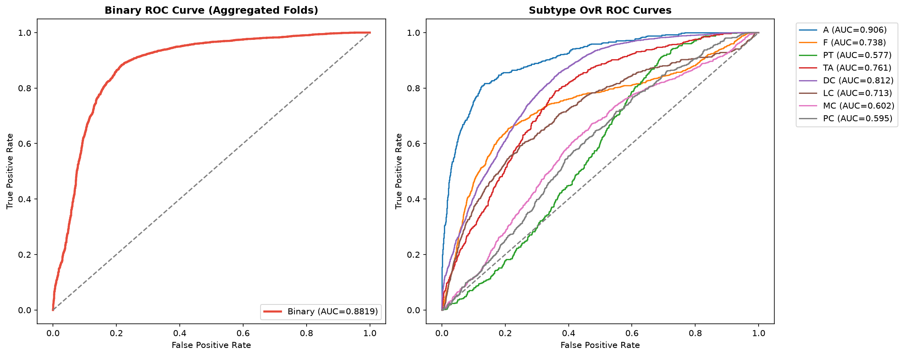
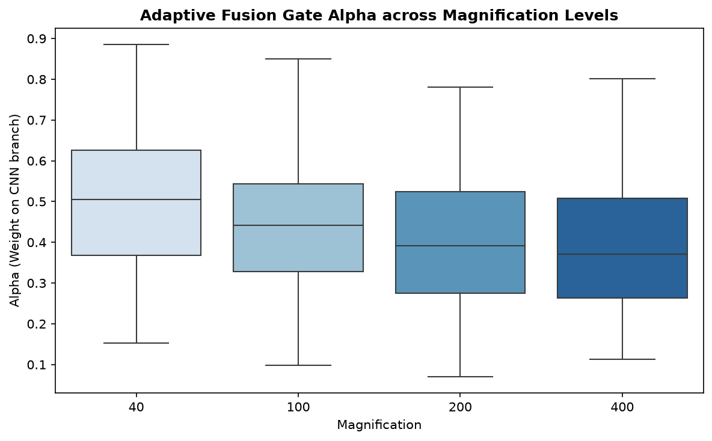
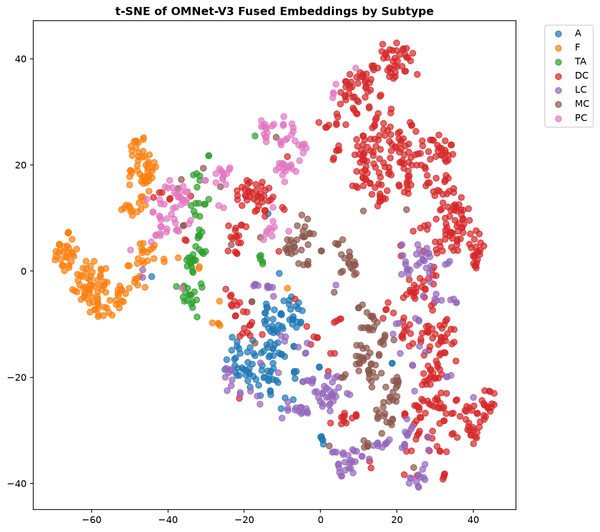

# A Magnification-Aware Dual-Branch Network for Breast Cancer Histopathology Classification

## OMNet Project Report

Department of Information Technology  
Guru Nanak Institute of Technology, Kolkata, India  
Academic session 2025 to 2026  
Revised 6 November 2026

## Abstract

OMNet-V3 investigated magnification-conditioned breast histopathology classification using EfficientNet-B0 and ViT-Tiny/16. Branch features were projected to 256 dimensions and fused by a scalar gate receiving image features and a 64-dimensional magnification embedding. Residual refinement fed binary and eight-class subtype heads, trained locally with weighted cross-entropy and directional probability consistency.

The primary series comprises scores reported in the project's conference paper: binary accuracy was 84.05% with fold standard deviation 3.13 percentage points, and subtype macro-F1 was 24.42% with standard deviation 3.84 points. The local series reported 83.82% and 25.63%, respectively; the cloud series reported 84.56% and 23.45%. Local and cloud are two separately saved runs, kept apart from each other and the primary series. Missing checkpoints and prediction-level records prevent reconciliation; confusion-count reconstructions remain separate from reported fold metrics.

BreaKHis supplied 40X, 100X, 200X and 400X images. Local metadata contained 7,909 unique filenames and 82 subtype-prefixed case groups. Five-fold stratified grouped evaluation used an internal grouped validation holdout. Patient separation needs identity verification because case token `14-13412` occurs under ductal and lobular carcinoma as separate prefixed groups.

Subtype recognition remained difficult, with substantial local failures for phyllodes, mucinous and papillary classes. Cloud-series fold 0 test images gave mean CNN gate weights of 0.685 at 40X and 0.470 at 400X; a local-series gate plot showed the same downward direction. This observational trend establishes neither branch usefulness nor causation. Grouping, augmentation and traceability limitations remain unresolved; matched improvement, external validation and clinical readiness were not established.

## Contents

1. Research problem and scope
2. Related methods and research position
3. Dataset and label structure
4. Grouping, splitting and experimental units
5. Preprocessing and augmentation
6. Dual-branch architecture
7. Hierarchical learning objective
8. Training and implementation
9. Experimental results
10. Fusion analysis and representation studies
11. Error analysis and limitations
12. Conclusions and further work

Appendix A. Experimental records and result reconciliation  
Appendix B. Configuration and reproducibility record  
Appendix C. Metrics and matrices  
References

## Notation and reading conventions

Image x has magnification index m; binary labels are 0 (benign) and 1 (malignant). Subtype order follows the table. B denotes batch size; B x 256 means a 256-element feature per image. Probabilities p and q come from the binary head and grouped subtype head.

Accuracy and F1 are percentages unless stated otherwise; MCC and AUC retain their usual scales. The 4.04-point dispersion around 83.82% is a population standard deviation across five folds, with denominator five, not a confidence interval or relative 4.04% change.

The primary series contains conference-paper scores; cloud and local are separately saved runs. All remain separate. Confusion-count reconstructions check arithmetic without replacing image-level predictions.

### Abbreviations

| Abbreviation | Meaning |
|---|---|
| AUC | Area under the ROC curve |
| CNN | Convolutional neural network |
| ViT | Vision transformer |
| KL | Kullback-Leibler divergence |
| MCC | Matthews correlation coefficient |
| ROC | Receiver operating characteristic |
| OD | Optical density |
| SVD | Singular value decomposition |
| AMP | Automatic mixed precision |
| A | Adenosis |
| F | Fibroadenoma |
| PT | Phyllodes tumor |
| TA | Tubular adenoma |
| DC | Ductal carcinoma |
| LC | Lobular carcinoma |
| MC | Mucinous carcinoma |
| PC | Papillary carcinoma |

## 1. Research problem and scope

### 1.1 Why magnification belongs in the model

Histopathology images contain evidence at several spatial scales. Low magnification shows tissue arrangements across a broad area, while higher magnification reveals smaller cellular structures within a narrower field. Resizing images to identical pixel dimensions does not remove this physical difference. A nucleus occupying the same number of resized pixels can represent a different observation scale. Magnification therefore supplies information about how visual patterns should be interpreted.

OMNet-V3 investigated this information through feature fusion. A convolutional network and a transformer processed the same image, and a learned gate mixed their representations using image features and acquisition magnification. The network received one image and one magnification index per prediction. Although training included 40X, 100X, 200X and 400X images, inference did not combine registered views of the same tissue across these scales. This distinction defines the contextual information actually available to the model. Removing, fixing or shuffling the embedding would test the contribution of metadata, but completed matched V3 comparisons were unavailable.

### 1.2 The two classification tasks

The model produced a benign-versus-malignant prediction and an eight-class subtype prediction. Four subtypes belonged to each coarse group. This hierarchy supported joint supervision because each subtype implied a parent label, while independent heads allowed their predictions to disagree. A ductal carcinoma image predicted as lobular carcinoma was a subtype error but remained in the correct malignant group. Binary accuracy could therefore remain reasonable while fine-grained recognition failed. The report evaluated both tasks separately.

The labels were inherited from the dataset and described image classification. They did not represent tumor grade, stage, receptor status, survival, recurrence or treatment response. The supplied benign grouping of the phyllodes category was a benchmark convention, rather than a statement about every phyllodes tumor in practice. These boundaries matter when interpreting a successful coarse decision: it does not establish a complete diagnostic workup or clinical utility.

### 1.3 Research questions

1. Can the shared representation support a useful coarse decision while learning the harder subtype task?
2. Does the gate change systematically with magnification?
3. Does adding scale metadata improve performance relative to the same network without it?
4. How much of the observed subtype error is associated with limited patient representation?

Chapter 12 answers these questions within the available evidence. Aggregate scores described moderate binary discrimination and weak subtype macro-F1, while gate analysis showed a monotonic change in mean weight. Metadata recounting identified substantial differences in subtype support measured in case groups. Matched ablations were missing, and observed support differences could not isolate the cause of class errors.

### 1.4 Contributions

1. An implemented dual-branch CNN-transformer design with magnification-conditioned fusion and residual refinement.
2. A hierarchical training objective combining binary and subtype supervision with directional probability consistency.
3. A group-aware evaluation across all dataset magnifications, with grouped internal validation and explicit limits on patient-identity verification.
4. Separate primary, local and cloud evidence records, distinguishing reported fold scores from reconstructed confusion-count metrics.
5. An analysis of gate behaviour across magnifications, describing the observed weighting trend without claiming performance improvement or causal attribution.

### 1.5 Scope and organization of the report

The report develops the dataset, validation design, preprocessing, architecture, objective and evaluation. Tensor dimensions, loss direction, split construction, transform order and metric definitions make the implementation interpretable. Configuration differences and failure analysis explain the limits of the measured findings. The primary summary reported 84.05% binary accuracy, while a comparison summary gave about 84.6%; learning rates, precision and reported fold partitions also differed. Subsequent chapters identify the relevant series for each claim, Appendix A records unresolved differences, and Chapter 11 consolidates limitations.

## 2. Related methods and research position

### 2.1 Convolutional feature extraction

Convolutional networks reuse learned filters across spatial positions, providing an inductive bias for texture and repeated structures. OMNet-V3 used pretrained EfficientNet-B0 without its classification layer, retaining a pooled 1,280-dimensional descriptor [[3]](#ref-3). Deeper features and pooling also capture broader tissue arrangements; calling this the local branch does not restrict every feature to cellular evidence. Fine-tuning adapted external pretraining to histopathology, but stain, acquisition and patient-specific shortcuts remained questions for grouped evaluation and external testing.

### 2.2 Transformer feature extraction

The transformer divided a 224 x 224 image into patches of width 16, producing a 14 x 14 grid of 196 image tokens. A class token summarized the sequence, and ViT-Tiny supplied a 192-dimensional representation. Positional information retained spatial placement [[4]](#ref-4). Self-attention combined information within the resized field; it could not recover detail lost through cropping or downsampling. Touvron and colleagues' data-efficient training and attention-based distillation supplied context [[18]](#ref-18), while OMNet-V3 used a configured pretrained backbone without a new distillation experiment. Its exact weight recipe still requires checkpoint linkage.

### 2.3 Feature fusion and magnification conditioning

Concatenation preserves branch coordinates at increased dimension, whereas averaging fixes equal contributions. OMNet-V3 projected both descriptors to 256 dimensions and learned a scalar mixing coefficient from image features and magnification. Unlike four fixed scale weights, this allowed different coefficients at the same magnification. Every feature coordinate nevertheless received the same branch weight. The local residual block also received the embedding, providing another scale pathway. The contribution was this implemented combination with hierarchical supervision; matched controls remain necessary to distinguish complementary features, capacity and training effects.

### 2.4 Patient-aware benchmarking

Priyanka, Narendra and Dilleswar Rao evaluated nine architectures using patient-level GroupKFold and reported mean accuracies from 90.73% to 92.67% [[2]](#ref-2). High accuracy alone therefore cannot diagnose leakage. The methodological lesson is to examine grouping, preprocessing, checkpoint selection and class handling before comparing scores. Their protocol differed from OMNet-V3's subtype-stratified grouped folds with internal validation, so the results provide context rather than a controlled ranking.

### 2.5 Hierarchical classification

OMNet-V3's eight subtypes mapped to two parent groups. Shared features supported both tasks, and a probability regularizer encouraged agreement between independently parameterized heads. Predicting only subtypes and summing their probabilities would guarantee consistency; predicting the parent first would impose a different decision structure. Independent heads permitted a stronger coarse classifier despite subtype uncertainty, but allowed contradictions. A no-consistency control and measured disagreement rate are needed to assess the regularizer's benefit.

### 2.6 Requirements for a fair comparison

A matched experiment would compare CNN-only, transformer-only, fixed-fusion and magnification-aware variants on identical outer folds, validation policies, transformations, class weights, budgets and checkpoint criteria. Parameter counts would clarify whether it tested the complete system, metadata or fusion alone. Two single-backbone baselines, DenseNet-201 and ViT-B/16, were executed at 200X on one patient split and are reported in Chapter 9. Their different protocol leaves a matched V3 comparison missing. V2 supplies development history rather than a controlled V3 ablation; detailed limitations appear in Chapter 11.

### 2.7 Related hybrid studies

Wang and colleagues' MFF-ClassificationNet used CNN-transformer multi-feature fusion [[6]](#ref-6). Fiaz and colleagues' DFViT combined pretrained convolutional features, a vision transformer and an MLP classifier [[7]](#ref-7). Both provide precedents for combining architectural families. Aldakhil, Alhasson and Alharbi's ECSAnet instead refined EfficientNetV2 with channel and spatial attention [[8]](#ref-8), motivating comparison with a single refined backbone. Ashab and colleagues' MagViT used per-scale transformer representations, a gate masking missing scales and patient-level model selection [[11]](#ref-11). Its multi-view input differs from OMNet-V3's single image and categorical magnification embedding.

Table 2.1. Design comparison with selected primary studies. Entries identify methodological controls needed for OMNet-V3, rather than rank scores across protocols.

| Study | Relevant design | Comparison needed for OMNet-V3 |
|---|---|---|
| Priyanka et al. [[2]](#ref-2) | Patient-aware benchmarking | Align grouping, validation and metrics |
| MFF-ClassificationNet [[6]](#ref-6) | CNN-transformer fusion | Isolate scale metadata |
| DFViT [[7]](#ref-7) | CNN-transformer integration | Match inputs, folds and fusion controls |
| ECSAnet [[8]](#ref-8) | EfficientNetV2 with attention | Compare refined single and dual branches |
| MagViT [[11]](#ref-11) | Gated per-scale representations | Distinguish multi-view input from conditioning |

These studies establish relevant alternatives, but no harmonized empirical comparison against OMNet-V3. Task labels, available input information and case separation must agree before scores can establish a ranking. A claim of being the first magnification-aware model would require a systematic prior-work comparison and evidence isolating the conditioning mechanism.

### 2.8 Earlier work on magnification

Bayramoglu, Kannala and Heikkila examined CNN learning across magnifications through magnification-specific and magnification-independent formulations [[12]](#ref-12). Gupta and Bhavsar investigated the same distinction using joint color-texture features and a classifier ensemble [[13]](#ref-13). Learning across scales therefore predates the present architecture. Their relevance is methodological: testing explicit conditioning requires preserving grouping and preprocessing while comparing it against the same dual-branch network trained across all magnifications without scale metadata.

### 2.9 Subtype classification and structured representations

Han and colleagues studied breast tumor multi-classification through structured deep learning [[14]](#ref-14), a different mechanism from OMNet-V3's probability-level hierarchy. Desai and Mahto compared ResNet-18, ResNet-34 and ResNet-50 on eight-class BreaKHis [[15]](#ref-15), discussing lobular-mucinous and phyllodes-fibroadenoma confusions. Their future work included patient-level or leave-one-patient-out splitting, preventing direct patient-disjoint comparison or inference of a patient-count ceiling. Srikantamurthy and colleagues combined convolutional transfer learning with an LSTM for benign and malignant subtype classification [[16]](#ref-16), offering sequence-based feature processing under an unharmonized protocol.

### 2.10 Fusion under class imbalance

Ativi and colleagues' CMAF-Net coupled cross-modal attention fusion, information-theoretic regularization and adaptive class balancing [[17]](#ref-17). This motivates considering interactions between fusion and imbalance: complementary branches may still poorly represent rare classes. Its main evaluation used IDC, rather than eight-subtype BreaKHis, so its relevance concerns design rather than numerical ranking. Adopting such regularization would require a matched ablation and an explicit account of the added objective.

## 3. Dataset and label structure

### 3.1 Dataset and label vocabulary

BreaKHis is a public breast histopathology benchmark introduced by Spanhol and colleagues [[1]](#ref-1). Its eight-class subset contains 2,480 benign and 5,429 malignant images, totaling 7,909 RGB microscopic fields, commonly distributed at 700 x 460 pixels. Training used mirrored distributions of this dataset. Project counts came from saved local filename metadata because the dataset documentation contained inconsistent totals [[1]](#ref-1).

The RGB fields came from the public benchmark rather than a new collection of clinical specimens. The typical 700 x 460 size described the distributed images. Use of dataset mirrors did not independently establish that their files were identical. The provenance description therefore distinguished the public image source from the metadata used for the project-specific recount.

Subtype indices 0 to 7 corresponded, in order, to A Adenosis, F Fibroadenoma, PT Phyllodes tumor, TA Tubular adenoma, DC Ductal carcinoma, LC Lobular carcinoma, MC Mucinous carcinoma and PC Papillary carcinoma. A through TA had binary index 0 (benign); DC through PC had binary index 1 (malignant). The ordering is part of the model specification. The first four subtype probabilities were summed for benign probability and the last four for malignant probability; changing the ordering would change the consistency target. Confusion matrices and plots used this same vocabulary.

### 3.2 Image and case-group support

Table 3.2 counts subtype, magnification and subtype-prefixed case groups. The metadata contained 7,909 records and 7,909 unique image names, with matching subtotals. Benign counts at 40X, 100X, 200X and 400X were 625, 644, 623 and 588; malignant counts were 1,370, 1,437, 1,390 and 1,232. The saved benign 40X count was 625, whereas the dataset website displayed 652. These values were not interchangeable.

Table 3.2. Image counts and subtype-prefixed case-group counts from saved metadata.

| Subtype | 40X | 100X | 200X | 400X | Images | Groups |
|---|---|---|---|---|---|---|
| A | 114 | 113 | 111 | 106 | 444 | 4 |
| F | 253 | 260 | 264 | 237 | 1,014 | 10 |
| PT | 109 | 121 | 108 | 115 | 453 | 3 |
| TA | 149 | 150 | 140 | 130 | 569 | 7 |
| DC | 864 | 903 | 896 | 788 | 3,451 | 38 |
| LC | 156 | 170 | 163 | 137 | 626 | 5 |
| MC | 205 | 222 | 196 | 169 | 792 | 9 |
| PC | 145 | 142 | 135 | 138 | 560 | 6 |
| Total | 1,995 | 2,081 | 2,013 | 1,820 | 7,909 | 82 |

Figure 3.1. BreaKHis image and subtype-prefixed case-group counts from Table 3.2. Separate panels distinguish image support from contributing groups; these are dataset counts rather than model results.

Malignant images accounted for approximately 68.64% of the metadata, so an always-malignant classifier would reach 68.64% pooled image accuracy. Ductal carcinoma contributed about 43.63%, making always-DC prediction a reference for subtype accuracy. Ductal carcinoma had 38 groups, while phyllodes tumor had three. Repeated fields supplied appearance variation without creating independent patients; hundreds of PT images could represent only two individuals when the third group was held out. Few groups limited diversity and made rare-class estimates unstable, without establishing a performance ceiling.

Case support was more informative about independent patients than the number of repeated fields. Fields from the same case supplied variation in appearance and scale, while remaining observations from that case. For PT, the contrast between hundreds of images and only three contributing groups made this distinction concrete. Holding out the third group could leave training with only two individuals. The image total therefore did not describe the breadth of independent case material available for learning or evaluation.

Figure 3.2. Saved 200X BreaKHis example fields from the earlier V2 data pipeline, with benign tissue above and malignant tissue below. They illustrate tissue appearance and colour variation, rather than V3 predictions.

### 3.3 Scope of the metadata check

The recount established agreement among filenames, class totals, magnification totals and group counts. It did not verify image bytes, visual duplicates, diagnoses or agreement between mirrors. Patient demographics, specimen inventories, scanner and institution information were not independently verified. These limits and rare-case support are discussed in Chapter 11; the metadata alone did not support fairness or scanner-robustness claims.

The procedure grouped records by subtype and magnification, then counted distinct parsed group identifiers separately. Agreement among these summaries established internal consistency of the listed metadata. Unique filenames addressed name duplication, while identical content under different names and visually similar fields required image-level checks. Likewise, agreement in the label counts did not independently validate the pathology annotations. The recount also identified the case-token collision considered in Chapter 4.

## 4. Grouping, splitting and experimental units

### 4.1 Filename parsing and group identity

The parser read image names such as `SOB_B_TA-14-4659-40-001.png`. The underscore-separated prefix supplied procedure, coarse class and subtype. Hyphen-separated fields supplied the year-and-case portion, magnification and sequence number. The penultimate token supplied magnification; joining the middle tokens preserved the complete case portion, including suffixes. For this example, subtype was TA, case portion was `14-4659`, magnification was 40 and sequence was 1. The resulting group identifier, `TA_14-4659`, excluded magnification and sequence, keeping related fields and scales together. Sequence `001` was not a patient identifier.

Case portion `14-13412` occurred under both DC and LC, producing `DC_14-13412` and `LC_14-13412`: 82 prefixed groups but 81 unprefixed portions. Whether these referred to one person was unknown. Evaluation was therefore described as disjoint by subtype-prefixed case group; a definitive patient-level guarantee required the original identity mapping. This uncertainty did not itself establish cross-fold leakage.

### 4.2 Outer folds and internal validation

Both V3 procedures used `StratifiedGroupKFold` with five splits, shuffling and seed 42. Subtype supplied the stratification target and parsed identifiers supplied the grouping constraint. Figure 4.1 distinguishes the outer test partition from the validation holdout used within the development pool. Stratification attempted label balance while preserving groups, but unequal group sizes prevented exact balance. With only three PT groups, PT could not appear in all five test folds.

Under the group constraint, stratification attempted to distribute subtype labels without dividing a parsed group between development and test. Groups with unequal image counts could not be divided to make the image-level label proportions match exactly. The available group support also constrained subtype coverage: three PT groups could not supply PT examples to every test fold in a five-fold evaluation. This restriction followed from the available cases; it did not indicate a defect in the splitter.

Figure 4.1. V3 evaluation protocol showing outer folds, the development pool, internal validation holdout and test partition. Validation supported checkpoint selection; the outer test partition supplied evaluation images, with separation defined by parsed groups.

Table 4.1. Recorded local outer-fold sizes. Development includes the later validation holdout.

| Fold | Development images | Development groups | Test images | Test groups |
|---|---|---|---|---|
| 0 | 6,353 | 66 | 1,556 | 16 |
| 1 | 6,380 | 66 | 1,529 | 16 |
| 2 | 6,320 | 66 | 1,589 | 16 |
| 3 | 6,207 | 64 | 1,702 | 18 |
| 4 | 6,376 | 66 | 1,533 | 16 |

Test counts summed to 7,909 images and 82 groups. No complete V3 fold manifest was available, so this local summary did not confirm a different reported partition. Within development, validation selection used the integer part of 10% of groups, with a minimum of one group. Development pools of 64 or 66 groups therefore supplied six validation groups; the remaining groups supplied training images.

Recorded fold 0 contained 5,829 training images from 60 groups, 524 validation images from six groups and 1,556 test images from 16 groups. Fold 1 contained 5,748 training, 632 validation and 1,529 test images, with the same 60/6/16 group counts. Complete equivalent epoch logs were unavailable for all five folds. Validation sampling used a list built from a Python set, whose order could vary across interpreter sessions; sorting and exporting identifiers would improve reproducibility.

### 4.3 Metric units and absent classes

The model predicted one label per image, and accuracy and F1 were computed over test images. Group separation did not make these patient-level metrics: cases contributing more images contributed more observations. Images from one case were correlated, and no patient-level score was available. Patient evaluation would require an aggregation rule specifying probability pooling, magnification weighting and handling of subtype annotations within a verified patient.

Local fold 0 had no PT test images and fold 2 had no A test images. Recall for an absent true class was undefined. Local subtype macro-F1 used `zero_division=np.nan` without a fixed eight-label list, so effective class handling depended on observed and predicted labels and undefined entries. Cloud used a different undefined-score setting; the summaries could not be described as averaging identical fixed class sets. The identity, manifest, sampling, support and evaluation-unit limitations are detailed in Chapter 11.

## 5. Preprocessing and augmentation

### 5.1 Input preparation and spatial transforms

The local dataset class opened images with Pillow, converted them to RGB and returned the transformed tensor with binary label, subtype index, magnification index, group identifier and source path. These fields linked predictions to cases and magnifications. Training first resized each field to 256 x 256, then applied a random resized crop to 224 x 224 with area scale between 0.8 and 1.0, random horizontal and vertical flips, and rotation by up to 20 degrees. Stain perturbation was then attempted with probability 0.5, followed by tensor conversion and ImageNet normalization. Both backbones received the same transformed tensor.

Resizing 700 x 460 fields to a square changed their aspect ratio, while cropping could remove subtype-relevant structures. Validation and test used resize to 256 x 256 followed by a deterministic 224 x 224 center crop, without random flips, rotation or stain perturbation. The crop retained 76.56% of the square's area: 224 squared divided by 256 squared equals 0.765625. This supplied a repeatable view while removing edge tissue. No ablation compared these choices with aspect-preserving resizing or higher-resolution inputs.

### 5.2 Normalization and cloud differences

ImageNet normalization used channel means 0.485, 0.456 and 0.406 and standard deviations 0.229, 0.224 and 0.225. For channel value u scaled from zero to one, the normalized value was `(u - mean) / standard_deviation`. This matched pretrained input scaling; it did not normalize stains or standardize biological colour meaning across laboratories. In the cloud procedure, stain perturbation was applied to the opened training image before the composed spatial transform. Cloud also used a random crop rather than the local random resized crop. These preprocessing differences formed part of the distinction between cloud and local experiments.

### 5.3 Optical-density model

Stain augmentation attempted to vary colour while preserving spatial structures, reducing reliance on incidental preparation or imaging patterns. Its intended optical-density representation followed the motivation of Macenko-style processing [[5]](#ref-5). Intensity was mapped to optical density, decomposed into basis directions and concentrations, perturbed, and reconstructed as intensity. For intensity I and reference intensity I0, the natural-logarithm form was:

    OD = -ln(max(I / I0, epsilon))                         (5.1)

Epsilon prevented a logarithm of zero. For N pixels, OD was an N x 3 matrix, approximated by N x 2 concentration coordinates C and a 2 x 3 basis H:

    OD approximately equals C H                           (5.2)
    I_reconstructed = I0 exp(-C_perturbed H)                (5.3)

With base-10 logarithms, the matching inverse was `I0 * 10^(-OD)`. Cloud used base-10 OD and the matching power-of-ten reconstruction. Local used a natural logarithm but did not apply the matching exponential inverse. The forward and inverse conventions must agree for reconstructed values to represent image intensity.

### 5.4 Implemented local perturbation

In the local function, SVD of the OD matrix provided the first two rows of Vh as basis vectors. The code projected OD onto those vectors, rescaled the two coordinates by independently sampled factors between 0.85 and 1.15, added biases between -0.05 and 0.05, and projected back into three channels. It then clipped the reconstructed OD array to zero through one and multiplied it by 255. This last operation treated density as intensity and was not Equation 5.3.

The defective inverse could produce severe colour changes and clipping, with contrast changes unlike realistic stain variation. Its effect on accuracy was not isolated. Local used principal SVD directions directly, rather than cloud's angular percentile construction; these directions identified a subspace, not chemically identified hematoxylin and eosin vectors. The implemented method was therefore an SVD-based OD perturbation with a reconstruction defect. Correcting it would change training inputs and require retraining before replacing reported scores; see Chapter 11.

A future check should save original images, evaluation crops and seeded augmentations, test unperturbed reconstruction, and record clipping and fallback rates. Cloud returned the original image on exceptions, which should not count as successful perturbation.

## 6. Dual-branch architecture

### 6.1 Local architecture and feature extraction

The local implementation combined two pretrained branches, normalized projections, a feature-and-magnification gate, residual refinement and direct linear heads. Each batch contained images of shape B x 3 x 224 x 224 and integer magnification indices of shape B. Indices zero to three represented 40X, 100X, 200X and 400X. Both branches processed the same image, while a learned embedding supplied its magnification context.

The CNN used `timm.create_model` with `efficientnet_b0`, pretrained weights and `num_classes=0`. Its `forward_features` output passed through global pooling; any remaining four-dimensional tensor was flattened across non-batch dimensions. A linear projection reduced the 1,280-dimensional descriptor to 256 dimensions, followed by LayerNorm with learned scale and bias. This projection selected combinations of backbone features for the shared task, while normalization controlled their per-sample representation. The local projection contained neither ReLU nor dropout, so its normalized feature could retain positive and negative values. Their relative scales influenced the later weighted sum.

The transformer used pretrained `vit_tiny_patch16_224` with its classifier removed. After `forward_features`, the local method took the first element if the returned object was a sequence, then selected token zero from a three-dimensional feature tensor. Its 192-element descriptor was projected to 256 dimensions and normalized with LayerNorm. Matching dimensions permitted elementwise blending; the projections and shared objective learned the coordinates used for fusion. A 16 x 16 patch at 224-pixel resolution could lose fine cellular detail, so attention across tokens did not establish high-resolution cellular analysis.

### 6.2 Magnification-aware fusion and refinement

The embedding contained four rows of 64 learned values. Let c_i and v_i denote projected CNN and transformer vectors, and e_i the magnification embedding. A linear gate and sigmoid produced a scalar mixing weight:

    a_i = sigmoid(w_g^T [c_i ; v_i ; e_i] + b_g)            (6.1)
    u_i = a_i c_i + (1 - a_i) v_i                          (6.2)

Figure 6.1. Local-series architecture and tensor dimensions. The branches supplied complementary feature representations; magnification conditioned their blend and its residual correction. Dimensions omit the batch axis.

The gate received 576 coordinates and could vary between images at one magnification. Values near one increased the direct CNN contribution; values near zero increased the transformer contribution. The categorical embedding imposed no ordered progression across magnifications. The sigmoid bounded the blend without a manually prescribed scale rule.

Residual refinement concatenated u_i and e_i into 320 coordinates. Its first linear layer mapped these to 256, followed by GELU, training dropout with probability 0.3 and another 256-to-256 linear layer. The correction and prediction heads were:

    r_i = W_2 Dropout(GELU(W_1 [u_i ; e_i] + b_1)) + b_2  (6.3)
    h_i = u_i + r_i                                       (6.4)
    z_binary = W_binary h_i + b_binary                    (6.5)
    z_subtype = W_subtype h_i + b_subtype                  (6.6)

The identity-plus-correction structure followed residual learning [[19]](#ref-19). It allowed scale-conditioned nonlinear refinement after blending. Consequently, alpha was not the proportion of the final decision attributable to each branch: feature norms and the residual changed its effect. The direct heads had two and eight outputs, without a hidden 128-dimensional layer. Cross-entropy consumed their logits; softmax and argmax supplied probabilities and image-level predictions during analysis.

### 6.3 Parameter accounting

A biased linear layer has `d*k + k` parameters; LayerNorm over 256 coordinates adds 512. Table 6.2 gives algebraic counts for the added local modules, rather than a measured checkpoint total. Whole-model accounting requires the exact instantiated backbones with their classifiers removed; see Chapter 11. Backbone counts should come from the model associated with each checkpoint, since a model-family summary does not verify the instantiated version.

Table 6.2. Local added-module parameter counts. Calculations include biases and LayerNorm parameters; the total excludes both pretrained backbones.

| Module | Calculation | Parameters |
|---|---|---|
| CNN projection plus LayerNorm | 1,280*256 + 256 + 512 | 328,448 |
| Transformer projection plus LayerNorm | 192*256 + 256 + 512 | 49,920 |
| Magnification embedding | 4*64 | 256 |
| Gate | 576*1 + 1 | 577 |
| Residual first linear layer | 320*256 + 256 | 82,176 |
| Residual second linear layer | 256*256 + 256 | 65,792 |
| Binary head | 256*2 + 2 | 514 |
| Subtype head | 256*8 + 8 | 2,056 |
| Total added parameters | Sum of rows | 529,739 |

### 6.4 Separate cloud formulation

The cloud formulation added ReLU and dropout after projection LayerNorm. Its gate used 576-to-128-to-1 layers with ReLU and had 73,985 parameters, compared with the local gate's 577. Cloud refinement used a 256-to-256 linear layer, LayerNorm, GELU and dropout, with 66,304 parameters, instead of the local residual block. Probability MSE replaced local directional KL with a detached binary target. These functional differences required separate treatment of the cloud series; the incomplete execution linkage did not authenticate a cloud checkpoint architecture count.

## 7. Hierarchical learning objective

### 7.1 Supervised losses and class weights

The local objective combined weighted cross-entropy for binary and subtype classification with a consistency penalty. Both tasks used integer labels and `CrossEntropyLoss`; the binary task used two logits. For class k with n_k training images, inverse-frequency weights were proportional to `N / (K*n_k)`, where N was the training image count and K the class count. Weights were computed after removing validation groups, preserving two binary and eight subtype entries. The local routine returned these weights directly; the cloud helper also divided each vector by its mean.

For probabilities s and class weights w, weighted mean cross-entropy was:

    L_CE = -sum_i w[y_i] ln(s_i[y_i]) / sum_i w[y_i]        (7.1)

A common weight scaling cancelled between numerator and denominator. The denominator summed target weights rather than counting images, affecting the supervised loss scale relative to the separately averaged consistency term. Inverse-frequency weighting emphasized rare training classes but could not supply missing examples. The cloud helper used sorted observed counts, which preserved the required label order only when all classes occurred. Class support therefore needed checking before weight construction.

### 7.2 Grouped subtype probabilities

Let s_i be the eight-way subtype softmax. Grouping the probabilities produced a binary distribution q_i:

    q_i[0] = s_i[A] + s_i[F] + s_i[PT] + s_i[TA]           (7.2)
    q_i[1] = s_i[DC] + s_i[LC] + s_i[MC] + s_i[PC]         (7.3)

The benign group comprised Adenosis (A), Fibroadenoma (F), Phyllodes tumor (PT) and Tubular adenoma (TA). The malignant group comprised Ductal carcinoma (DC), Lobular carcinoma (LC), Mucinous carcinoma (MC) and Papillary carcinoma (PC). The direct binary softmax p_i described the same groups. Summation retained uncertainty across subtypes: several malignant probabilities could jointly support malignancy without any one subtype dominating. Comparing integer argmax labels would discard that information.

### 7.3 Directional consistency and gradients

The local implementation called `F.kl_div(log(grouped), consistency_target, reduction='batchmean')`, with the binary softmax detached as `consistency_target`. Under this input-target convention, the KL direction was from the binary reference to the grouped subtype distribution:

    L_cons = (1/B) sum_i sum_g p_i[g] ln(p_i[g] / q_i[g])   (7.4)

The logarithm of q was protected by a minimum value of 1e-8. KL was asymmetric, so reversing the distributions would change the penalty and gradients. Detaching p treated the binary probabilities as fixed targets during that backward pass. Consistency gradients passed through q into the subtype head and shared representation, but not directly through p into the binary head. Binary supervised cross-entropy still trained that head, and shared-feature updates could still affect its predictions.

### 7.4 Combined objective and interpretation

The configured coefficients were:

    L = 0.3 L_binary + 0.6 L_subtype + 0.1 L_consistency    (7.5)

The subtype term received the largest coefficient, expressing a training preference. Actual gradient sizes also depended on class weights, predictions, batch composition and loss reductions. Independently parameterized heads could still yield contradictory argmax predictions. Grouped probability agreement did not guarantee agreement between the binary argmax and the parent of the largest subtype probability. Measuring those disagreements required paired per-image outputs; see Chapter 11.

Effective-number weighting [[20]](#ref-20) and focal loss [[21]](#ref-21) were alternatives for controlled comparison, not components of this objective. The former changed how support determined weights; the latter reduced contributions from well-classified examples. Neither supplied independent patient diversity. Weighted training also did not establish calibrated malignancy risk. Calibration and predictive accuracy required separate assessment, as discussed by Guo and colleagues [[25]](#ref-25).

### 7.5 Cloud consistency difference

The cloud formulation used mean squared differences between direct binary and grouped subtype probabilities. Its expression detached neither distribution, allowing consistency gradients through both heads. MSE was bounded for probability inputs, whereas KL could become large when grouped probability approached zero under a positive reference. Equal coefficients therefore did not make the penalties equivalent. The saved cloud scores and unavailable checkpoint linkage did not establish which penalty performed better.

## 8. Training and implementation

### 8.1 Local configuration

The local series used batch size 16, input size 224, five folds, a maximum of 30 epochs, five frozen-backbone warmup epochs and early-stopping patience eight. Backbone and added-module learning rates were 1e-5 and 1e-4; weight decay was 1e-4, gradient clipping used maximum norm 1.0, and AMP was disabled. AdamW applied decoupled weight decay [[22]](#ref-22) to two parameter groups: both backbones, and the projections, fusion module and heads. The optimizer construction specified no separate no-decay exclusions for bias or normalization parameters. No gradient accumulation was specified.

The primary description instead listed backbone and head rates of 1e-4 and 5e-4. The cloud configuration used those larger rates with FP32 and no AMP. These records described separate series, rather than a single shared recipe. Their differences were retained when interpreting results.

Figure 8.1. Local-series training loop. Validation subtype macro-F1 governed checkpoint retention and patience; the selected checkpoint was used for outer-test evaluation. Backbone unfreezing changed trainable parameters after warmup.

### 8.2 Warmup and fine-tuning

Backbone parameters had `requires_grad` disabled for epochs one through five and enabled from epoch six. This was frozen-feature warmup, not a linear learning-rate ramp. The cosine scheduler progressed across the configured 30-epoch budget, including frozen epochs. Backbone updates therefore began below the initial learning rate.

The fold routine called `.eval()` on backbones during warmup, but `train_one_epoch` began with `model.train()`. That recursive reset could undo the intended evaluation mode, permitting batch-normalization statistics to change despite frozen parameters. Frozen parameters consequently did not guarantee frozen running statistics. Enforcing the intended mode would require an implementation change and new experiments; see Chapter 11.

### 8.3 Training procedure

Within each outer fold, validation groups were held out from the development portion before training and weight construction. Each training batch supplied images, magnification indices and both labels. The model produced both logits, the hierarchical objective was evaluated, gradients were computed and clipped, and AdamW updated trainable parameters. Validation then measured the selection criterion without a training update. The cosine scheduler stepped once after training and validation each epoch.

### 8.4 Checkpoint selection and logged behaviour

A checkpoint was retained whenever validation subtype macro-F1 improved, and a counter tracked epochs without improvement. Early stopping could end training before the configured budget. Selection prioritized subtype performance even if binary performance peaked elsewhere. The executed single-backbone baselines also selected checkpoints using validation subtype F1. The selected checkpoint was then evaluated on the outer test portion.

Fold 0 reached its best validation subtype macro-F1 of 0.1512 at epoch 8 and stopped at epoch 16; its logged test subtype macro-F1 was 0.3028. Across 21 logged epochs in partial fold 1, validation subtype macro-F1 stayed between 0.0525 and 0.1001 and validation binary F1 between 0.4191 and 0.4920. Training loss continued its downward trend meanwhile. The six-group validation holdout provided a low and noisy selection signal that was not necessarily representative of the test portion. The aggregate summary reported five completed folds, but retained curves covered only complete fold 0 and partial fold 1.

Figure 8.2. Local-series training loss and validation subtype macro-F1 on separate axes. Fold 0 is complete and fold 1 partial; curves for missing folds were not reconstructed.

### 8.5 Hardware and timing

The local runtime identified an AMD Radeon RX 9060 XT with total device memory 15.92 GiB, PyTorch 2.13.0+rocm7.2 and HIP 7.2.53211. Logged epochs took 97.9 to 103.4 seconds with frozen backbones during epochs 1 to 5, and 178.0 to 194.0 seconds after unfreezing. These recorded bounds described per-epoch durations; peak memory and total run time were not recorded. The primary description identified a Tesla T4 with mixed precision, while the cloud formulation had an ROCm-oriented FP32 configuration without a linked runtime record. No controlled latency measurement accompanied the results.

### 8.6 Reproducibility

Seed 42 initialized Python, NumPy and PyTorch, with fold-dependent seeds for validation sampling. Dependencies used lower bounds rather than locked versions. Exact reproduction required the dataset manifest, implementation revision, environment, fold assignments, configuration and checkpoint-selection record. Missing checkpoints and prediction-level outputs limited independent reconstruction; see Chapter 11.

## 9. Experimental results

Results are reported by series, because the series differ in their scores and in the evidence retained for them. Table 9.1 lists what exists for each one.

Table 9.1. Evidence available for each result series. Yes indicates retained evidence, Partial indicates incomplete coverage, and No indicates no retained evidence of that kind.

| Result series | Aggregate scores | Confusion counts | ROC plot | Gate record | Per-epoch log | Per-image predictions |
|---|---|---|---|---|---|---|
| Primary (conference paper) | Yes | No | No | No | No | No |
| Cloud | Yes | Yes | Yes | Yes | No | No |
| Local | Yes | Yes | Yes | Yes | Partial | No |
| V2 | Yes | Yes | Yes | No | No | Yes |
| Baselines | Yes | Yes | No | No | Partial | No |

Table 9.1 distinguishes available measurements from the underlying prediction evidence. Primary evidence comprised aggregate scores and AUC only. Cloud gate evidence was a summary, while local evidence included a gate plot and a partial epoch log. Baseline outputs included test summaries, confusion displays and training output; V2 supplied the detailed prediction check discussed below. Evidence availability did not make the protocols interchangeable.

### 9.1 Three result records

Table 9.2 presents the primary, cloud and local series separately. Their differing scores accompanied different methodological descriptions, so none was substituted for another. Within-series agreement between summaries established consistency of reporting, rather than independent replication. The table describes performance across folds; pooled counts are considered separately below.

Table 9.2. Reported fold means and dispersions. Percentage metrics use percent and percentage points; MCC uses its original scale. Primary and cloud dispersions are reproduced as reported; local aggregation uses population fold standard deviation.

| Metric | Primary reported series | Cloud series | Local series |
|---|---|---|---|
| Binary accuracy | 84.05 ± 3.13 | 84.56 ± 2.48 | 83.82 ± 4.04 |
| Binary macro-F1 | 79.89 ± 3.66 | 80.32 ± 3.13 | 81.24 ± 5.14 |
| Binary balanced accuracy | 80.84 ± 3.66 | 81.07 ± 3.26 | 82.37 ± 4.38 |
| Binary MCC | 0.6074 ± 0.0679 | 0.6175 ± 0.0532 | 0.6364 ± 0.1018 |
| Subtype accuracy | 45.29 ± 7.65 | 44.01 ± 6.38 | 42.86 ± 4.69 |
| Subtype macro-F1 | 24.42 ± 3.84 | 23.45 ± 4.30 | 25.63 ± 5.03 |
| Subtype weighted-F1 | 46.08 ± 6.51 | 44.75 ± 5.89 | 42.02 ± 5.40 |
| Subtype balanced accuracy | 35.35 ± 7.13 | 32.93 ± 4.70 | 30.50 ± 5.80 |
| Subtype MCC | 0.2975 ± 0.0630 | 0.2738 ± 0.0504 | 0.2565 ± 0.0570 |

### 9.2 Reading the headline scores

All three series showed a substantial gap between coarse and fine-grained classification. Binary accuracy was around 84%, whereas subtype macro-F1 was around one quarter of its maximum. Accuracy gave common classes more image weight; macro-F1 weighted class F1 values equally under the evaluator's class-handling convention. MCC provided a complementary confusion-matrix summary under imbalance [[24]](#ref-24). These metrics therefore answered different questions about the same classification task.

The full dataset's always-malignant reference had 68.64% image accuracy. The binary records exceeded that descriptive reference, but it was not an actual same-fold baseline. For subtypes, the 43.63% pooled accuracy of an always-DC rule was close to the reported accuracies. Learned predictions were not equivalent to that rule, but accuracy in the low forties alone did not demonstrate useful eight-class recognition. Class recall and macro-F1 were needed to interpret that result.

### 9.3 Pooled matrix results

Integer counts in the saved matrices were checked against class support and used for the pooled metrics in Table 9.3. Figures 9.1 and 9.2 show the local matrices; Appendix C supplies the complete local subtype matrix. This was an arithmetic check of annotated counts. The broader evidence and evaluation limitations are discussed in Chapter 11.

Table 9.3. Pooled image metrics calculated from annotated figure counts. These are not fold means.

| Source matrix | Accuracy | Macro-F1 | Weighted-F1 | Balanced accuracy | MCC |
|---|---|---|---|---|---|
| Local binary | 83.82% | 81.79% | 84.06% | 82.91% | 0.6390 |
| Local subtype | 42.72% | 27.58% | 42.08% | 29.88% | 0.2548 |
| Cloud binary | 84.51% | 81.98% | 84.50% | 81.93% | 0.6396 |
| Cloud subtype | 44.03% | 27.30% | 43.23% | 27.14% | 0.2546 |

Pooling counts before calculating nonlinear class scores differs from averaging scores calculated within folds. Missing-class conventions can also affect a fold mean. The local pooled accuracy was close to its fold mean, while subtype macro-F1 differed appreciably; both calculations are therefore labelled explicitly. The cloud binary matrix used counts 1,860, 620, 605 and 4,824. An alternative binary summary contained 1,870, 610, 657 and 4,772 and implied a different accuracy. Table 9.3 used the first set, without combining the alternatives.

### 9.4 Local binary errors

The local matrix contained 1,996 true benign predictions, 484 benign images classified as malignant, 796 malignant images classified as benign and 4,633 true malignant predictions. Row totals matched 2,480 benign and 5,429 malignant images. Pooled accuracy was `(1,996 + 4,633) / 7,909`, or 83.8159%. These counts show the contributions of both classes to the aggregate result.

Figure 9.1. Local pooled binary confusion counts. Rows are true labels and columns are predictions; row percentages accompany the integer counts.

Sensitivity was 85.34%, specificity was 80.48%, and malignant precision was 90.54% in this image mixture. The false-negative rate was 14.66% of malignant images and the false-positive rate was 19.52% of benign images. False negatives were more numerous because malignant images were more common, even though their row error rate was lower. These are image errors; patient-level interpretation and prevalence dependence are addressed in Chapter 11.

### 9.5 Subtype performance and recurring confusions

The local subtype matrix contained 3,379 correct predictions out of 7,909, including 2,269 correct ductal carcinoma predictions. The diagonal sum therefore needed to be read alongside individual classes. Table 9.4 reports precision, recall and F1 with the true-image support for each subtype. The codes mean A Adenosis, F Fibroadenoma, PT Phyllodes tumor, TA Tubular adenoma, DC Ductal carcinoma, LC Lobular carcinoma, MC Mucinous carcinoma and PC Papillary carcinoma.

Table 9.4. Per-class metrics from local figure counts. Scores are percentages; support counts true images. Subtype codes are defined immediately above.

| Subtype | Support | Precision | Recall | F1 |
|---|---|---|---|---|
| A | 444 | 42.39 | 58.33 | 49.10 |
| F | 1,014 | 37.36 | 36.29 | 36.82 |
| PT | 453 | 4.29 | 1.55 | 2.27 |
| TA | 569 | 17.66 | 34.80 | 23.43 |
| DC | 3,451 | 68.63 | 65.75 | 67.16 |
| LC | 626 | 25.94 | 29.71 | 27.70 |
| MC | 792 | 10.58 | 9.22 | 9.85 |
| PC | 560 | 6.01 | 3.39 | 4.34 |

PT had seven correct local predictions and 277 predictions as F; PC had 19 correct predictions and 310 as DC. MC had 73 correct predictions, with substantial predictions as DC and LC. Table 9.5 shows recurring PT-to-F, PC-to-DC, MC-to-DC and LC-to-MC errors in both series. LC correct counts differed markedly, at 186 locally and 42 in cloud, as did MC correct counts, at 73 and 197. Similar aggregate performance thus coexisted with different class-specific outcomes. Recurrent off-diagonal routes identified concrete errors shared across the saved matrices, while the correct-prediction rows exposed differences that an overall score obscured. These observations described the recorded predictions and did not identify a cause of the differences between the series. Adenosis recall was more favorable than that of several classes with more images, so image count alone did not explain the pattern.

Figure 9.2. Local pooled subtype counts in the subtype order defined in the text. The ductal carcinoma diagonal dominates the total, while several smaller classes have weak diagonals.

Table 9.5. Main confusions recorded in the local and cloud series. Entries are integer image counts; support is the true-subtype total in each series, and the final rows show correct predictions.

| True subtype | Wrongly predicted subtype (or correct label) | Local count | Cloud count | Support (images) |
|---|---|---|---|---|
| Phyllodes tumor | Fibroadenoma | 277 | 260 | 453 |
| Papillary carcinoma | Ductal carcinoma | 310 | 276 | 560 |
| Mucinous carcinoma | Ductal carcinoma | 272 | 270 | 792 |
| Lobular carcinoma | Mucinous carcinoma | 184 | 188 | 626 |
| Lobular carcinoma | Lobular carcinoma (correct) | 186 | 42 | 626 |
| Mucinous carcinoma | Mucinous carcinoma (correct) | 73 | 197 | 792 |

### 9.6 ROC evidence

The separate binary AUC records were 0.8945 for primary, 0.8980 for cloud and 0.8819 for local. Figure 9.3 presents the saved local curves, and Figure 9.4 compares the recorded subtype AUCs. AUC measures ranking across thresholds, whereas a confusion matrix describes discrete decisions. Consequently, an AUC cannot be derived from a single matrix or interpreted as that matrix's expected accuracy.

Local AUC was highest for A at 0.906 and lowest for PT at 0.577, PC at 0.595 and MC at 0.602. The other local legend values were F 0.738, TA 0.761, DC 0.812 and LC 0.713. Cloud legend values for PT and PC were 0.525 and 0.442. A separate ROC description gave 0.590 and 0.490, respectively; those descriptions remain distinct. Ranking performance and the subtype decision errors therefore required separate interpretation.

Figure 9.3. Saved local binary and one-versus-rest subtype ROC curves. The binary legend reports 0.8819; the subtype legend shows uneven ranking performance across classes.

An image assigned the wrong eight-way class could still receive a useful relative probability for its true class in a one-versus-rest ranking. This distinction mattered for the low-recall PT, PC and MC classes: their discrete errors and their ranking results described different aspects of performance. A ranking score therefore did not replace the class recall shown by the matrix.

Figure 9.4. Recorded local and cloud one-versus-rest subtype AUCs. Codes follow the subtype key in Section 9.5; each series retains its own recorded values.

### 9.7 V2 as project history

V2 studied binary classification at 200X with EfficientNet-B0, ViT-B/16 and a soft-voting ensemble. Its task, transformer size, magnification coverage and training design differed from V3. Table 9.6 preserves its saved test summary. Its F1 column concerned the malignant class and must not be read as subtype or binary macro-F1.

Table 9.6. Saved V2 test summary. F1 is malignant-class F1, not macro-F1.

| Model | Accuracy | Malignant F1 | Sensitivity | Specificity | ROC-AUC |
|---|---|---|---|---|---|
| EfficientNet-B0 | 81.79% | 87.94% | 94.90% | 51.19% | 0.8712 |
| ViT-B/16 | 84.29% | 89.67% | 97.45% | 53.57% | 0.8998 |
| Soft-voting ensemble | 84.29% | 89.57% | 96.43% | 55.95% | 0.8973 |

The detailed V2 prediction CSV had 280 rows, with TN 45, FP 39, FN 5 and TP 191. These matched the rounded ViT-B/16 row rather than identifying a separate ensemble evaluation. Recalculation gave malignant F1 89.6714%, benign F1 67.1642% and macro-F1 78.4178%. This demonstrated the numerical distinction between malignant F1 and macro-F1. The V2 manifest listed 56 training groups, 13 validation groups and 13 test groups with empty pairwise intersections under its identifiers; identity qualifications are discussed in Chapter 11.

### 9.8 Executed single-backbone baselines

Two single-backbone networks were also run at 200X on one patient-level split. Table 9.7 gives their recorded test scores.

Table 9.7. Executed baseline test scores as recorded decimal fractions. Split entries give training, validation and test images, followed by patients in the same order.

| Backbone | Magnification | Split images | Split patients | Test subtype accuracy | Subtype macro-F1 | Binary accuracy |
|---|---|---|---|---|---|---|
| DenseNet-201 | 200X | 1,444 / 289 / 280 | 56 / 13 / 13 | 0.5107 | 0.2556 | 0.7679 |
| ViT-B/16 | 200X | 1,444 / 289 / 280 | 56 / 13 / 13 | 0.5036 | 0.3070 | 0.8786 |

These baselines used a different protocol from V3: one patient split, 200X only, larger backbones and no phyllodes images in the test split. They provide context rather than matched controls, so no ranking follows. Their subtype macro-F1 scores were not uniformly lower than the V3 fold means: ViT-B/16 exceeded the reported V3 values, while DenseNet-201 lay below local and above primary and cloud. Their printed macro averages cover eight rows, including a phyllodes row with zero test support and a recorded F1 of 0.00. This comparison is descriptive only.

### 9.9 Variation across folds

Local binary accuracy ranged from 79.56% to 90.97%, and subtype macro-F1 ranged from 18.19% to 30.28%. These recorded extrema described variation with held-out case composition, rather than confidence intervals. Chapter 11 discusses fold dependence, incomplete prediction evidence and the boundaries of statistical comparison.

### 9.10 What the results show together

The primary, cloud and local series agreed on the broad performance pattern: coarse classification was much stronger than subtype classification. Read beside these aggregate records, the saved subtype matrices showed that DC dominated correct subtype predictions. PT and PC were weak in both series. MC was particularly weak locally, while LC and TA had lower recall and F1 than MC in cloud. The recurring confusions in the local and cloud matrices gave this broad pattern a class-level description. PT was frequently assigned to F, while PC and MC were frequently assigned to DC. Agreement in these routes coexisted with differences in correct LC and MC predictions between local and cloud. Similar overall scores therefore did not imply identical behavior for individual subtypes. The series remained separate records, with the primary aggregate evidence and the saved local and cloud matrices contributing different levels of detail to the account.

For interpretation, a useful binary score did not validate the subtype head. Subtype accuracy close to the always-DC reference required the accompanying macro-F1 and per-class recall to show how predictions were distributed across labels. The aggregate score and the weak class diagonals described the same result at different levels. AUC supplied evidence about ranking across thresholds, whereas the matrices supplied evidence about the discrete decisions that were made. Neither summary replaced the other. The single-backbone baselines supplied context under their own protocol, including their restricted magnification and test support, and did not establish a ranking against V3. These distinctions governed how the reported scores could be read together; the limits of the evidence and evaluation are considered in Chapter 11.

## 10. Fusion analysis and representation studies

### 10.1 Saved gate statistics

The gate coefficient alpha was the CNN weight in the intermediate blend, with the complementary coefficient assigned to the transformer. Table 10.1 gives the saved cloud means and standard deviations by magnification. The cloud mean decreased by 0.2149 between 40X and 400X. The dispersion described variation among analyzed images, rather than fold variation or uncertainty in the mean.

Table 10.1. Saved cloud gate summary by magnification. Coefficients are dimensionless; standard deviations describe image-level alpha variation.

| Magnification | Mean CNN coefficient | Standard deviation | Mean transformer coefficient |
|---|---|---|---|
| 40X | 0.6850 | 0.1301 | 0.3150 |
| 100X | 0.5991 | 0.1283 | 0.4009 |
| 200X | 0.5258 | 0.1449 | 0.4742 |
| 400X | 0.4701 | 0.1459 | 0.5299 |

Figure 10.1. Cloud mean CNN coefficients and one standard deviation at each categorical magnification. The means decrease with magnification; error bars are not confidence intervals.

The local box plot showed the same downward direction from 40X to 400X: its median lines and boxes shifted toward lower CNN coefficients. Local used one linear layer for the gate, whereas cloud used a 576 to 128 to 1 network. The large overlap of the boxes showed substantial within-magnification variation. Both were fold 0 analyses of a single run in their respective series, so their visual agreement described these analyses.

### 10.2 Interpreting alpha

Alpha gave the mixing rule an explicit architectural meaning, but it was not a probability that the CNN was correct, a percentage of medically relevant evidence or a causal attribution of the final label. Learned branch projections could have different feature norms and encode overlapping information. Series-specific feature refinement modified the blend before classification, and alpha depended on image content as well as magnification. A lower CNN coefficient therefore did not isolate the transformer's contribution to a correct prediction.

The coefficient trend alone did not establish a classification improvement: a monotonic mixing coefficient could occur without any improvement in classification. Linking the gate to performance therefore required comparison of the full model with a learned image-only gate, a magnification-only gate and a fixed blend. Those comparisons would distinguish the usefulness of magnification metadata from the presence of an adaptive image-dependent mixture. Substantial variation within a magnification also showed that alpha depended on image content as well as the magnification category. The observed mixing distributions described the trained gate, while the proposed comparisons would test its relationship to classification performance.

Figure 10.2. Saved local gate distributions by magnification. The boxes overlap considerably despite the downward shift in their central positions; no numerical values were read from the plot.

One hypothesis was that broad textures at low magnification favored convolutional features, while relationships among larger cellular appearances favored transformer features at higher magnification. This remained a hypothesis about the observed trend. The gate plots described how the trained networks mixed their features; they did not establish a biological explanation. Chapter 11 discusses the evidence limits of this interpretation.

### 10.3 Embedding visualization

The saved local t-SNE showed fused embeddings with seven labels and no PT, consistent with no phyllodes tumor test images in local fold 0. The cloud plot's legend contained A, F, PT, TA and DC only. t-SNE reduced higher-dimensional features to coordinates for displaying local neighborhood relationships [[9]](#ref-9). Visible groupings were descriptive and not calibrated: axes were not biological variables, and distances between separated groups were not quantitative subtype similarities.

The plot showed areas dominated by individual labels alongside mixed neighborhoods. These patterns helped inspect the representation but did not locate subtype errors exclusively in the embeddings or the classification head. Projection structure and classifier decisions concerned different aspects of the model. The visualization therefore complemented the confusion counts in Chapter 9.

### 10.4 Experiments that would test this

A stronger analysis would export alpha with image and verified patient identifiers, magnification, labels, predictions and fold, then examine distributions by fold and patient. Holding an image fixed while changing its magnification index, and shuffling magnification metadata during training, would test metadata dependence. CNN-only, ViT-only, fixed-blend, image-only gate, magnification-only gate and no-consistency comparisons would test branch and conditioning contributions under matched splits and selection. A stain-transform comparison would address the local reconstruction defect.

Grad-CAM uses target-class gradients to weight feature maps for coarse localization [[23]](#ref-23). Grad-CAM, Score-CAM and inspection of correct and incorrect predictions were contemplated, but verified V3 attribution maps were unavailable. Future maps would need specified targets, layers and example selection, including failures and pathologist-defined regions. These proposed interventions and attribution checks would test the interpretations above; no numerical outcomes were assigned to unperformed experiments.

Figure 10.3. Saved local fused-embedding projection. Labels are A Adenosis, F Fibroadenoma, TA Tubular adenoma, DC Ductal carcinoma, LC Lobular carcinoma, MC Mucinous carcinoma and PC Papillary carcinoma; groupings coexist with overlap.

## 11. Error analysis and limitations

### 11.1 Dataset and identity

Evaluation was disjoint by subtype-prefixed case group, but definitive patient separation requires the original identity mapping. Case token `14-13412` occurred under both Ductal carcinoma and Lobular carcinoma; prefixed grouping treated these as separate groups, although whether they represent one person is unknown. There were 82 prefixed groups and 81 unprefixed case portions. No complete V3 fold manifest survives: only local partition sizes were recorded, and another description gave different sizes.

The metadata recount checked filenames and totals, not image content, duplicates or diagnoses. Demographic, specimen, scanner and institution information was unavailable, preventing fairness or scanner-robustness claims. All results came from BreaKHis, without external validation. CAMELYON16 concerns lymph-node metastasis detection [[10]](#ref-10), while BACH uses normal, benign, in situ and invasive categories [[26]](#ref-26); neither directly substitutes for the eight subtype labels. No pathologist reviewed the errors, and an image field may lack structures needed to establish its subtype.

### 11.2 Binary errors and subtype confusion patterns

The local binary matrix contained errors in both directions, including 796 malignant images predicted benign. Higher malignant recall did not establish a safer operating point: clinical tradeoffs depend on thresholds, prevalence, downstream actions and error costs. Case-level error tables are needed to distinguish dispersed failures from errors concentrated in a few cases, including whether failures persist across magnifications.

Phyllodes tumor predicted as Fibroadenoma recurred in local and cloud matrices, with counts 277 and 260 respectively. Papillary carcinoma predicted as Ductal carcinoma likewise recurred, with counts 310 and 276. Lobular carcinoma and Mucinous carcinoma results differed between series. These patterns can preserve the broad malignant group while losing subtype accuracy, but the matrices do not identify the microscopic cause. Local Tubular adenoma precision was 17.66% despite 34.80% recall; Adenosis precision was 42.39%. Recall alone therefore obscured overprediction.

### 11.3 Patient scarcity, selection and implementation

Phyllodes tumor had only 3 case groups, restricting diversity and statistical confidence; reweighting could not create new patient variation. Scarcity was associated with weak recognition, without proving a performance ceiling. Alternative explanations included defective stain reconstruction, downsampling, square distortion, hyperparameters, label ambiguity, tissue composition and checkpoint selection. Selection relied on a small six-group validation holdout: logged fold 0 validation subtype macro-F1 remained well below its logged test value, making validation a weak and noisy selection signal. Controlled comparisons are needed to distinguish these explanations.

The local stain transform treated optical density as intensity during reconstruction, potentially producing severe colour changes and clipping. It used SVD directions rather than Macenko hematoxylin and eosin vectors; the cloud procedure differed. Its accuracy effect was not isolated, and correction requires retraining. Square resizing distorted aspect ratio, while resizing and centre cropping lost detail and edge tissue; no ablation tested these effects. Backbone `.eval()` during warmup could be undone by `model.train()`, so batch-normalization statistics may not have remained frozen. Validation groups were sampled from a list built from a Python set, making selection potentially different across interpreter sessions; the list should be sorted and exported. Dependency specifications gave lower bounds only, and one seed did not eliminate nondeterminism.

### 11.4 Evaluation and statistics

Metrics were image-level, with correlated images from each case and no patient-level score. Some test folds lacked subtypes: local fold 0 had no Phyllodes tumor and fold 2 no Adenosis. Macro-F1 class inclusion depended on observed and predicted labels and differed between local and cloud evaluators. Fold dispersions were population standard deviations, not confidence intervals; overlapping training pools meant folds were not independent replications, and no paired significance test was possible. Fold means and pooled metrics describe different aggregations and must remain separate.

No matched V3 CNN-only, ViT-only, fixed-fusion, image-only-gate, no-magnification or no-consistency ablation was available. Thus fusion and scale conditioning had no established measured improvement, and the design alone established neither novelty, optimality nor superiority. Executed DenseNet-201 and ViT-B/16 baselines used a different protocol: 200X, one patient split, different backbones and no Phyllodes tumor test images. They provided context rather than controls; published comparisons likewise require compatible tasks and protocols. Separate head matrices could not measure disagreement, and a consistency penalty did not prevent contradictions. Calibration and thresholds were unestablished; weighted training did not produce calibrated malignancy risk.

### 11.5 Missing evidence and scope

Primary, cloud and local series differed in scores, learning rates, precision, architecture, fold sizes and AUC; no difference could be assigned to a single cause. The local directional KL used the binary reference distribution, grouped subtype probabilities and a detached target, whereas cloud consistency used probability MSE. Exact implementation versions, pretrained weight recipes and whole-model parameter totals were not linked to checkpoints. Without checkpoints and per-image predictions, fold scores, thresholds and ROC curves could not be independently recalculated. Matrices were transcribed from annotated figures. Retained histories were complete for fold 0, partial for fold 1 and absent for other folds; summaries could not reconstruct the missing fold-score table.

Gate evidence covered images from fold 0 of one run per series, without per-image alpha values or the analyzed checkpoint. Alpha was an intermediate mixing weight followed by series-specific feature refinement, not attribution or correctness; biological explanations remained hypotheses. The t-SNE plots contained incomplete class sets and uncalibrated axes and distances. No verified Grad-CAM or attribution maps existed. Per-magnification F1 also remained unestablished.

The work concerned research image classification, without clinical deployment, prospective benefit, regulatory status or a controlled latency benchmark. Whole-slide use would require evaluated tissue detection, tiling, quality control, aggregation, rejection and patient reporting. No turnaround-time or workload reduction was measured. Recovering complete records would permit consistent recalculation, but correcting preprocessing or training behavior would require new experiments rather than assigning historical scores to the revised implementation. The implemented architecture, observed imbalance and stronger coarse than subtype performance remained supported within these boundaries.

## 12. Conclusions and further work

### 12.1 Conclusions

OMNet-V3 combined EfficientNet-B0 and ViT-Tiny/16 representations through a magnification-conditioned gate. The local implementation added scale-conditioned residual refinement and separate coarse and subtype heads, trained with weighted cross-entropy and directional KL consistency. The primary series reported 84.05% binary accuracy and 24.42% subtype macro-F1. The reconstructed local matrices gave 83.82% pooled binary accuracy and 27.58% pooled subtype macro-F1. These pooled scores remained distinct from fold summaries and from the cloud series.

Fine-grained classification remained the main challenge, particularly for Phyllodes tumor, Mucinous carcinoma and Papillary carcinoma locally. Limited case diversity was a credible contributor alongside augmentation, validation and implementation choices. The decreasing saved mean gate coefficient described internal mixing behavior; it did not establish a performance benefit from conditioning on magnification. Table 12.1 relates these findings to the research questions.

### 12.2 First priority: recover one complete experiment

Identify the primary run and recover its implementation version, parameter states, fold membership and per-image predictions. Resolve the `14-13412` identity collision using the original mapping. Regenerate metrics, matrices and ROC curves from the same predictions, then determine whether differing summaries reflect separate runs, postprocessing or reporting inconsistencies. This linked record should anchor subsequent comparisons, with additional runs clearly identified and their configuration differences retained. Recovery would also support checking class-specific errors against case membership and magnification.

### 12.3 Second priority: correct and isolate implementation choices

Correct the inverse optical-density conversion with reconstruction checks and documented fallback behavior. Enforce warmup statistics, export validation identities selected from a sorted list, and preserve label order and absent-class conventions. Repeat same-fold model and baseline comparisons as new experiments; corrected implementations require fresh evaluation.

### 12.4 Third priority: test contribution and generalization

Test matched single-branch, static-fusion, no-magnification and no-consistency variants. Extend gate analysis across folds and examine higher-resolution or aspect-preserving inputs. External evaluation requires compatible labels and a distinction between adaptation and locked-model testing. Additional rare-subtype patients would broaden training diversity and evaluation support. Chapter 11 sets out the present evidence limits.

Table 12.1. Answers to the research questions. Status refers to the available evidence within the reported benchmark.

| Question | What the evidence shows | Status |
|---|---|---|
| Can the shared representation support a useful coarse decision while learning the harder subtype task? | Joint training produced stronger binary performance than subtype performance within BreaKHis; usefulness beyond this benchmark remains unestablished. | Partly supported |
| Does the gate change systematically with magnification? | Saved cloud mean coefficients decreased from 40X to 400X in fold 0, and the saved local fold 0 plot shows the same direction; other folds were not analyzed. | Supported for the analyzed fold 0 records only |
| Does adding scale metadata improve performance relative to the same network without it? | No matched no-magnification ablation was available. | Not tested |
| How much of the observed subtype error is associated with limited patient representation? | Sparse case support accompanied weak rare-subtype recognition, but its contribution was not quantified or causally isolated. | Association only |

## Appendix A. Experimental records and result reconciliation

Table A.1 combines unresolved differences with the limits of each evidence category. Scores retain their association with the primary, cloud or local series. Resolving discrepancies requires a linked implementation, configuration, fold assignment, selected checkpoint and prediction record; choosing a favorable value cannot reconcile experiments. Chapter 11 explains the resulting limitations.

Table A.1. Unresolved experimental differences and evidence limits. Each row identifies the available description and its interpretation boundary.

| Experimental item | Reported descriptions | Interpretation |
|---|---|---|
| Binary accuracy | Primary summary 84.05%; comparison summary about 84.6% | Keep primary and cloud series separate |
| Subtype macro-F1 | Primary summary 24.42%; comparison summary about 23.4% | Preserve the association with the applicable series |
| Learning rates | A training description uses 1e-4 / 5e-4; local configuration uses 1e-5 / 1e-4 | Do not describe the runs as identical recipes |
| Precision | Mixed precision is stated for one series; local AMP is disabled | Precision and hardware effects have not been isolated |
| Test fold sizes | One description gives 1,564 / 1,491 / 1,652 / 1,639 / 1,563 images | This differs from the local partition in Chapter 4 |
| Binary AUC | Primary summary 0.8945; cloud curve legend 0.8980 | Underlying score arrays are needed for reconciliation |
| Subtype recalls | Descriptions contain differing per-class values | Local class metrics are derived consistently from the matrix in Chapter 9 |
| Patient separation | Group-disjoint design is intended | The case-token collision requires original identity verification |
| Rare-subtype performance | Limited case support is associated with weak recognition | This is a limitation, not proof of an absolute performance ceiling |
| Primary study summary | Main architecture, training description and reported scores | Some numerical and configuration descriptions differ within the study record |
| Local model formulation | Residual fusion, directional KL, transforms and partial learning history | Complete checkpoint-level linkage remains unavailable |
| Cloud model formulation | Alternative gate, refinement and probability-MSE consistency | No complete execution history establishes its relationship to the cloud score series |
| Cloud aggregate measurements | Mean scores and reported dispersions | No linked per-image predictions permit full reconstruction |

## Appendix B. Configuration and reproducibility record

Table B.1. Saved local configuration. Image dimensions are in pixels; magnifications identify the dataset scales.

| Setting | Value | Setting | Value |
|---|---|---|---|
| Dataset mirror identifier | `saikatd1998/dataset` | Input image side | 224 pixels |
| Resize side before crop | 256 pixels | Batch size | 16 |
| DataLoader workers | 0 | Folds | 5 |
| Magnifications | 40, 100, 200, 400 | Fusion dimension | 256 |
| Magnification embedding dimension | 64 | Dropout | 0.3 |
| CNN | `efficientnet_b0` | Transformer | `vit_tiny_patch16_224` |
| Epoch limit | 30 | Frozen-backbone epochs | 5 |
| Early-stopping patience | 8 | Backbone learning rate | 0.00001 |
| Added-module learning rate | 0.0001 | Weight decay | 0.0001 |
| Gradient norm limit | 1.0 | AMP | Disabled |
| Binary / subtype / consistency weights | 0.3 / 0.6 / 0.1 | Seed | 42 |
| Smoke test | False |  |  |

Recorded configuration: `2026-08-21T18:13:22.512087`.

A complete rerun must save verified patient and parsed case identities, filenames, image hashes, labels, magnifications and fixed partition membership. It must also retain configuration, implementation and environment versions, epoch histories, checkpoint hashes and selection metrics, together with both heads' probabilities or logits, predicted labels and per-image alpha.

The [OMNet project repository](https://github.com/T-RexBytes/OMNet) provides development materials; BreaKHis is described in [[1]](#ref-1). Reproduction additionally requires the identity mapping, partitions, selected parameters and prediction records above. Repository access does not establish their completeness; Chapter 11 describes the evidence limits.

## Appendix C. Metrics and matrices

### C.1 Binary definitions

Malignant is positive. TP/TN are correct malignant/benign predictions; FP/FN are benign/malignant misclassifications respectively.

    Accuracy=(TP+TN)/(TP+TN+FP+FN)  (C.1)
    Sensitivity=TP/(TP+FN)  (C.2)
    Specificity=TN/(TN+FP)  (C.3)
    Positive precision=TP/(TP+FP)  (C.4)
    Positive F1=2 TP/(2 TP+FP+FN)  (C.5)
    Negative F1=2 TN/(2 TN+FP+FN)  (C.6)
    Binary macro-F1=(Positive F1+Negative F1)/2  (C.7)
    Balanced accuracy=(Sensitivity+Specificity)/2  (C.8)

V2 substitution used TP 191, TN 45, FP 39 and FN 5: positive F1 `382/426 = 0.896714`, negative F1 `90/134 = 0.671642`, and macro-F1 0.784178.

    MCC=(TP*TN-FP*FN)/
    sqrt((TP+FP)(TP+FN)(TN+FP)(TN+FN))  (C.9)

MCC is undefined if its denominator is zero; software conventions must be stated for degenerate predictions. The count-based calculations here used matrices with nonzero denominators.

### C.2 Multiclass definitions

Support/predicted counts are row/column sums. Precision/recall divide diagonals by column/row sums; F1 divides twice the diagonal by their sum. Macro-F1 averages included classes; weighted-F1 weights support; balanced accuracy averages recall. Local macro-F1/weighted-F1: 27.58%/42.08%.

### C.3 Fold averages and pooled estimates

For fold scores a_1 through a_5:

    Mean=(a_1+a_2+a_3+a_4+a_5)/5  (C.10)
    SD_population=sqrt(sum_f (a_f-Mean)^2/5)  (C.11)

Fold means weight folds equally; pooled accuracy weights images. Pooled macro-F1 uses summed counts. Reported dispersion is population SD, not sample SD, standard error or confidence intervals.

### C.4 Unrecoverable measurements

Matrices cannot recover calibration, ROC-AUC, precision-recall AUC, patient aggregation, magnification-specific performance or image identities. Separate head matrices cannot recover disagreement; linked image-level scores and metadata are required.

### C.5 Subtype matrices

Key: A Adenosis, F Fibroadenoma, PT Phyllodes tumor, TA Tubular adenoma, DC Ductal carcinoma, LC Lobular carcinoma, MC Mucinous carcinoma and PC Papillary carcinoma.

Table C.1. Local figure counts; true rows, predicted columns.

| True | A | F | PT | TA | DC | LC | MC | PC |
|---|---|---|---|---|---|---|---|---|
| A | 259 | 4 | 6 | 79 | 13 | 7 | 72 | 4 |
| F | 43 | 368 | 89 | 305 | 138 | 13 | 46 | 12 |
| PT | 65 | 277 | 7 | 58 | 13 | 4 | 13 | 16 |
| TA | 65 | 131 | 28 | 198 | 90 | 9 | 26 | 22 |
| DC | 42 | 105 | 16 | 254 | 2,269 | 353 | 236 | 176 |
| LC | 28 | 11 | 2 | 4 | 201 | 186 | 184 | 10 |
| MC | 82 | 51 | 14 | 116 | 272 | 127 | 73 | 57 |
| PC | 27 | 38 | 1 | 107 | 310 | 18 | 40 | 19 |

Local diagonal: 3,379; row totals match Chapter 3.

Table C.2. Cloud figure counts; true rows, predicted columns; same key.

| True | A | F | PT | TA | DC | LC | MC | PC |
|---|---|---|---|---|---|---|---|---|
| A | 235 | 30 | 4 | 85 | 11 | 9 | 65 | 5 |
| F | 34 | 417 | 164 | 169 | 45 | 82 | 62 | 41 |
| PT | 17 | 260 | 15 | 34 | 40 | 13 | 11 | 63 |
| TA | 24 | 205 | 20 | 73 | 151 | 5 | 51 | 40 |
| DC | 20 | 87 | 39 | 131 | 2484 | 346 | 171 | 173 |
| LC | 11 | 24 | 2 | 0 | 353 | 42 | 188 | 6 |
| MC | 25 | 62 | 10 | 57 | 270 | 143 | 197 | 28 |
| PC | 3 | 33 | 40 | 42 | 276 | 62 | 85 | 19 |

Table C.3. Per-class test results printed for the two executed 200X baselines (Chapter 9). Values are decimal fractions; support counts test images of that subtype in the single patient-level test split.

| Subtype | Support | DenseNet-201 precision | DenseNet-201 recall | DenseNet-201 F1 | ViT-B/16 precision | ViT-B/16 recall | ViT-B/16 F1 |
|---|---|---|---|---|---|---|---|
| Adenosis (A) | 32 | 0.50 | 0.19 | 0.27 | 0.94 | 0.53 | 0.68 |
| Fibroadenoma (F) | 35 | 0.50 | 0.40 | 0.44 | 0.46 | 0.17 | 0.25 |
| Phyllodes tumor (PT) | 0 | 0.00 | 0.00 | 0.00 | 0.00 | 0.00 | 0.00 |
| Tubular adenoma (TA) | 17 | 0.23 | 0.41 | 0.29 | 0.43 | 0.71 | 0.53 |
| Ductal carcinoma (DC) | 139 | 0.82 | 0.80 | 0.81 | 0.78 | 0.71 | 0.74 |
| Lobular carcinoma (LC) | 28 | 0.06 | 0.07 | 0.07 | 0.00 | 0.00 | 0.00 |
| Mucinous carcinoma (MC) | 14 | 0.00 | 0.00 | 0.00 | 0.16 | 0.57 | 0.25 |
| Papillary carcinoma (PC) | 15 | 0.13 | 0.20 | 0.16 | 0.00 | 0.00 | 0.00 |

## References

[1] F. A. Spanhol, L. S. Oliveira, C. Petitjean and L. Heutte. [A Dataset for Breast Cancer Histopathological Image Classification](https://doi.org/10.1109/TBME.2015.2496264). IEEE Transactions on Biomedical Engineering, 63(7), 1455-1462, 2016.

[2] V. Priyanka, M. Narendra and T. Dilleswar Rao. [A patient-aware benchmarking of CNN and transformer architectures for breast cancer histopathology classification](https://www.frontiersin.org/journals/digital-health/articles/10.3389/fdgth.2026.1752938/full). Frontiers in Digital Health, 8, 1752938, 2026.

[3] M. Tan and Q. V. Le. [EfficientNet: Rethinking Model Scaling for Convolutional Neural Networks](https://arxiv.org/abs/1905.11946). Proceedings of ICML, 2019.

[4] A. Dosovitskiy et al. [An Image is Worth 16x16 Words: Transformers for Image Recognition at Scale](https://arxiv.org/abs/2010.11929). ICLR, 2021.

[5] M. Macenko et al. [A Method for Normalizing Histology Slides for Quantitative Analysis](https://doi.org/10.1109/ISBI.2009.5193250). IEEE International Symposium on Biomedical Imaging, 2009.

[6] X. Wang, G. Wang, L. Li, H. Zou and J. Cui. [MFF-ClassificationNet: CNN-Transformer Hybrid with Multi-Feature Fusion for Breast Cancer Histopathology Classification](https://doi.org/10.3390/bios15110718). Biosensors, 15(11), 718, 2025.

[7] A. Fiaz, B. Raza, M. Faheem and A. Raza. [A deep fusion-based vision transformer for breast cancer classification](https://pmc.ncbi.nlm.nih.gov/articles/PMC11665795/). Healthcare Technology Letters, 11(6), 471-484, 2024.

[8] L. A. Aldakhil, H. F. Alhasson and S. S. Alharbi. [Attention-Based Deep Learning Approach for Breast Cancer Histopathological Image Multi-Classification](https://pmc.ncbi.nlm.nih.gov/articles/PMC11241245/). Diagnostics, 14(13), 1402, 2024.

[9] L. van der Maaten and G. Hinton. [Visualizing Data using t-SNE](https://www.jmlr.org/papers/v9/vandermaaten08a.html). Journal of Machine Learning Research, 9, 2579-2605, 2008.

[10] B. E. Bejnordi et al. [Diagnostic Assessment of Deep Learning Algorithms for Detection of Lymph Node Metastases in Women With Breast Cancer](https://doi.org/10.1001/jama.2017.14585). JAMA, 318(22), 2199-2210, 2017.

[11] N. Ashab, S. K. Kundu, S. M. Parvez, S. H. Sohag, B. Biswas and N. Subha. [MagViT: Interpretable Multi-Magnification Transformers with Patient-Level Model Selection for Breast Histopathology](https://arxiv.org/abs/2608.16959). Author-produced conference version, arXiv:2608.16959, 2026.

[12] N. Bayramoglu, J. Kannala and J. Heikkila. [Deep learning for magnification independent breast cancer histopathology image classification](https://doi.org/10.1109/ICPR.2016.7900002). Proceedings of the 23rd International Conference on Pattern Recognition, 2016.

[13] V. Gupta and A. Bhavsar. [Breast Cancer Histopathological Image Classification: Is Magnification Important?](https://openaccess.thecvf.com/content_cvpr_2017_workshops/w8/html/Gupta_Breast_Cancer_Histopathological_CVPR_2017_paper.html). Proceedings of the IEEE Conference on Computer Vision and Pattern Recognition Workshops, 2017.

[14] Z. Han et al. [Breast Cancer Multi-classification from Histopathological Images with Structured Deep Learning Model](https://pmc.ncbi.nlm.nih.gov/articles/PMC5482871/). Scientific Reports, 7, 4172, 2017.

[15] A. Desai and R. Mahto. [Multi-Class Classification of Breast Cancer Subtypes Using ResNet Architectures on Histopathological Images](https://pmc.ncbi.nlm.nih.gov/articles/PMC12387189/). Journal of Imaging, 11(8), 284, 2025.

[16] M. M. Srikantamurthy, V. P. S. Rallabandi, D. B. Dudekula, S. Natarajan and J. Park. [Classification of benign and malignant subtypes of breast cancer histopathology imaging using hybrid CNN-LSTM based transfer learning](https://doi.org/10.1186/s12880-023-00964-0). BMC Medical Imaging, 23, 19, 2023.

[17] W. X. Ativi et al. [CMAF-Net: cross-modal attention fusion with information-theoretic regularization for imbalanced breast cancer histopathology](https://doi.org/10.1038/s41598-025-32794-1). Scientific Reports, 16, 9607, 2026.

[18] H. Touvron, M. Cord, M. Douze, F. Massa, A. Sablayrolles and H. Jegou. [Training data-efficient image transformers & distillation through attention](https://proceedings.mlr.press/v139/touvron21a.html). Proceedings of ICML, PMLR 139, 10347-10357, 2021.

[19] K. He, X. Zhang, S. Ren and J. Sun. [Deep Residual Learning for Image Recognition](https://arxiv.org/abs/1512.03385). Proceedings of the IEEE Conference on Computer Vision and Pattern Recognition, 2016.

[20] Y. Cui, M. Jia, T.-Y. Lin, Y. Song and S. Belongie. [Class-Balanced Loss Based on Effective Number of Samples](https://arxiv.org/abs/1901.05555). Proceedings of the IEEE Conference on Computer Vision and Pattern Recognition, 2019.

[21] T.-Y. Lin, P. Goyal, R. Girshick, K. He and P. Dollar. [Focal Loss for Dense Object Detection](https://arxiv.org/abs/1708.02002). Proceedings of the IEEE International Conference on Computer Vision, 2017.

[22] I. Loshchilov and F. Hutter. [Decoupled Weight Decay Regularization](https://arxiv.org/abs/1711.05101). ICLR, 2019.

[23] R. R. Selvaraju, M. Cogswell, A. Das, R. Vedantam, D. Parikh and D. Batra. [Grad-CAM: Visual Explanations from Deep Networks via Gradient-based Localization](https://arxiv.org/abs/1610.02391). Proceedings of the IEEE International Conference on Computer Vision, 2017.

[24] D. Chicco and G. Jurman. [The advantages of the Matthews correlation coefficient (MCC) over F1 score and accuracy in binary classification evaluation](https://doi.org/10.1186/s12864-019-6413-7). BMC Genomics, 21, 6, 2020.

[25] C. Guo, G. Pleiss, Y. Sun and K. Q. Weinberger. [On Calibration of Modern Neural Networks](https://proceedings.mlr.press/v70/guo17a.html). Proceedings of ICML, PMLR 70, 1321-1330, 2017.

[26] G. Aresta et al. [BACH: Grand Challenge on Breast Cancer Histology Images](https://arxiv.org/abs/1808.04277). Medical Image Analysis, 2019. DOI: 10.1016/j.media.2019.05.010.
